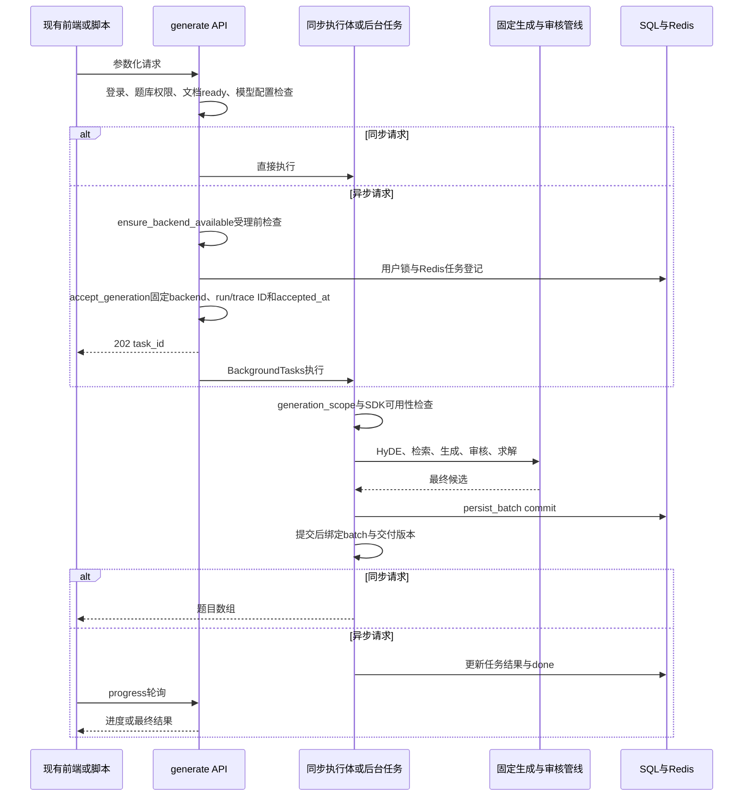
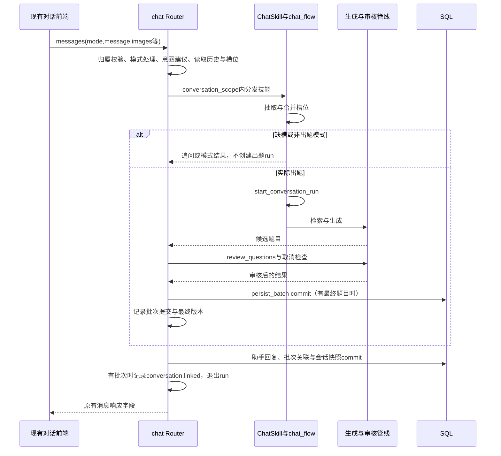

# Agent 开发指南

编写日期：2026-11-13。适用范围：`agent` 分支本轮 SDK 接入的开发与交接。

SDK 执行层、业务事实接点和本地追踪已接入。实际检查、独立审查及分支集成状态统一记录在第 11 节和 [SDK 接入与 G0 验收](SDKAgent接入与G0验收.md)；后续开发者应同时核对该记录与目标提交。

## 1. 目标、范围与阅读入口

本轮把确定的出题执行接入 OpenAI Agents SDK，保留既有出题逻辑、四模式、前端交互及 HTTP 数据契约。SDK 负责模型执行；槽位检查、检索、并发拆题、格式修复、盲评、重出、独立解题及落库继续由现有 Python 业务代码控制。接入不意味着把固定管线改成由模型自由选择工具和步骤的自治循环。

开发顺序按本轮约定执行：先在 `agent` 完成 SDK 业务开发、独立审查和 G0，再交接 `main` 进行 G1；G1 冻结后进入 G2。保留既有前端，不以 SDK 接入为由重写生成页、题目预览或运维界面。五个 `/api/admin/ops/*` 查询接口仍是后续合同，本文不将其列为已实现或已上线能力。

| 阅读入口 | 主要职责 |
| --- | --- |
| `backend/app/api/generate.py` | 参数化同步入口、异步任务登记、进度查询、最近批次恢复及资源校验 |
| `backend/app/api/chat.py` | 会话归属、显式模式、意图建议、消息持久化、进度与取消、数据操作确认 |
| `backend/app/services/rag/modes.py`、`skills.py` | 四模式标识和技能注册，不承担 SDK 工具调度 |
| `backend/app/services/rag/slots.py`、`chat_flow.py` | 槽位抽取与合并、缺失追问、快速出题与创新命题的执行条件 |
| `backend/app/services/rag/hyde.py`、`retrieval.py` | 假设段落、缓存、稠密与稀疏检索、RRF 融合和重排 |
| `backend/app/services/rag/question_gen.py` | 分题型与单题并发、考点规划、流式滚动解析、Schema 修复与补齐 |
| `backend/app/services/question_review.py` | 查重、盲评、修补复评、换模板重出、降级、独立解题 |
| `backend/app/services/generation.py` | 参数转换、后台任务、批次与题目保存、Redis 进度 |
| `backend/app/services/rag/llm.py` | 统一模型入口、JSON 解析重试及当前 run 的 SDK/legacy 分流 |
| `backend/app/services/agent_sdk.py` | 原生 Agent、Runner、Chat Completions 模型与同步/流式桥接 |
| `backend/app/services/generation_observation.py` | 请求上下文、运行与阶段、题目版本、审核/重出/提交事实的内存接点 |
| `backend/app/services/agent_tracing.py`、`agent_telemetry/` | SDK 追踪生命周期、属性白名单、脱敏、本地有界导出 |
| `backend/app/schemas/api.py`、`schemas/question.py` | 对外请求与领域题目契约 |
| `frontend/src/api/backend.ts`、`frontend/src/components/tabs/GenerateTab/`、`frontend/src/store/AppContext.tsx` | 现有请求、字段映射、四模式及会话状态边界 |

相关设计应一起阅读：[四模式整合](对话四模式与主线整合.md)、[必填信息检查](对话出题必填信息检查.md)、[审核中间件](出题审核中间件设计与实施记录.md)、[运维联调契约](运维后台接口与联调契约.md)、[实施分工](运维后台三人实施分工方案.md)、[G0 独立准备记录](运维后台A0与G0独立准备记录.md)。历史文档与当前代码冲突时，先查实际调用点，并把差异列入交接；历史测试通过不代表本轮通过。

## 2. 四模式、槽位与固定管线

### 2.1 模式选择与上下文

`MODES` 为 `generate/creative/qa/data`，默认 `generate`。消息中的显式模式由 Router 查 `SKILLS` 分发；未知值由请求模型归一化为 `generate`。意图识别只建议切换，不能越过用户的模式选择执行其他业务。

| 模式 | 执行条件与结果 | 当前 SDK 出题 run 边界 |
| --- | --- | --- |
| 快速出题 `generate` | 补齐题型、每题型数量、难度与范围后生成，随后统一审核与保存 | 槽位齐备并进入实际生成时开始 |
| 创新命题 `creative` | 检查范围、题型和难度；仅取首个题型，固定 1 道，以 `source_mode=new` 和创新指令生成，复用审核 | 构造完参数并进入实际生成时开始 |
| 知识答疑 `qa` | 检索当前文档回答文字问题，不生成题目批次 | 不创建出题 run |
| 数据管理 `data` | 查询当前用户可访问的数据；受支持的写操作先返回确认预览 | 不创建出题 run，不因模式名升级成 SDK 自由写工具 |

模式切换通常清空旧槽位。高置信度不匹配的消息可暂存为待续文字与图片，紧接着的切换确认在新模式中接续；新的普通请求会替换旧待续内容。不能绕过现有数据操作确认、账号/会话绑定及执行时归属校验。

图片请求最多 4 张，限 PNG/JPEG/WebP 的 base64 data URL，单张解码后不超过 5 MiB；纯图片允许，文字与图片同时为空不允许。当前图片用于快速出题/创新命题的要求抽取，不能据此宣称已支持图片答疑。SDK 适配须保持原消息顺序和 text/image_url 语义。

### 2.2 槽位规则

快速出题按 `types → count → difficulty → scope` 检查。数量必须明确到每个题型，为 1–20 的整数；拒绝布尔值、小数、非有限数、零、负数和超限值。新消息未提及某个历史有效数量时继续保留；只有一个题型且尚缺数量时才可使用明确总数，多题型总数不自动分配。

缺槽返回固定编号追问、累计 `slot_state`、空 `questions` 和 `done=false`，不生成题目、不创建出题 run。`build_params()` 再次检查完整性，不能依赖领域模型的默认值跳过用户确认。题型为 `single/multiple/judge/blank/compute/essay`，难度为 `低/中/高/地狱`。

来源已不是快速出题必填槽位，缺省为 `variant_data`；显式的 `original/variant_data/variant_context/new` 仍兼容。`original` 只有在材料能统计出原题数且数量不足时才触发 `NeedConfirmError`；无法识别题号结构时允许跳过数量预检。不能把历史欢迎语或旧设计中的“询问来源”当成新增必填要求。

### 2.3 固定业务顺序


上图表达业务依赖，不表示所有入口都在同一处生成 HyDE。参数化路径在 run 内获取 HyDE；对话 Router 根据进入技能前已有的 scope 提前尝试 HyDE，新的 scope 可能到本轮抽槽后才得到，此时允许不使用 HyDE。该前置调用不能追记成 run 内已执行的模型阶段。

检索使用 HyDE 或原查询作稠密查询，稀疏 BM25 始终使用原查询，再 RRF 融合与重排。可用分支失败时可能降级；所有参考片段为空时，生成抛错，不能编造“已成功检索”。

当前生成按题型最多 6 个线程；每批固定 1 道题，单题批次最多 6 个并发。两题以上先尝试规划不同考点。每批先流式滚动解析完整对象并做 Pydantic 校验，结束时可用 JSON Repair 抢救；Schema 不合格带错误最多重试一次。生成数量不足最多再补两轮，最终数量仍不足会抛错。提示词去重约束与归一化题干过滤继续保留。

审核按用户收藏、本人组卷及同题库个人历史语料查重，然后进行双评；两次总分差大于 0.7 时可仲裁。失败题先做一轮最小修补与单评，仍缺题时按配置换模板重出。重出轮数被限制为 1–2 轮；后续可从未通过候选中按距目标档最近的顺序补齐。查重、盲评、修补、规划、求解各有既有降级路径；**不能将此流程描述为“只有全面审核通过的题才可能交付”。**

盲评实际只把题干、范围和目标档送给判定模型，不提交选项、答案或解析作全面审查。提示要求高难题提供多解法，但当前缺少两种解法只记日志，并非强制拒绝。最后独立求解从同一次 JSON 取非空答案与解析，成功时覆盖原值；失败或结果不完整则保留原内容，不能把 `solved` 计数当作数学正确性证明。

## 3. 同步、异步与对话时序

### 3.1 参数化同步与异步

| 当前 API | 当前行为 |
| --- | --- |
| `POST /api/generate` | 同步校验、生成、审核和提交；响应为题目数组，不能私自改成 run 详情对象 |
| `POST /api/generate/start` | 资源、模型配置与执行后端可用性检查后创建 Redis 任务，注册 `BackgroundTasks`，返回 202 与 `task_id` |
| `GET /api/generate/progress/{task_id}` | 按当前用户读取进度、结果、`batch_id`、审核旧计数或错误；不返回其他用户任务 |
| `GET /api/generate/batches/latest` | 从已提交批次恢复当前用户最近的题目，支持题库和文档筛选 |



异步登记不是持久任务队列，用户锁也不是 worker 心跳。当前锁租期为 60 秒，不应从锁存在/过期推导执行终态或声称具备无限时长互斥。后台任务在 `finally` 释放锁，进度数据有 TTL；进程重启可能丢失执行，不能据 Redis 键消失补造失败事件。

当前异步入口在取锁、创建任务和返回 202 前调用 `ensure_backend_available()`，缺少 SDK 时以 `503 AGENT_RUNTIME_UNAVAILABLE` 拒绝受理。任务登记成功后，`accept_generation()` 固定 backend、run/trace ID 和 accepted_at 并发出受理事件；后台 `generation_scope(..., run=run)` 复用该身份，在实际执行时发 started，结束时发 ended。同步实际执行也先检查依赖。202 不保证之后的模型、持久化或其他执行步骤成功；进程重启后的受理事实恢复仍由 G2 处理。

### 3.2 对话路径



`conversation_scope()` 延迟到 `start_conversation_run()` 才建立真正的 run。意图识别、槽位抽取和 Router 前置 HyDE 均不因此自动走 SDK；普通追问、仅切换、qa、data 不检查出题 SDK 可用性，不统计成出题运行。同一会话可触发多次独立 run，不能用 `session_id` 替代运行标识。

消息响应继续包含 `reply/slot_state/questions/done/batch_id/kind/mode/mode_changed/suggested_template/confirm`。模式建议、数据操作确认及暂停反馈保持原语义；`done` 是既有交互字段，不能作为运维权威终态。前端继续使用原进度轮询和请求有效性判断，避免切换账号/会话后把旧响应写入新会话。模型内部流式不代表新增了浏览器 SSE 或 WebSocket 接口。

## 4. SDK 边界与保持策略

### 4.1 默认 SDK、显式 legacy

公开配置定义默认 `GENERATION_LLM_BACKEND=sdk`，允许值仅为 `sdk/legacy`。`generation_scope()` 创建 run 时固定 backend；`rag.llm._sdk_enabled()` 只看当前 run。没有出题 run 的调用继续走既有 legacy 客户端，即使全局默认是 sdk；run 建立后也不受途中全局值变化影响。

`legacy` 必须由开发/部署进程显式选择，作为兼容核对或回退选项。SDK 缺失不会静默切 legacy：实际 SDK 出题前置检查抛出 `AGENT_RUNTIME_UNAVAILABLE`。缺少追踪依赖或导出失败则属于观测不可用，不等于执行 SDK 不可用。

### 4.2 单次调用映射

| 既有职责 | SDK 接入必须保持的行为 |
| --- | --- |
| 消息与模型 | `rag.llm` 构造 model/messages/temperature/max_tokens/response_format；适配器保持顺序，不把 system 拆成新的 instructions |
| 单次执行 | 使用原生 `Agent`、`Runner.run/run_streamed`、`OpenAIChatCompletionsModel`；当前 tools/handoffs 为空，`max_turns=1`，不追加推理步骤 |
| 返回文本 | 从原始输出的文本项取值；流式只产文本 delta，不把 reasoning、拒绝信息或工具事件变成题目文本 |
| JSON 修复 | 继续由 `chat_json`、`_RollingParser`、审核低温 JSON 辅助函数持有，SDK 不新增统一重试循环 |
| 传输重试 | OpenAI 客户端和 SDK 模型重试均关闭；不能因接入额外放大调用次数 |
| thinking 兼容 | 保留不支持 thinking 参数时的既有回退条件；流式成功响应开始后不因后续读取错误再发一次请求 |
| 凭据与服务地址 | 使用调用方已有的当前用户模型凭据与现有地址、超时配置；不新增另一套凭据持久化 |

`chat_json()` 对 JSON 解析失败降低温度，可将已有 token 预算放大两次，再按剩余次数回喂错误；传输错误走它原有的异常边界。审核 `_chat_json_low()` 有自己的两档预算与 JSON Repair 逻辑，不应把所有调用概括为“完全不重试”。Schema 重试、补题、审核重出与底层传输重试的业务含义不同，修改参数时须分别核对。

## 5. 上下文、线程池、取消与提交边界

`generation_observation` 用 `ContextVar` 绑定当前 run、事件 sink、阶段父子关系及延迟对话启动器。`GenerationRun` 保存归属、入口、backend、可空 task/session/batch 和 SDK trace 标识；跨工作线程共享的序号及题目版本状态有锁保护。不要新增模块级“当前用户/当前 run/当前 trace”可变变量。

新增线程任务必须为每次 `submit` 新建 `copy_context()`，或使用 `map_in_context()`。不能让多个线程同时进入同一个复制上下文，也不能直接换回普通 `pool.map()` 后假定上下文自动传播。当前按题型、单题批次、盲评、修补、复评和求解线程均有相应传播接点。结果仍按原顺序合并，不能把并发完成顺序变成题目顺序。

`agent_sdk.complete/stream` 为每次执行创建私有 `asyncio.Runner` 和 `AsyncOpenAI`，客户端只属于本次事件循环，不放入 legacy 的跨线程缓存。现有入口为同步函数，由框架/工作线程调用；新增 async 调用方应在线程中运行同步桥接并核对上下文，不能直接在已运行的事件循环里嵌套此桥接。流提前结束时先取消 SDK 执行，再关闭事件迭代器并等待其任务，最后释放 HTTP 客户端和私有循环；`_stream_questions` 使用 `closing()` 保证 Schema 失败也关闭流。

对话 `POST /api/chat/sessions/{session_id}/cancel` 返回 202 只表示取消请求已写 Redis。执行体在进度回调、阶段检查点和审核后检查到标记，才确认取消。它不是抢占式中断所有正在运行的模型请求；线程池退出仍可能等待已提交任务。当前没有参数化任务的对应取消接口，也没有新增管理员强停接口。

保存边界必须分清：

1. `persist_batch()` 的 `db.flush()` 只完成事务内准备，不能报交付成功。
2. `delivery("batch")` 包住实际 `db.commit()`；成功返回后绑定 `batch_id`，再逐题记录最终交付版本。提交失败发失败事实，不能把候选题数当成实际交付数。
3. 对话随后独立提交助手回复、批次关联与槽位快照，`conversation.linked` 在该提交成功且有批次后发出。run 直到这一步及后续请求收尾才结束。
4. 第二次提交失败时，第一次已提交题目仍存在；必须保留“题目已提交、回复关联失败”的事实。客户端未收到响应也不自动等于没有成果。
5. 取消若在题目提交前被执行体确认，阻止后续题目保存；提交后的迟到取消不能撤销已提交结果或把已完成运行改写成取消。不要承诺现有检查点与 SQL commit 之间具备原子取消事务。

被业务层捕获的异常需在现有接点调用 `mark_outcome()`，否则 scope 无法仅凭“函数返回了回复文案”知道实际失败/取消/待确认。scope 未捕获异常会标失败，退出时才发权威结束；当前内部还存在 `needs_confirmation` 结果值，与后续持久 execution 状态的映射要在 G1 冻结。

## 6. 事件、题目版本与 G1 合同

### 6.1 当前 MVP 的内存事实

当前 `event_sink()` 注入请求级收集器，`emit()` 只在 run 和 sink 同时存在时交付事件；默认不保存事件。sink 异常只产生安全分类日志，不改变业务结果。现有 `GenerationEvent` 包含 `event_schema_version=1/event_id/occurred_at/event_type/run_id/owner_user_id/entrypoint/backend/session_id/task_id/batch_id/sdk_trace_id/sequence/metadata`，`name` 为兼容读取属性。metadata 只接受允许的标识、计数、布尔值和空值，不放正文、异常或个人配置。

| 当前输出事件 | 源码接点与解释 |
| --- | --- |
| `run.accepted/run.started/run.ended` | 异步由 `accept_generation` 受理、后台 scope 开始；同步/对话由 scope 受理并开始。结束使用执行体真实 outcome |
| `stage.started/stage.ended` | `stage/observed_stage`，含阶段 ID 与父阶段 ID；对应固定函数边界 |
| `conversation.context_bound` | 延迟对话 run 绑定上下文，不代表回复已保存 |
| `dependency.observed` | 当前映射自对话槽位/前置 HyDE 的依赖记录，尚不等于所有真实依赖调用均已采集 |
| `question.revised` | 生成、修补、求解、提交前/交付检查的内容版本接点 |
| `review.judge/review.recorded` | 单评与汇总盲评事实，当前实际范围为 `stem` |
| `regeneration.started/regeneration.finished/regeneration.result` | Schema 重试、生成不足补齐、审核换模板等真实尝试；result 仅在已有相应接点时产生 |
| `degradation.selected` | 已显式接线的规划/生成/审核/求解等降级分支；未接线分支不能视为“未降级” |
| `delivery.started/delivery.failed/delivery.committed` | 按 `kind=batch/assistant_reply` 分开记录对应提交边界 |
| `delivery.question` | 批次提交成功后的逐题最终版本与该版本的审核事实标记 |
| `conversation.linked` | 助手回复提交成功并已绑定批次后的关联事实 |

当前阶段包括 `hyde/hyde.generate/retrieval/planning/generation/generation.type/generation.batch/generation.stream/review/review.deduplication/review.evaluate/review.judge/review.repair/review.regenerate/solve/solve.question/persist_batch`。它们是内部接点名称，不直接等于前端运维阶段枚举。无当前 run 时装饰器不产生阶段观测；对话 run 外的前置工作不会凭空补入时间线。

### 6.2 版本与审核范围的不变量

当前使用题干、选项、答案、解析各自的内容指纹判断变化，为同题 ID 分配递增版本及新的 `question_revision_id`；新题 ID 从自己的版本开始。指纹用于进程内比较，不作为正文导出。版本表当前上限为每 run 4096 个题目标识，超限发安全降级标记、无法关联的版本保持未知，run 退出清空内存状态。这不是数据库题目版本历史。

修补可保留题目 ID，但只要内容变化必须是新版本。独立求解在盲评之后覆盖答案/解析，也会产生新版本；旧盲评仍属于旧版本与 `stem` 范围，不能自动套到新版本或扩成答案/解析通过。`record_review(..., unknown=True)` 不构成明确审核完成；`delivery.question.reviewed=true` 只表示该版本有已知范围的审核事实，**不等于通过**，失败审核也可能有事实标记。

例如：版本 1 的题干被盲评 → 最小修补产生版本 2 并复评 → 独立解题覆盖答案产生版本 3 → 提交版本 3。交付版本 3 不能继承版本 2 的完整内容通过结论。现有 `difficultyReview` 可能保留此前评分摘要，因此运维覆盖不能只读该字段或 `difficultyScore>0`。本轮只观测已有审核，不为提高覆盖率擅自增加模型复审。

### 6.3 G1 待冻结、G2 待实现

当前有事件信封和内存证据，不具备持久幂等、乱序处理、独立周期心跳、SQL 运行台账、完整统计服务或重启重放能力。没有 sink 的运行不会留下可回放的事件清单。异步受理与实际开始已分开记录；`dependency.observed` 尚非完整被动探测。不能由“已存在同名事件”推断运维合同已完成。

G1 应在 main 冻结以下差异，G2 再实现持久消费者与 API：

- 将事件 `metadata.question_revision_id` 直接映射到前端每题 `content_revision`；运行摘要 `revision`、最终集合版本与逐题内容版本保持区别。
- 固定事件生产步骤、必填条件、终态/待确认映射、受理与实际开始的时间、幂等键、重复/乱序/迟到事件和采集缺口规则；事件版本号本身不提供持久幂等。
- 冻结 `delivery.committed` 与后续逐题交付事件如何组成准确最终集合；批次和回复两次提交分别保留，不能只靠 batch 存在推导完整关联。
- 定义要求审核范围、实际审核范围和逐题最终版本证据；明确 pass/fail、unknown 与显式 skipped，缺证据不自动填 skipped。
- 定义真实重出 attempt 的层级与去重、结果数量和耗时。当前生成补齐与内部 Schema 重试可能嵌套，不把旧 `ReviewStats.regenerated` 候选数量当作尝试数或最终保留数。
- 明确 SDK trace 与 Phoenix trace 的适配映射、分组、导出状态、单条可读证据和到期时间；当前 run 只直接持有 SDK trace ID，不能假定 Phoenix 同 ID。当前 SDK `group_id` 使用可空 session，与合同参数化使用 run 分组的目标差异需核对。
- 冻结概览 `accepted_at` cohort、质量告警 `finished_at` 窗口、分子分母与排除样本、未知不补零、权限、保留期及迁移顺序。

“执行完成”“题量满足”“最终版本在要求范围内审核完成/通过”“追踪可读”是独立判断。零成果、未采集、部分范围、降级放行不能伪装成质量达标。G1 冻结不是五个查询接口已经实现；schema、OpenAPI、生成 API 文档和前端映射需在后续实际实现时同步。

## 7. 如何安全扩展

| 扩展内容 | 建议位置与必要边界 |
| --- | --- |
| 新增确定性阶段 | 在实际业务服务中实现，复用 `stage/observed_stage`；从既有固定管线显式调用，保持输入输出类型、错误与取消传播，不把阶段选择交给自由 Agent 循环 |
| 调整模型参数 | 先改拥有该调用的 `rag.llm`/生成/审核辅助函数，再核对 SDK `ModelSettings` 映射；比较 SDK/legacy 的 messages、预算、temperature、response_format、thinking、调用次数与流关闭 |
| 更换模型实现 | 保持当前用户凭据作用域和惰性依赖；明确同步/流式支持与能力错误，不在适配层复制提示词、JSON 修复或业务重出 |
| 扩展审核 | 保留本地评分重算和既有判定；新增范围必须实际提供对应内容并记录版本/范围证据，不能只给旧 `stem` 事件换名称 |
| 调整修补或重出 | 在内容改动前后观测版本；每次真实尝试成对记录开始/结束，空结果与失败不丢失，候选量、去重后量、最终交付量分开 |
| 扩展对话模式 | 同步模式常量、技能注册、schema、前端与文档；保留显式选择、槽位隔离和写操作确认，不因 SDK 已接入而默认增加第五模式 |
| 增加持久采集 | G1 后由 G2 的事实/统计模块消费接点；SDK/业务适配器不顺手写运维 SQL、启动心跳或新增后台 API |

领域题目继续以 `schemas/question.py::Question` 为准。实时生成响应使用已有 camelCase 字段，例如 `knowledgePoint/difficultyScore/difficultyReview/docName`；数据库恢复接口经 `question_to_api()` 使用 snake_case，前端已有兼容映射。新增字段须贯穿保存、读取与前端映射，不能只改模型 prompt。需要变更外部契约时同步 schema、根 `openapi.json` 与 `docs/api.md`，并逐条核对生成脚本覆盖实际路径。

快速出题的 `build_params()` 当前把 scope 单独返回给生成调用，领域 `GenerateParams.scope` 不一定同时填入；而审核及重出读取 `params.scope`。创新命题生成时又单独覆盖 `source_mode=new` 与 directive。扩展时必须逐入口核对传入参数与持久化参数，不能假定它们天然一致；这是现有边界的待核验项，本指南不替实现作修复结论。

优先扩展现有职责边界。若阶段调用、参数转换与观测包装开始重复，应提出局部抽取方案，避免另建平行管线；涉及审核策略或交付行为的改变应有对应设计与验收，不借观测改造扩大业务范围。

## 8. 依赖、Windows 环境与开发启动

### 8.1 两套安装入口

根 `pyproject.toml` 和 `backend/pyproject.toml` 均声明 `sdk-agent` 可选 extras，当前锁定 `openai-agents==0.20.0`、`openinference-instrumentation-openai-agents==2.7.0`、`opentelemetry-exporter-otlp-proto-http==1.45.2`、`httpx==0.28.1`。版本变更应同时核对两个清单和各自锁文件。仅默认安装不包含该 extra；缺少 SDK 时应用基础能力仍可启动，实际 SDK 出题按可用性检查报错。

以下为后续开发者的 PowerShell 操作说明；本次文档任务未执行安装、启动服务或模型请求。选择一种环境，勿混用两个 `.venv`。SDK 路径使用 Python 3.11 或以上，并按锁文件与最终验收记录核对实际版本。

```powershell
# 根环境：供仓库根的测试与静态检查使用
$repoRoot = 'C:\Users\39651\.codex\worktrees\sdk-agent-g0\MathCraft'
Set-Location -LiteralPath $repoRoot
uv sync --frozen --extra sdk-agent --extra dev

# 或 backend 独立环境：供 backend 工作流使用
Set-Location -LiteralPath (Join-Path $repoRoot 'backend')
uv sync --frozen --extra sdk-agent --group dev
```

`tools/ops_g0` 有独立清单和环境，不等于应用已经安装 sdk-agent，也不能用其 harness 结果代替两类实际业务入口验收。

### 8.2 Windows 临时目录与 D 盘 scratch

Windows 上先为当前终端指定可写、隔离的 D 盘 scratch，再启动 Python/pytest/uvicorn。`tempfile` 可能缓存临时目录，因此应在进程启动前同时设置 `TEMP` 和 `TMP`。不要把 `.venv`、测试 SQLite、上传/向量缓存和运行证据当作源码提交；保留其他并行任务的目录。

```powershell
$repoRoot = 'C:\Users\39651\.codex\worktrees\sdk-agent-g0\MathCraft'
$scratchRoot = 'D:\vscode project\math_agent\deeptutor_and_mathcraft\MathCraft\.scratch\sdk-agent-dev'
$tempRoot = Join-Path $scratchRoot 'tmp'
New-Item -ItemType Directory -Force -Path $tempRoot | Out-Null
$env:TEMP = $tempRoot
$env:TMP = $tempRoot
$env:GENERATION_LLM_BACKEND = 'sdk'
$env:AGENT_TRACE_ENABLED = 'false'
Set-Location -LiteralPath $repoRoot
```

上述操作只设置临时目录，不会自动隔离实际启动服务的数据库、上传或向量路径。人工启动前应由部署负责人提供独立开发配置及已有认证/数据库/Redis 条件，按当前配置定义隔离运行数据；不要读出或复制个人敏感配置来“补齐环境”。命令中的含空格路径使用变量或引号，可执行文件使用 PowerShell `&` 调用。

使用 backend 独立环境启动的示例：

```powershell
Set-Location -LiteralPath (Join-Path $repoRoot 'backend')
& '.\.venv\Scripts\python.exe' -m uvicorn app.main:app --host 127.0.0.1 --port 8000 --workers 1
```

如果选的是根环境，则保持工作目录为 `backend`，将可执行文件改为 `Join-Path $repoRoot '.venv\Scripts\python.exe'` 后用 `&` 调用。显式兼容核对可在启动进程前设置 `$env:GENERATION_LLM_BACKEND = 'legacy'`，完成后按目标环境恢复 sdk。启动本身不表示已完成 G0；模型调用仅在另有授权的业务验证中进行。

### 8.3 本地追踪配置与正文边界

| 配置 | 当前公开默认值与行为 |
| --- | --- |
| `AGENT_TRACE_ENABLED` | `false`，默认不导出 |
| `AGENT_TRACE_ENDPOINT` | `http://127.0.0.1:6026/v1/traces`，应用接线默认本地 OTLP 地址 |
| `AGENT_TRACE_PROJECT` | `mathcraft-agent` |
| `AGENT_TRACE_API_KEY` | 默认空；启用开关但无 key 时状态为 `unconfigured`，不导出 |
| `AGENT_TRACE_QUEUE_CAPACITY` | `64` |
| `AGENT_TRACE_MAX_ATTEMPTS` | `2`，为总尝试上限，非无限重试 |
| `AGENT_TRACE_TIMEOUT_SECONDS` | `0.5` |

此处仅列公开变量名与非敏感默认值，不展示任何实际 key 或配置文件内容。6026 是应用当前默认端口；独立准备工具文档的 6016 是另一套隔离环境，不能混作应用已经完成接线的证据。需要启动本地追踪接收端时，由 G0 负责人按隔离部署记录操作，本指南不新增容器或凭据初始化步骤。

应用 lifespan 初始化追踪；单独 SDK 执行也会在首次模型调用前准备运行时。初始化先移除默认 SDK 处理器，启用时通过 OpenInference 独占处理器接入本地导出；关闭时再次清空恢复的默认出口。禁用、缺 key 或导出不可用均不回退云端。传输只接受显式回环 IP 的 HTTP `/v1/traces`，禁止 URL 用户信息、查询串与片段；`localhost` 不在当前允许的主机集合内。

生产接线当前采用属性白名单：保留必要运行/用户/会话标识、模型名/提供方和 token 计数等，隐藏输入、输出、调用参数及工具内容；清空原始异常状态文字与 span 事件，再经脱敏器进入缓冲。**当前不留对话、题干、答案、解析、检索片段或模型调用正文，也没有一个“开关即可安全采全文”的已实现合同。** 后续若开放生产正文，须先按 G1/G2 明确逐字段/路由白名单、独立权限、脱敏和审计，认证、改密、个人模型设置不得纳入。工具内合成脱敏样例不能证明任意正文均安全。

队列不等待网络、满时丢弃计数，单载荷有大小限制；后台导出有次数和超时上限，业务请求不等待 `flush()`，停机刷新/关闭有截止时间。导出 ACK 仅说明端点受理；G0 仍须按关联标识核对 Phoenix 根与子 spans 实际可查、访问受控及真实清理。当前没有上线的单条 trace 授权/审计 API，不从健康状态或安全路径拼接可用正文链接。

## 9. 测试与验收方法

以下命令用于维护与扩展时复核。已执行的结果见第 11 节及配套验收记录，测试文件存在本身不构成通过证据。

当前并行工作区的 `backend/tests/conftest.py` 在导入应用前建立临时 SQLite、隔离数据目录和明确假值，注入假的敏感模块，排除 dotenv/file-secret 来源与继承的个人配置，使用每用例独立的 `fakeredis.FakeRedis` 并阻断服务网络。Redis URL 的不可达占位地址不表示会访问该服务。旧版本文档中的本机 Redis 15 号库及 `flushdb()` 流程不适用于这版内存夹具；若最终分支切回真实 Redis 夹具，必须先确认专用实例/逻辑库隔离。

默认 `fake_models` 会替换 LLM、向量、重排并令审核直通，所以普通接口用例只能证明编排；不能证明真实 SDK Runner 执行或真实审核行为。专门的 SDK 测试在 HTTP `MockTransport` 层伪造服务响应，同时保留原生 Agent/Runner/模型协议解析；事件测试通过 `event_sink` 收集事实，追踪测试替换导出缓冲，不调用外部模型或本地追踪服务。

| 文件 | 阅读与验收重点 |
| --- | --- |
| `backend/tests/test_agent_sdk.py` | SDK/legacy 参数与调用次数、消息/图片、JSON 预算、thinking 回退、拒绝、流提前关闭、私有循环与客户端释放、缺依赖 |
| `backend/tests/test_generation_observation.py` | 同步/异步入口、归属及线程传播、对话两次提交、取消确认、版本变化、审核范围、真实重出、观测失败隔离 |
| `backend/tests/test_agent_tracing.py` | 白名单正文排除、异常排除、观测故障不改变业务 |
| `backend/tests/test_chat_requirements.py`、`test_chat_modes.py`、`test_chat.py` | 槽位、四模式、既有 API 行为和会话边界 |
| `backend/tests/test_question_review.py` | 真实审核服务函数的假模型覆盖及降级边界 |
| `backend/tests/test_ops_g0_*.py` 与 `tools/ops_g0/` | 独立准备工具的合成边界；其通过不能替代应用业务 G0 |

在第 8.2 节完成当前终端的 TEMP/TMP 设置并安装根环境后，可按改动范围执行：

```powershell
Set-Location -LiteralPath $repoRoot
& '.\.venv\Scripts\python.exe' -m pytest -q 'backend/tests/test_agent_sdk.py' 'backend/tests/test_generation_observation.py' 'backend/tests/test_agent_tracing.py'
& '.\.venv\Scripts\python.exe' -m pytest -q 'backend/tests/test_chat_requirements.py' 'backend/tests/test_chat_modes.py' 'backend/tests/test_chat.py' 'backend/tests/test_question_review.py'
& '.\.venv\Scripts\python.exe' -m ruff check 'backend/app' 'backend/tests'
```

共享核心、认证/授权、隔离或迁移变更按仓库约定再运行根环境全量 pytest；Pyright 覆盖范围有改动时执行 `& '.\frontend\node_modules\.bin\pyright.cmd'`。前端修改后执行 typecheck/lint，路由或构建相关改动另执行 build。检查通过后仅因新变更、失败或未解决风险扩大/重复测试。

G0 必须覆盖实际参数化与对话入口驱动 SDK 的合成路径、两账号并发/同会话多运行/线程关联、成功/失败/降级、导出断连/超时/满队列/恢复、单一本地出口、正文排除及受控访问、固定版本和 Phoenix 真实删除前后对照。默认假模型与合成数据已经足以验证业务执行接线，不需要真实账号或付费模型。仅独立 harness、安装成功、HTTP 202、端口健康、导出 ACK 或前端演示成功均不构成 G0 通过。

## 10. 排错入口

| 现象 | 优先核对 | 不应据此得出的结论 |
| --- | --- | --- |
| `AGENT_RUNTIME_UNAVAILABLE` | 实际运行的 Python 环境是否安装 sdk-agent；根/backend 是否混用环境；惰性依赖是否齐全 | 不静默回退 legacy，不把缺依赖当成模型余额问题 |
| 默认 sdk 但槽位/答疑未走 Runner | 是否有实际出题 run；调用是否在意图/槽位/前置 HyDE 阶段 | 不代表 SDK 分流失效 |
| 异步 202 后失败 | worker 的实际错误、SDK 可用性、任务过期；按当前用户读取 | 202 不保证已开始或已提交 |
| 收集不到事件 | 是否注入 sink、是否创建出题 run、线程是否复制上下文 | 没有事件不证明没有执行、没有降级或审核通过 |
| 题目保存了但对话报错 | 两次 SQL commit 的各自结果、`delivery.question` 与 `conversation.linked` | 不抹掉首次提交，也不盲目重试造成重复批次 |
| 点暂停后仍等待 | 下一取消检查点、正在执行的模型调用与线程池收尾、是否已提交 | 取消 202 不是即时停止或回滚证明 |
| 闭环错误或客户端已关闭 | 是否跨调用复用 AsyncOpenAI、是否在已有事件循环里直接调用同步桥接、流是否正确关闭 | 不用全局事件循环/客户端掩盖生命周期错误 |
| JSON/Schema 失败、额外请求 | 对照拥有该策略的预算/修复/补齐/重出和 thinking 条件，用假 transport 核对调用次数 | 不叠加 SDK 自动重试，不复制原始模型全文进日志 |
| 盲评通过但交付标记未审 | 求解是否改变答案/解析并产生新版本，范围是否仅 stem | 不把旧版本通过证据升级到新版本，不自动补审 |
| 题量不足或近档补齐 | 去重、重出失败、unknown 放行及 `review_nearest_fallback` 等真实降级分支 | 不以 `completed` 或旧 regenerated 数值证明质量达标 |
| 追踪无数据 | 安全 `snapshot()` 状态是否 disabled/unconfigured/unavailable，实际端点是否为应用 6026 接线，队列失败/丢弃计数 | 不读取/打印实际 key，不回退云端，不把 disabled 当出题失败 |
| Phoenix 有根但缺子 span | ContextVar 传播、后台导出与丢弃、SDK/Phoenix 映射和单条存储证据 | 健康检查与 ACK 不证明完整或可读 |
| Windows 临时目录/SQLite/Chroma 报错 | 启动前的 TEMP/TMP 是否均指向 D 盘可写 scratch，是否启动了新进程 | 不清理其他任务目录，不切换到真实用户数据来绕过 |

内部诊断优先使用安全标识、事件类型、计数和固定原因码。现有业务错误文案/日志不一定已完成全部安全收敛，不能把它们原样复制进运维事件、追踪或报告；仅声明本轮新观测边界的行为，不扩大成“所有日志已经无正文”的结论。

## 11. 验收状态与 G2 交接

开发基线为长期 `agent` 的 `05cc44d65d456f12733a0e8a7dccb3b24f3c35ff`。最终提交、检查与安全证据索引由 [SDK 接入与 G0 验收](SDKAgent接入与G0验收.md) 记录；历史独立准备和前端合成回归不能替代本轮业务验收。

| 项目 | 当前状态 | 主代理必须填写的真实结果 |
| --- | --- | --- |
| agent 最终实现快照 | 待本轮验收 | 最终 SHA/差异范围、依赖与锁文件、实际接点变化；重核第 4–6、8–9 节 |
| agent 独立代码审查 | 待本轮验收 | 审查者、未携带实现上下文的独立审查范围、发现与修复/复审结论、报告路径 |
| SDK 参数/流/错误兼容 | 待本轮验收 | 实际命令、Python 与依赖版本、通过/失败/跳过数、既有与新增诊断 |
| 独立工具验证 | 待本轮验收 | 工具测试范围、环境与命令、通过/失败/跳过数；与实际业务 G0 的证据边界 |
| 既有行为基线与临时目录修复 | 待本轮验收 | 基线范围、TEMP/TMP 隔离方式、实际命令与结果、遗留失败或跳过 |
| 业务行为与测试隔离 | 待本轮验收 | 四模式/槽位/审核回归、并发与取消、两次提交；最终夹具是否仍为 fakeredis 与禁网 |
| G0 实际业务追踪闭环 | 待本轮验收，不能写通过 | 参数化与对话 run/trace 映射、根/子 span 实际查询、安全与故障恢复、真实清理和唯一调度交接证据 |
| agent → main 交接 | 待独立审查及 G0 | 实际移交/合并范围与 SHA、冲突处理、前端与固定管线保持核对、遗留项与责任人 |
| main / G1 契约冻结 | 待本轮验收，不能写通过 | 冻结版本与目标 SHA、事件/版本/范围映射、未知/统计/权限/保留边界、迁移顺序及消费方确认 |
| G2 启动条件 | 依赖上述门槛，尚未完成 | 本轮负责人实际放行结论、甲乙分工、共享文件编辑顺序和验收样例位置 |

独立审查由没有附带本轮编写代码上下文的审查智能体完成，覆盖实际最终差异。后续 Agent 开发也沿用此流程：在 `agent` 或以其为基线的隔离分支开发，完成适用检查、中文约定式提交和独立复核，再按任务约定集成；不擅自修改 `AGENTS.md`，不推送未获授权的提交。

G2 交接包至少包含：

- 已确认 G0/G1 证据索引、源码/依赖快照、两类入口及假服务注入位置、可复核事件样例与 SDK/Phoenix 标识映射。
- 事件生产/消费清单、必填条件与安全原因码、最终交付集合、逐题版本及审核范围、重出层级与旧字段兼容解释；列出仍未采集的事实。
- 甲负责的运行与质量事实/统一统计服务接口，乙消费统计服务的窗口、分母和未知规则；甲乙按已冻结边界并行实现，避免重复统计公式。
- G2 的 SQL 台账/幂等/独立周期心跳、依赖观测/告警、五查询 API、OpenAPI 与前端联调、M8 清理与活动保护、M9 自监控/容量/访问审计的实际责任与顺序。
- Phoenix 详细数据 3 天、SQL 摘要 14 天、每日清理等已确认设计的落地计划；当前 MVP 无运维 SQL、无应用周期清理实现，不能写成保留已生效。沿用 G0 已选定的唯一 Phoenix 清理责任，避免双调度。
- 未解决风险、失败/跳过样例、复现命令与安全证据路径；文件中不得包含实际凭据、个人配置、会话文件或用户正文。

进入 G2 后仍以实际代码、冻结契约和独立证据更新状态；最终 G3 才验证业务入口至本地追踪、持久摘要、检测告警与现有前端的真实贯通。
