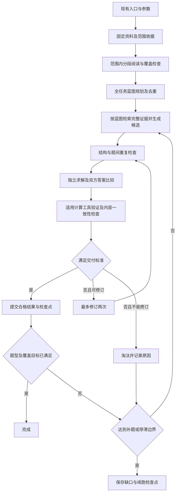

# 出题质量与取材链路优化设计

日期：2026-11-15（日本时间）。

状态：**实施前设计，业务代码尚未修改，未完成验收**。需求与范围已按本轮讨论对齐；本文标注“建议”的数据结构、接口和模块拆分属于实施方案，不表示用户逐项确认了字段或程序细节。

依据：[需求讨论](../requirements/出题逻辑优化需求与设计讨论.md)、[本地问题核查](../research/出题与知识库问题核查-2026-11-15.md)、[原始问题记录](../agent问题记录和后续规划.txt)。本文是本次专项方案，不修改或代替[总体 PRD](../requirements/PRD-智能出题智能体.md)。

## 1. 目标与范围

本次目标是让系统在交付前完成计算题的质量闭环：依据可追溯，题面完整，独立求解与命题答案一致，适用数学工具检查通过，题干、答案和解析自洽；不通过则修订或淘汰，再按缺口补题。

### 1.1 已确认需求

| 编号 | 要求 |
| --- | --- |
| G01 | 优先正确性与可信度，不为速度或凑足数量保留已知错误题 |
| G02 | 独立解题只读完整题面，不接收命题答案、解析或蓝图解法；求解后比较双方答案 |
| G03 | 新增标准数学工具验证只针对计算题，首批覆盖表达式与函数值、方程、极限、导数、积分、矩阵 |
| G04 | 本次不新增或调整证明题、复杂图形题的专项约束；已有约束沿用现状 |
| G05 | 范围贯穿阅读、规划、检索、命题、修订、验证与补题；修复现有服务链路的范围丢失 |
| G06 | 对指定范围分段完整阅读并检查覆盖，先规划整个任务，再按蓝图逐题取材；证据不足时继续检索 |
| G07 | 同知识点允许合理变式；机械重复默认淘汰，明确要求同模板改数据训练时按该目标判断 |
| G08 | 目标题量指合格交付数量；按题型缺口补题，不把拒绝候选重新补回 |
| G09 | 每个候选最多修订 2 次；首轮后最多 5 轮补题；连续 2 轮无新增合格题提前停止 |
| G10 | 未足量时保存有效进度并允许续跑，不能标记足量完成或降低质量标准 |
| G11 | 教师可以审阅与选用，系统不能把未解决的计算错误或必要检查转交教师兜底 |
| G12 | 实施目标分支为 `agent`；本次先形成文档，不开始业务实现 |

本期新增工具标准的分派建议以 `type=compute` 为入口，再识别上述运算类别；不自动扩展到单选、多选、填空。混合在 compute 中的证明或复杂图形任务沿用既有处理，不能仅因题型是 compute 就强加计算标准。复合计算题逐小问记录覆盖范围，不能验证一个小问就宣称全题通过。这是遵循 Q13 的最小实施边界，不把其他题型的通用结构与已有审核修复一并取消。

### 1.2 本次不实施

- 侧面板与对话共同编辑任务计划的前后端重构、槽位替换与删除等协作能力。
- 多资料选择界面、首次确认计划交互、运行中由教师修改全局要求的交互。
- PRD 的正式候选保存、逐题版本历史、版本额度、指定版本组卷及独立组卷页面。
- 证明题、复杂图形题的新增验证标准或既有专项约束调整。
- 对历史已保存题目自动改写、重判、删除或批量修复。
- 更改 AGENTS.md、PRD 文档或引入新的可观测性平台。

Q9“首轮合格题作为候选，由教师保存为 v1”已经确认，但属于后续版本管理。本次沿用现有批次与题目保存方式，内部候选和检查记录不是 PRD 的正式版本功能。后端质量状态与续跑记录也不等于实现一套前端任务计划产品。

## 2. 问题依据与设计约束

当前 `question_gen.py` 按题型共享一次检索，考点规划只看前 1500 字符，规划失败后继续无规划生成；并发候选不能看到同轮其他候选。`question_review.py` 存在审核无法判定时放行、拒绝题补回、独立解题后直接覆盖答案解析等路径。`generation.py` 保存批次时直接标记 done，没有最终质量关卡。

`slots.build_params` 把范围单独返回，`generation.build_params_from_slots` 丢弃该值；修复范围透传属于本次共用服务修复，不调整对话协作协议。同步、异步、对话三个调用路径必须使用相同质量服务，不能只修异步入口。

本地数据有 88 道已保存题，其中存在选项缺失、答案与解析矛盾及可独立核验的数学错误；审核标记和三个反例不是整体错误率。扫描教材的简化稿移除了例题与解答，只增加检索轮数无法恢复原文证据。详细来源及复现边界见核查报告，不重复访问真实模型或用户数据。

当前工作目录在 `main`；`agent` 位于另一个干净 worktree。已核对两分支的生成相关差异，实施时须以 `agent` 当时实际代码重新定位，不复制 `main` 的追踪封装或其他分支专有逻辑。当前文档改动不切换分支、不操作其他任务的 worktree。

## 3. 核心处理流程

流程图表示计算质量路径。证明或复杂图形任务沿用现有专项处理，不能因为未运行新增计算验证而被新增规则统一拒绝，也不能记录成“数学工具已验证通过”。

质量判定与难度判定分开：数学正确但难度不合适可按现有目标调整；难度达标不能覆盖数学失败。结构有效、独立求解一致也不能代替适用工具验证。最终存入交付题目表的是通过完整关卡后的内容。

## 4. 材料保留、范围与检索

### 4.1 原始依据与已有资料

保留原始文件、解析正文、OCR 结果、例题、习题、解答及图形关联。知识点简化稿继续用作导航或知识检索，不作为完整教材依据的替身。建议将出题依据与摘要标记为不同内容角色，共用既有文档归属和权限边界。

已有资料按能力区分：能从现存解析/OCR 产物恢复正文的，显式建立新索引版本；只能找到简化稿的，可以检查该简化稿本身的范围，但应报告缺少原教材依据，不能编造例题或章节页码。文档没有下册时，不能声称覆盖上下册。设计不授权本轮调用真实 OCR、修改用户文件或自动重建线上索引。

原文更新与索引重建保留旧版本，先建立、校验新依据，再切换可用版本；失败保留旧索引。任务固定文档与索引版本，不能在续跑时静默改用新资料。具体迁移由实施阶段补充可执行命令与回退步骤。

### 4.2 可定位范围

范围对象建议包含：原始范围描述、文档及版本、章节/节标识、页码体系、正文块标识及文本区间、排除项、解析状态。页码区分 PDF 物理页与印刷页；无法可靠映射时报告不明确，不能自行假定一致。

章节过滤在文档与权限过滤之后、候选材料进入生成上下文之前执行。当前 `section` 文本和带重叠内容的 chunk 不能直接作为整片文本的硬边界；应依据块的正文区间裁剪或重新形成章节内证据，邻接补取也不绕过范围限制。

范围不能唯一定位或原文缺失时，保留可恢复状态并说明缺口。不能以“模型知道这个章节”代替来源定位。现有 API 的自然语言 scope 可以保留，由服务内部解析；本次不要求增加前端章节选择控件。

### 4.3 完整阅读与逐题取材

完整阅读指遍历指定范围内可用的内容块、逐段形成带出处的阅读结果，再合并规划；不是每次调用重复塞入全文。覆盖清单保存应读块、成功读取块、失败块和版本；模型输出一句“已读完”不构成覆盖证据。概念、条件、方法、典型例题及解答与原文位置关联。

先形成整个任务的题型与考点分配，再为每个蓝图单独取材。检索行为可以包括改写查询、按章节定位、读取邻接块、补齐例题与解答，但必须限定文档、范围、调用次数和停止原因。摘要导航不能取代原始例题与必要条件。

检索停止条件是当前蓝图所需定义、条件和依据已齐备，或达到预算、无新证据；不是仅依据代理自评分。检索预算与工具超时具体值采用可配置的实施参数，尚未作为用户确认数值。证据仍不足的蓝图进入换点或受阻处理，不能无依据继续出题。

## 5. 蓝图与重复控制

每个蓝图建议保存稳定标识、题型、考点、核心方法、题目结构、变式维度、来源块及目标难度。数量对应原始目标题量，不能因规划返回不足而缩小 requested。

规划结果先做完整性检查，再做规范化精确去重和语义复核；不足时追加规划。规划完全失败时报告失败原因，不能回退无蓝图生成。借鉴 DeepTutor 的全局规划和生成上下文衔接，不把其主题字符串去重视为语义去重或足量保证。

重复判定综合题目条件、设问、核心方法、结构和训练目标。同知识点本身不构成重复，向量相似度只作候选信号。明确的改数据训练允许同模板下不同且有效的数据；完全重复仍剔除。

并发生成完成后统一提交候选，与历史、已通过题及同轮候选比较；不能仅比较各工作线程启动时的快照。查重失败不冒充查重通过，须记录失败并按必要检查规则处理。跨轮保留已淘汰原因和失败结构，避免反复占用同一蓝图。

## 6. 计算题标准验证

### 6.1 完整题面与独立性

独立求解输入包含题干、选项、明示条件、必要图形或其可用表述，不含命题答案、命题解析和蓝图解法。不能通过系统提示、修订消息历史或工具请求间接泄漏答案。独立求解输出包含答案、推导、条件、置信状态及可验证运算描述。

保留命题结果与独立结果，再比较等价性。缺失、格式不合法或低置信求解不能回退命题答案冒充独立一致。选择题采用受限标签语法并区分单选与多选，不能从任意英文句子抽大写字母。

冲突时先记录双方结果和证据，定位题面、求解或命题错误，再修订或淘汰。修订器可以看到缺陷及双方证据，重新求解器仍须在干净上下文中只看新题面。禁止静默覆盖答案与解析后跳过比较。

### 6.2 验证任务与工具边界

验证任务建议采用受限结构：操作类型、表达式、变量、定义域、参数条件、极限方向或积分边界、待比较结果、预期结果种类。题目条件和运算描述应可核对；不能只把答案转换成表达式后检验它等于自身。

数学工具作为可选能力惰性加载；缺少依赖报告 unavailable，不影响应用启动，但适用计算题不能因此直接通过。表达式使用受限语法与白名单，禁止执行模型生成的任意 Python。设置输入规模、运算超时和资源边界，耗时符号运算不能阻塞事件循环。SymPy 是首选候选工具，具体版本、依赖分组和锁文件在实现时核对，不在本轮安装。

| 运算类别 | 最低核验内容 | 不足以通过的情况 |
| --- | --- | --- |
| 表达式、函数值 | 条件下等价性、定义域、实际函数值 | 只在少量点取值相同就认定恒等 |
| 方程 | 解集、原式代回、定义域、漏根及增根 | 只确认给出的一个根成立 |
| 极限 | 方向、存在性、有限值或发散种类 | 只比较接近点的数值 |
| 导数 | 求导结果及适用区间，必要时分段边界 | 忽略不可导点或参数条件 |
| 积分 | 积分区间与奇点、收敛性；不定积分允许常数差 | 工具输出未求值积分仍算通过 |
| 矩阵 | 维度、运算结果、可逆或秩等必要条件 | 仅核对部分元素或默认矩阵可逆 |

数值验证可辅助发现反例，不能替代普遍结论的符号或论证依据。参数题、分段题只验证了部分条件时，必须记录覆盖不足，不能全题通过。验证工具产生的结果还应分别与命题答案、独立答案核对，防止双方共享同一错误。

### 6.3 状态与最终关卡

每项记录区分 passed、failed、unknown、not_applicable，并另记 unavailable、timeout 等原因。not_applicable 不等于 passed；证明题沿用既有处理，不新增工具约束。属于本期支持的计算任务但无法解析、条件不全或工具无法求值时记 unknown，不允许改标不适用来绕过关卡。

结构检查核对非空题面、答案和解析，以及选择题标签、选项数量、答案集合等既有题型要求；计算任务还核对小问覆盖、单位与定义域。格式检查以实际渲染规则为准，识别截断和定界符问题，不能把合法公式换行间距当作错误。

最终交付需满足范围依据、结构、重复检查、独立求解比较、适用工具验证、题干答案解析一致性以及目标难度要求。检查证据绑定题目内容摘要和资料版本；任何自动修订使相关证据失效，重新验证后才保留。本次不实现教师编辑后的正式版本管理或组卷拦截扩展。

保留命题解析并检查关键步骤与答案对应关系，不以工具只核对最终答案就认定整段解析正确。模型一致性检查作为补充证据，不能写成形式证明。涉及解析无法确认的计算候选继续修订或淘汰。

## 7. 修订、补题与完成语义

候选初检不计修订次数，之后最多 2 次修订，每次都重新经过完整的适用质量关卡。结构主体无法修复、必要条件缺失或范围不符时可提前淘汰，不强制用完次数。新出替代题属于新候选，补题轮次和任务预算仍累计。

首次生成后，按各题型的目标题量与合格数量计算缺口。补题最多 5 轮，不含首轮；一轮指针对当前全部缺口完成一组生成和审核。连续 2 轮没有新增合格题停止；有新增时停滞计数归零。并发任务返回不等于新增合格，重复题或失败题不计进展。

补题预算应由一处编排拥有，不能在生成器、审核器中各自嵌套 5 轮。底层调用的格式修复、模型请求重试、证据补取也须计入独立的调用预算，避免候选修订上限失去实际意义。目标量、蓝图缺口与已通过集合在整个任务中保持一致。

例如要求 10 道，首轮通过 7 道；补题第一轮通过 2 道，则只再补 1 道。若此后连续两轮均无新增合格题，保存 9 道和缺口 1，任务不算完成。重跑不得重新生成已合格的 9 道或重新纳入被否决的旧题。

建议内部状态采用 running、completed、partial、blocked、failed、interrupted：completed 仅表示数量、题型与质量目标全部满足；partial 表示保留合格题但存在缺口；blocked 表示材料、能力或预算阻碍继续；failed 表示执行错误；interrupted 表示取消或中断。每次执行结束与业务目标完成是两件事。

## 8. 数据、接口与无前端改动的兼容

### 8.1 建议的最小持久化边界

| 对象 | 最小内容 | 边界 |
| --- | --- | --- |
| 质量运行记录 | 用户与题库、原始目标、范围/资料版本、状态、预算和停止原因 | 供检查点与续跑，不实现前端任务计划 |
| 蓝图与阅读结果 | 蓝图标识、来源、阅读覆盖、分配与缺口 | 续跑不重复阅读未变化的已完成块 |
| 内部候选与检查记录 | 内容摘要、双方答案、工具任务结果、缺陷、修订次数 | 与正式交付题目分离，失败候选不进题目池 |
| 合格批次 | 合格题、实际数量、各题型缺口、运行关联 | 未足量不写 done；题目保存来源块标识 |

建议在既有业务模型边界内以 Alembic 增量迁移承载检查点；Redis 仅缓存进度，TTL 过期不能清除唯一恢复依据。记录以用户及题库归属隔离，不保存 API 凭据；续跑重新取得当前合法授权，不能复用持久化密钥。

新运行记录质量策略版本。历史 done 批次及旧审核结果保留原始含义，不能在迁移时升级成“按新标准验证通过”，也不能伪造工具记录或阅读检查点。新增字段允许区分历史未验证状态，历史来源块为空时如实保留。

### 8.2 现有入口的最小衔接

`/api/generate` 同步入口、`/api/generate/start` 异步入口以及现有对话出题结果的共用审核调用均接入相同服务。对话端只保留必要的范围透传、质量结果和检查点关联，不新增槽位编辑协议、面板同步或计划确认功能。

建议保留现有轮询 done 为“本轮执行已结束”，增加明确的业务 status、requested、accepted、missing_by_type、stop_reason、can_resume。旧客户端无法认识新字段时，也不能收到“生成完成”的错误描述：不足量通过既有 error.message 报告，例如“已保留 7/10 道合格题，仍缺 3 道，可继续生成”。具体响应 schema 在实施时确定，并同步 OpenAPI 与 API 文档。

现有前端先检查 error，再读取 questions；因此该兼容方式能准确报错，但不会在同一次响应中自动展示部分结果。合格题先持久化，供刷新后的既有读取入口恢复；对应读取接口需能识别并返回有合格内容的 partial 批次，并携带真实状态。现有成功提示及页面不能据此宣称具有完整的部分交付交互。

同步接口完整成功保留题目列表形态，不足量返回带实际数量、检查点标识的业务错误；不返回一个缩短列表冒充完成。对话回复报告实际数量和缺口，既有回复结束标记不作为足量依据。具体错误码、HTTP 状态及字段是待实现契约建议，不是现有能力。

建议提供质量运行续跑的后端调用入口，读取原目标、合格集合和剩余预算，而非把“再生成几道”当作续跑。入口可以先用于脚本/API，不新增前端按钮，不增加对话协作协议；路由命名与 schema 在实现时确定。后端可续跑不等于当前网页已有续跑操作。

### 8.3 续跑、锁与一致性

预算上限约束一次执行窗口。显式续跑开启新窗口，保留累计消耗、既往失败原因及已合格结果，不改原始目标；持续失败不能后台无限自动重启。资料版本或要求变化不能静默续跑原检查点，应返回原因或作为新运行。

每轮合格结果与检查点以事务提交，保持候选去重提交和数量更新一致；恢复不重复插入题目或重复计数。取消时保存上一次已提交结果，未完成验证不变成合格。进程异常退出后允许从最近已提交检查点恢复，不承诺恢复尚未提交的工作。

续跑重新检查用户与题库、文档权限、资料版本和运行归属。采用运行锁及续期，避免现有固定短锁过期后重复执行；其他用户不能猜测标识读取或恢复结果。权限撤销、资料删除时停止继续取材，按现有资源隔离规则处理已有结果。

## 9. 模块职责与实施顺序

建议按现有边界拆分小模块：范围与证据准备放在 `services/rag/`；生成器消费蓝图与证据；独立求解、答案比较和计算验证由质量服务组织；任务编排负责预算、缺口、事务和检查点。数学工具适配器不直接查询数据库或修改题目，验证器返回结论与证据，由编排决定修订与交付。

| 阶段 | 实施内容 | 阶段完成条件 |
| --- | --- | --- |
| 1 | 最终质量关卡、独立答案比较、计算工具适配、去掉错误放行与拒绝题补回 | 已知计算错误被挡住，异常不伪装通过 |
| 2 | 范围透传、原文依据及可定位范围、资料迁移设计落地 | 首轮、修订、补题使用同一有效范围 |
| 3 | 分段阅读覆盖、全局蓝图、逐蓝图有界检索、并发及跨轮去重 | 不靠前 1500 字符规划，材料缺失有明确处理 |
| 4 | 集中预算、足量补题、持久检查点和后端续跑、接口兼容 | 缺口准确、跨中断恢复、不重复保存 |
| 5 | 三条入口联调、回归评测、设计及契约同步 | 相关检查通过，未实现能力明确标出 |

各阶段是实施顺序，不能把阶段 1 完成描述为整个方案完成。实现与设计文档一起维护；依赖增加同步两套实际受影响的依赖配置与锁文件，可选工具缺失仍可启动应用。文档阶段不更改这些文件。

## 10. 验收标准

采用离线假模型、假服务与可复核的数学样例，验证真正失败模式。基础门禁要求固定回归集中所有已知严重错误均被拒绝、修订后完整重检、零拒绝候选补回、零不足量完成标记；这些是流程验收，不是宣称真实模型正确率达到 100%。开放生成质量另用独立标注样本报告正确性、合格率、足量率、工具覆盖、重复率、调用量和耗时，不把模型自评分当真值。

| 场景 | 预期 |
| --- | --- |
| 独立求解提示或消息中混入命题答案 | 隔离测试发现泄漏；正常请求只含完整题面 |
| 命题答案错误、独立答案正确 | 记录冲突，修订或淘汰，不能直接覆盖后宣告通过 |
| 双方答案相同但都错 | 适用工具验证发现冲突，候选不能交付 |
| 求解空输出、低置信、服务异常或工具缺失/超时 | 记录具体状态，适用计算题不放行，不借旧答案兜底 |
| 等价答案、不定积分常数差、定义域差异 | 前两者按数学条件判断，定义域缺陷不能被表达式简化掩盖 |
| 方程漏根、极限方向错、反常积分发散、矩阵维度错 | 分别触发相应标准验证失败 |
| 答案正确但解析矛盾或截断 | 不通过最终内容关卡 |
| 证明题或复杂图形题 | 新计算工具不适用，已有专项约束及处理不被本次改写 |
| 范围只在槽位中、进入审核与补题 | 实际读取及生成仍使用原范围，跨章同名知识点不越界 |
| 只有简化稿、无可靠原文或页码映射 | 不声称完整依据已就绪，报告资料能力缺口 |
| 规划输出不足、重复或完全失败 | 追加规划或报告受阻，不缩小原始目标、不无规划生成 |
| 同知识点合理变式、明确改数据训练 | 不因共享知识点或结构直接误删；完全重复仍拒绝 |
| 同轮并发生成相同题目 | 统一提交时只保留有效唯一结果 |
| 要求 10 道，首轮 7 道、补题 2 道后连续失败 | 保存 9 道及缺口 1，partial，不写 done，不把失败题补回 |
| 候选连续修订、补题长时间无进展 | 修订最多 2 次、补题最多 5 轮、连续 2 轮无新增即停止 |
| 某个请求题型首轮完全没有结果 | 仍计算该题型完整缺口并尝试补题，不能因没有分组而跳过 |
| 重复提交续跑、锁过期或进程中断 | 归属与互斥有效，恢复不重复入库，未验证内容不计合格 |
| 轮询缓存过期、用户退出再恢复 | 根据持久检查点找回有效结果，不依赖旧 Redis 缓存 |
| 三条入口及旧前端遇到不足量 | 后端状态一致、已有错误提示准确；完整部分交付界面不列为本次成果 |

计算回归样例至少包含核查报告中的极限与反常积分错误及其正确推导；不使用用户个人凭据或直接修改历史题目。测试默认审核直通时，专项用例必须显式调用真实质量流程，否则不能证明关卡生效。

后端实施后运行相关质量、接口、隔离与迁移测试及规定静态检查；涉及共享核心链路时按 AGENTS.md 执行完整后端检查，先核实测试 Redis 隔离。当前仅文档阶段，检查 Markdown、链接、差异和范围一致性，不启动 Redis 或真实模型。

## 11. 当前交付与后续进入条件

当前交付是本文及需求讨论同步，尚未新增依赖、数据模型、接口、索引或业务代码；尚无运行时修复和验收结果。Q12、Q13、Q14 已记录，Q10 等面板协作决定留待后续，不作为本次实现的前置问题。

进入实现时以 `agent` 的实际代码为基础创建本任务隔离分支，保留其他工作；实现中同步具体 schema、迁移和验收结果。本文的建议接口及模块拆分可以按现有架构细化，但不得扩大已确认范围或将暂缓能力悄悄纳入。
