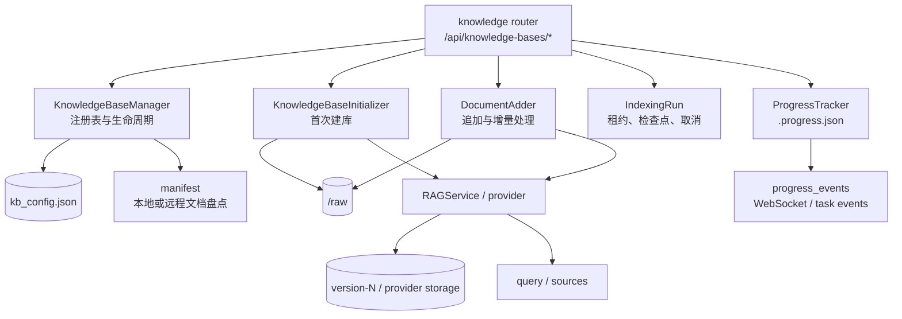

# 知识库模块说明

> 本文记录当前 MathCraft 知识库模块的实现边界、领域模型、数据布局、生命周期、接口分组和验收方法。内容以 `backend/math_q_agent/knowledge/`、`backend/math_q_agent/api/routers/knowledge.py` 以及当前 OpenAPI 快照为准；接口的完整参数和响应契约仍以 [`openapi.json`](../../openapi.json) 与 [`docs/api.md`](../api.md) 为准。

## 1. 模块定位

知识库模块为统一 FastAPI 后端提供四类能力：

1. 注册和管理知识库目录、默认知识库、状态和元数据。
2. 接收本地文件或外部来源，保存原始文档并驱动解析、切分、嵌入和 RAG 索引。
3. 以任务、持久化进度和 WebSocket 事件的形式暴露索引过程。
4. 通过绑定的 RAG provider 检索片段，或把检索请求转发到外部连接器。

知识库有两种实现形态：

- **本地索引库**：文档由 MathCraft 管理，位于 `$MATH_Q_HOME/data/knowledge_bases/<kb>/raw`，由绑定的 RAG provider 建立索引。
- **连接型知识库**：`kb_config.json` 中保存外部资源指针。资源可能是本机目录、外部索引、远程服务或智能体；MathCraft 按类型决定是否允许上传、索引、检索和删除。

该模块保持单租户运行边界。模型、嵌入和外部服务凭据由设置模块写入运行时数据目录，知识库模块只读取解析后的运行时配置，不应把凭据写进代码、文档或测试数据。

### 1.1 正式知识库是唯一知识库入口

MathCraft 统一使用 DeepTutor 正式知识库模块。公开知识库接口只有 `/api/knowledge-bases/*` 与 `/ws/knowledge-bases/*`；默认 RAG provider 为 `llamaindex`，provider 仍可按知识库绑定切换。

出题服务保留 `/api/generate` 和 `/api/chat`，但它们只是出题编排接口：通过 `math_q_agent.multi_user.knowledge_access` 读取正式知识库文档清单，再通过 `RAGService.search()` 检索。出题请求传入的 `doc_id` 是 `raw/` 下的 POSIX 相对路径，并通过 `document_keys` 强制限定检索范围。

旧的 `/api/kb/*`、Chroma/Ollama 入库、解析、切片、嵌入和检索实现已移除。历史运行时目录可以继续保留在本地，但应用不会读取、迁移或自动删除这些数据。

```text
正式知识库上传/索引 → provider 索引发布 → RAGService.search(document_keys=[doc_id]) → 出题 LLM 编排
```

统一知识库、出题和模型设置共用同一个 FastAPI 进程；模型、嵌入和解析配置统一由 `/api/settings` 管理。

## 2. 组件关系



API 路由负责 HTTP、上传安全、任务编排和错误映射；`knowledge` 包负责领域状态和持久化；`services/rag` 负责具体解析、索引、嵌入和检索实现。领域代码通过 `progress_events` 暴露窄接口，不直接依赖 FastAPI 或 WebSocket，CLI 使用时可以保持无事件的默认行为。

## 3. 源码目录与职责

| 文件 | 职责 | 关键边界 |
| --- | --- | --- |
| `backend/math_q_agent/knowledge/__init__.py` | 包级懒加载导出 | 导出 `KnowledgeBaseManager`、`KnowledgeBaseInitializer`、`DocumentAdder`；避免导入阶段加载可选引擎 |
| `manager.py` | 知识库注册表、状态、默认库、路径、连接型资源、文件夹/GitHub/网页来源元数据 | `kb_config.json` 是目录注册表的事实来源；写入使用原子 JSON 写入 |
| `initializer.py` | 首次建库、创建目录、复制初始文件、调用 RAG 流程、写入元数据 | 建库阶段先登记 `initializing`，没有可处理文档时失败 |
| `add_documents.py` | 追加文件、文件哈希、去重、移除原始文件、增量索引 | 复用已有索引和解析结果；对 LightRAG 等 provider 走其专用批处理路径 |
| `indexing_run.py` | 单知识库索引租约、任务日志、文档检查点、取消请求、失败分类 | `.indexing-run.json` 不是解析缓存，也不是队列；只记录可靠边界上的状态 |
| `progress_tracker.py` | 人类可读进度、阶段、百分比、终态校验和持久化 | `.progress.json` 是可恢复的展示快照；发布完成前不会过早显示 `completed` |
| `progress_events.py` | 进度广播和任务事件的应用端口 | 不依赖 Web 框架；服务启动时由 API 层安装回调 |
| `manifest.py` | 本地目录、外部文件夹和远程资源的文档清单 | 无法访问时返回 `unavailable`，不会把未知状态误报为空库 |
| `kb_types.py` | 连接型知识库类型、检索能力和本地原始文件能力判定 | “连接型”不等于“不可检索”；调用方必须使用能力函数判定 |
| `naming.py` | 知识库名称校验和规范化 | 目录名和注册表键必须使用安全名称 |
| `api/routers/knowledge.py` | HTTP 端点、上传路径校验、任务启动、provider 配置和错误映射 | 文件很大，新增端点应放进已有能力分组，避免复制整段逻辑 |

## 4. 领域模型

### 4.1 知识库注册项

注册项位于 `$MATH_Q_HOME/data/knowledge_bases/kb_config.json` 的 `knowledge_bases` 对象下，常见字段包括：

| 字段 | 含义 |
| --- | --- |
| `name` | 对外显示名称通常来自注册表键；名称经过 `validate_knowledge_base_name` 校验 |
| `status` | 当前生命周期状态，例如 `initializing`、`processing`、`ready`、`error`、`needs_reindex`、`unknown` |
| `progress` | 最近一次索引进度快照，包含阶段、任务、计数、错误和时间戳等 |
| `rag_provider` | 绑定的索引或检索 provider，例如 `llamaindex`、`pageindex`、`graphrag`、`lightrag`、`lightrag_server`、`ima`、`weknora`、`kiwix` |
| `search_mode` | provider 使用的默认检索模式，可被查询请求覆盖 |
| `type` | 连接型知识库的类型；普通本地索引库通常没有该字段 |
| `needs_reindex` | 配置或嵌入绑定变化后是否需要重建索引 |
| `is_default` | API 展示的默认库标记；默认库由管理器按可用名称解析 |
| `source` / `assigned` / `read_only` | 资源来源、访问分配和只读属性，主要由资源访问层补充 |

`KnowledgeBaseInfo` API 对象还会返回 `id`、`statistics`、`metadata`、`path`、`available` 和 `provenance_label`。`available=false` 表示注册项存在但当前资源不可访问；它不等于注册项被删除。

### 4.2 连接型知识库

`kb_types.py` 将以下类型视为连接型。连接型资源不参与普通本地上传和嵌入 reconcile，删除注册项时不得删除外部资源。

| `type` | 指针字段 | 是否使用本地 `raw/` | 是否可由 RAG 检索 | 行为 |
| --- | --- | ---: | ---: | --- |
| `obsidian` | `vault_path` | 否 | 否 | 由 Obsidian 能力直接浏览用户的 Markdown vault，不建立 MathCraft 索引 |
| `linked` | `external_path` | 否 | 是 | 直接挂载用户已有的本地引擎索引，不复制、不重新索引 |
| `subagent` | `agent_kind`、可选 `cwd` 或 `partner_id` | 否 | 否 | 通过 `consult_subagent` 实时驱动连接的本地或伙伴智能体 |
| `lightrag_server` | `server_url`、可选 `api_key` | 否 | 是 | 将查询转发到外部 LightRAG 服务的 `/query` |
| `ima` | `client_id`、`api_key`、`knowledge_base_id` | 否 | 是 | 通过 IMA 的 `search_knowledge` API 检索 |
| `weknora` | `server_url`、`api_key`、`knowledge_base_id` | 否 | 是 | 通过自托管 WeKnora 的知识搜索 API 检索 |
| `marginnote4` | `device_id`、可选 `server_url` | 否 | 否 | 由 MarginNote 能力访问同步数据，落到其专用存储 |
| `kiwix` | `server_url`、`zim_name` | 否 | 是 | 通过 `kiwix-serve` 的 HTTP API 查询 ZIM 文章 |

判断规则必须遵循以下三个函数，而不是直接比较 `type` 字符串：

- `is_connected_kb(entry)`：判断数据是否由外部资源拥有。
- `supports_rag_retrieval(entry)`：判断 `rag` 工具是否能检索；`linked` 和远程服务连接器可以检索。
- `supports_local_raw_files(entry)`：判断是否允许 MathCraft 管理本地 `raw/` 文件。

### 4.3 文档清单

`manifest.py` 使用 `KbManifest` 和 `KbDocument` 表示文档盘点结果。清单记录知识库名称、provider、状态、类型、过滤模式、总数、匹配数、保留的文档和不可用原因。

- 普通知识库从 `<kb>/raw` 递归枚举文件。
- `linked` 和 `obsidian` 从外部目录原地枚举。
- IMA 等支持 inventory 的远程连接器通过服务 API 获取名称，文件大小可能未知。
- 无法访问外部服务返回 `remote`，外部目录消失或 `raw/` 未创建返回 `missing`，智能体类资源返回 `agent`。
- `limit` 默认最多保留 20 条清单项；文件列表 API 的默认和最大限制分别为 200 和 1000。

## 5. 本地数据布局

运行时数据不属于 Git 仓库，默认位于 `$MATH_Q_HOME/data`。知识库模块涉及的目录和文件如下：

```text
data/
└── knowledge_bases/
    ├── kb_config.json              # 知识库注册表和状态
    └── <kb>/
        ├── raw/                    # MathCraft 管理的原始文件，支持子目录
        ├── metadata.json           # provider、更新时间、来源和统计元数据
        ├── .progress.json          # 进度展示快照
        ├── .indexing-run.json      # 索引任务检查点和终态
        ├── .indexing-cancel.json   # 当前任务的取消请求
        ├── .indexing.lock          # 单知识库索引租约
        ├── version-N/              # 已发布的索引版本及 meta.json
        ├── llamaindex_storage/     # 兼容旧流程或特定 provider 的存储目录
        └── visual_assets/          # 解析产生的图片等可视资源
```

`kb_config.json` 和各类 JSON 元数据通过原子写入保存。管理器读取注册表时会做 provider、嵌入配置和孤儿项 reconcile；连接型知识库会跳过本地目录清理、嵌入校验和普通索引流程。

## 6. 生命周期与索引流程

### 6.1 首次创建

1. API 校验名称、provider、文件类型和上传路径；上传路径必须落在目标知识库的 `raw/` 下。
2. 管理器先将知识库登记为 `initializing`，写入初始 provider 和进度。
3. `KnowledgeBaseInitializer` 创建 `<kb>/raw`，写入 `metadata.json`，复制初始文件。
4. `FileTypeRouter` 递归收集支持的文件；文本类文件可直接读取，PDF、Office、EPUB、图片等走解析器。
5. `RAGService` 按绑定 provider 执行解析、切分、嵌入和索引发布。
6. 进度和注册表写入终态：成功为 `ready`，失败为 `error`；成功发布的索引会记录版本和统计信息。

无可处理文档时流程明确失败，不创建一个“看起来已就绪”的空库。

### 6.2 追加和增量索引

`DocumentAdder` 通过文件哈希和元数据判断文档是否已入库：

1. 新文件先写入 `raw/`，同名文件在目标路径上使用不冲突命名。
2. 已处理文件的哈希用于跳过未变化文档。
3. provider 处理新文件；成功处理的哈希和统计信息写回 `metadata.json`。
4. 删除原始文件时，同时清理其元数据关联；索引是否需要重建由 provider 的一致性策略决定。
5. 追加失败以逐文件 `DocumentIndexFailure` 记录，结果通过 `DocumentIndexResult` 汇总已处理数和失败数。

GitHub 和网页来源也通过管理器写入 `metadata.json`，由 `services/github_source` 与 `services/web_source` 的同步任务下载、比较哈希并调用相同的追加/移除路径。

### 6.3 重建、重试和取消

- `reindex`：使用当前 `raw/` 和绑定 provider 重新构建索引，可接收索引 LLM、配置指纹和嵌入模型选择。
- `retry`：根据上一次失败的持久化检查点继续；已验证的解析结果和已完成的云解析切片可以复用，未检查点的切分和嵌入阶段会重启。
- `cancel`：写入当前 `task_id` 的取消请求；索引在安全边界检查到请求后进入取消终态，不强行破坏已经发布的版本。
- 同一知识库同一时间只能有一个索引租约；并发启动会返回 busy/冲突结果。

### 6.4 扫描 PDF 解析

ParseService 在选择普通解析器前检查 PDF 的文字层和页面图像。存在页面图像且所有页面没有可提取文字时，文件被判定为扫描 PDF，并强制进入 MinerU 云端 OCR：本次请求将 `is_ocr` 临时设为 `true`，不启动本地 MinerU、LiteParse 或 Docling OCR。

扫描 PDF 要求 MinerU 配置为 `cloud`、API 地址非空且至少有一个 API Token。缺少配置时索引任务失败并返回 `scanned_pdf_mineru_cloud_not_configured`；云端请求失败时返回 `scanned_pdf_mineru_cloud_failed`。这两类错误都会保留在索引任务和文档失败状态中，不会静默跳过并发布空索引。

已经包含可提取文字的 PDF 不触发该策略，普通文件仍使用当前活动解析器。该检测覆盖文字层完全为空的典型扫描文档；乱码、少量页眉页脚或公式缺失需要后续质量门禁处理。

索引任务的终态包括 `completed`、`partial`、`failed`、`cancelled` 和 `interrupted`。文档级状态可以是 `pending`、`parsing`、`parsed`、`embedding`、`completed`、`failed`、`excluded` 或中断后的 `unknown`。

### 6.5 查询

查询前可调用 `GET /api/knowledge-bases/{kb_name}/query-options` 获取 provider、可用模式、默认 `top_k`、最大 `top_k`、是否可生成答案以及索引是否就绪。

`POST /api/knowledge-bases/{kb_name}/query` 的请求体：

```json
{
  "query": "什么是拉格朗日中值定理？",
  "top_k": 8,
  "search_mode": "default",
  "synthesize": false
}
```

约束和返回约定：

- `query` 必须是非空字符串。
- `top_k` 可选，范围为 1 到 50；省略时使用知识库/provider 默认值。
- `search_mode` 可选，必须由 provider 解释；可用模式由 `query-options` 返回。
- `synthesize=true` 时，在召回片段基础上调用已配置的 LLM，返回 `answer`。
- `sources` 中统一补充 `file` 字段；同时可能包含 `content`、`title`、`source`、`page`、`chunk_id` 和 `score`。
- 索引未就绪或 provider 返回可解释的不可用结果时，接口可以保持 200，并在 `sources` 为空时返回 `error_type` 和 `detail`；知识库不存在返回 404，检索引擎异常映射为 502。

## 7. 进度、任务和可观察性

### 7.1 进度阶段

`ProgressStage` 当前包含：

- `initializing`：创建目录、登记注册项。
- `processing_documents`：批量解析、嵌入或发布索引。
- `processing_file`：处理单个文件。
- `completed`：索引版本已发布且终态写入校验通过。
- `error`：流程失败并带有错误信息。

进度记录通常包含 `task_id`、`stage`、`message` 或 `message_key`、`message_params`、`current`、`total`、`progress_percent`、`file_name`、`indexed_count`、`index_changed`、`index_action`、`publication_version`、`timestamp` 和错误字段。前端可以使用 `message_key` 与参数本地化；后端不假设浏览器语言。

### 7.2 HTTP、WebSocket 和任务日志

- `GET /api/knowledge-bases/{kb_name}/progress`：读取持久化进度；没有进度时返回 `not_started` 语义。
- `POST /api/knowledge-bases/{kb_name}/progress/clear`：清除展示快照，不删除知识库或索引。
- `GET /api/knowledge-bases/{kb_name}/indexing-run`：读取当前或最近一次索引检查点。
- `POST /api/knowledge-bases/{kb_name}/indexing-run/{task_id}/cancel`：请求取消指定任务。
- `GET /api/knowledge-bases/tasks/{task_id}/stream`：读取任务日志流。
- `ws://<host>/ws/knowledge-bases/{kb_name}/progress?task_id=<optional>`：订阅实时进度。

WebSocket 不带 `task_id` 时订阅知识库的实时进度；带 `task_id` 时先重放该任务的持久化快照，再接收实时更新。典型消息类型为 `progress`、`error` 和 `complete`。应用层通过 `progress_events.install_progress_ports` 注入广播和任务事件回调，领域层在没有服务端回调时保持无操作。

### 7.3 发布可见性

进度显示的 `completed` 受索引发布元数据保护：如果 `publication_version` 尚未对应一个已发布的原生索引，`visible_progress` 会暂时返回“正在完成索引发布”的处理中状态，避免客户端看到 100% 但马上无法检索的假终态。

## 8. HTTP 接口分组

所有知识库管理接口位于 `/api/knowledge-bases` 下。下面列出按用途整理的入口；完整字段、响应和校验规则见 [`docs/api.md`](../api.md)。

### 8.1 目录、配置和默认库

| 能力 | 入口 |
| --- | --- |
| 健康检查 | `GET /api/knowledge-bases/health` |
| 列表和详情 | `GET /api/knowledge-bases`、`GET /api/knowledge-bases/{kb_name}` |
| 创建和删除 | `POST /api/knowledge-bases`、`DELETE /api/knowledge-bases/{kb_name}` |
| 配置读写 | `GET/PUT /api/knowledge-bases/{kb_name}/config`、`GET /api/knowledge-bases/configs` |
| 配置同步 | `POST /api/knowledge-bases/configs/sync` |
| 默认库 | `GET /api/knowledge-bases/default`、`PUT /api/knowledge-bases/default/{kb_name}` |
| 支持文件 | `GET /api/knowledge-bases/supported-file-types` |

创建知识库是 `multipart/form-data`，至少需要 `name`，可带 `files`、`rag_provider`、`pageindex_mode`、`search_mode`、`rel_paths`、`indexing_llm`、`embedding_model` 和 `storage_workspace_id`。

### 8.2 文件和本地目录

| 能力 | 入口 |
| --- | --- |
| 上传文件 | `POST /api/knowledge-bases/{kb_name}/upload` |
| 文件列表和预览 | `GET /api/knowledge-bases/{kb_name}/files`、`GET /api/knowledge-bases/{kb_name}/file-preview-text/{filename}` |
| 文件访问和删除 | `GET/DELETE /api/knowledge-bases/{kb_name}/files/{filename}` |
| 文件夹和移动 | `POST /api/knowledge-bases/{kb_name}/folders`、`POST /api/knowledge-bases/{kb_name}/files/move` |
| 可视资源 | `GET /api/knowledge-bases/{kb_name}/visual-assets/{asset_id}`、`GET /api/knowledge-bases/{kb_name}/visual-coverage` |
| 来源页面 | `GET /api/knowledge-bases/{kb_name}/source-page` |

上传接口支持 `files`、可选 `rag_provider`、`rel_paths`、`dest_subdir` 和 `image_analysis`。所有本地路径都要经过路径段清理和 `raw/` 内安全拼接；连接型知识库不应绕过能力检查调用这些入口。

文件分类由 `FileTypeRouter` 统一完成：PDF、DOCX、XLSX、PPTX、EPUB 和部分图片走解析器；TXT、Markdown、JSON、YAML、CSV、TeX、代码和常见文本格式可直接读取；扩展名最终以 `GET /supported-file-types` 和当前解析器能力为准。

### 8.3 索引任务

| 能力 | 入口 |
| --- | --- |
| 查看重建配置 | `GET /api/knowledge-bases/{kb_name}/reindex-config` |
| 重建索引 | `POST /api/knowledge-bases/{kb_name}/reindex` |
| 更新待生效策略 | `PUT /api/knowledge-bases/{kb_name}/indexing-policy` |
| 失败重试 | `POST /api/knowledge-bases/{kb_name}/retry` |
| 查询任务 | `GET /api/knowledge-bases/{kb_name}/indexing-run` |
| 取消任务 | `POST /api/knowledge-bases/{kb_name}/indexing-run/{task_id}/cancel` |
| 就绪检查 | `GET /api/knowledge-bases/{kb_name}/indexing-readiness` |
| 进度 | `GET /api/knowledge-bases/{kb_name}/progress`、`POST /api/knowledge-bases/{kb_name}/progress/clear` |

### 8.4 外部连接器和来源同步

连接器统一采用“probe 后 connect”的思路：先验证路径或远程服务，再写入注册项，避免生成一个已登记但不可用的知识库。

| 资源 | 探测/连接入口 |
| --- | --- |
| Obsidian | `POST /connect-obsidian` |
| MarginNote 4 | `POST /connect-marginnote4` |
| 外部文件夹索引 | `POST /probe-folder`、`POST /connect-folder` |
| LightRAG 服务 | `POST /probe-lightrag-server`、`POST /connect-lightrag-server` |
| WeKnora | `POST /probe-weknora`、`POST /connect-weknora` |
| IMA | `POST /probe-ima`、`POST /connect-ima`、`POST /list-ima` |
| Kiwix | `GET /kiwix-catalog`、`POST /probe-kiwix`、`POST /connect-kiwix`、`GET /kiwix-articles` |

本地外部文件夹还支持：

- `POST /api/knowledge-bases/{kb_name}/link-folder`
- `GET /api/knowledge-bases/{kb_name}/linked-folders`
- `DELETE /api/knowledge-bases/{kb_name}/linked-folders/{folder_id}`
- `POST /api/knowledge-bases/{kb_name}/sync-folder/{folder_id}`

GitHub 和网页来源保存于知识库元数据并由同步服务执行：

- GitHub：`POST/GET/DELETE /{kb_name}/github-source[s]`、`POST /{kb_name}/sync-github`。
- 网页：`POST/GET/DELETE /{kb_name}/web-source[s]`、`GET /web-source-sync`、`GET /web-source/{source_id}/pairings`、`PUT /web-source/{source_id}/schedule`、`POST /web-source/{source_id}/cancel`、`POST /web-source/{source_id}/retry`、`POST /sync-web`。

### 8.5 provider 和检索配置

provider 目录和各 provider 的配置由以下入口管理：

- `GET /api/knowledge-bases/rag-providers`、`PUT /rag-providers/{provider}/mode`。
- `GET/PUT /rag-pipelines/{provider}/config`，当前有 `pageindex`、`ima`、`llamaindex`、`graphrag`、`lightrag` 和 `lightrag-server` 配置入口。
- `GET /rag-pipelines/{provider}/preflight`、`GET /rag-pipelines/model-options`、`GET /embedding-usage`。
- `PUT /rag-pipelines/active-model`，以及 GraphRAG 模型兼容性检查和 LightRAG 模型选项接口。

可选 provider 使用懒加载。缺少依赖时，列表或预检应报告 `unavailable`/未配置等状态，不能因为可选引擎缺失而阻止服务启动。

## 9. 异常边界与安全约束

1. **路径安全**：上传、移动、预览和删除只能作用于目标知识库允许的目录；外部连接器保存的是指针，不能当作本地路径递归删除。
2. **并发安全**：索引通过 `.indexing.lock` 和任务 ID 保证单知识库单运行；旧任务发现任务 ID 已被替换后必须停止写入。
3. **源文件一致性**：`IndexingRun.verify_sources()` 会在关键阶段重新校验哈希；源文件在索引期间被修改时应失败并要求使用当前文件重试。
4. **错误分类**：超时、资源耗尽、依赖缺失、不支持输入、模型下载失败、嵌入失败、无效输出和一般运行时异常会归类为稳定错误码。
5. **敏感信息**：索引日志和错误文本会对 bearer、API key、token、secret、password、authorization 以及带认证信息的 URL 做脱敏；外部连接失败响应不得回显凭据。
6. **外部不可用**：远程清单访问失败表示 `remote`/不可用；不能把网络失败渲染成“0 个文档”。
7. **只读资源**：`read_only` 或连接型知识库不能走普通上传、删除原始文件或本地 reindex；API 应返回清晰的冲突或不可用信息。
8. **配置变更**：provider、嵌入模型、索引策略变化可能使知识库进入 `needs_reindex`；查询前应检查 `indexing-readiness` 或详情中的统计状态。
9. **可选依赖**：解析器和 RAG 引擎必须惰性导入；缺依赖时报告不可用，不能在 import 阶段让服务启动失败。

## 10. 验收标准

完成知识库模块改动或排查时，至少应覆盖以下场景：

- 能创建本地知识库、上传支持格式、观察索引进度并在 `ready` 后检索。
- 重复上传相同文件会利用哈希或现有索引结果，失败文件能在结果中被识别。
- 重建、重试、取消在 HTTP、持久化快照和 WebSocket 中保持同一个 `task_id` 语义。
- 服务重启或 WebSocket 重连后，`/progress` 和 `indexing-run` 能恢复最近状态。
- 源文件在索引期间变更会触发一致性失败，不会静默发布混合版本。
- 连接型知识库按类型正确区分：是否有本地文件、是否可检索、是否允许本地索引和删除。
- 远程服务不可达时返回明确的不可用/连接失败信息，不注册虚假的可用库，也不把不可达当空库。
- 检索返回统一的 `file` 来源字段，`top_k`、检索模式和可选答案生成符合 query-options 契约。
- 可选引擎缺少依赖时只影响对应 provider 的可用性，默认服务仍能启动。
- 变更后的代码、OpenAPI 快照、`docs/api.md`、设计说明和 README 入口保持同步；运行时数据、凭据和本地索引不进入提交。

## 11. 维护入口

- 领域实现：[`backend/math_q_agent/knowledge/`](../../backend/math_q_agent/knowledge/)
- HTTP 路由：[`backend/math_q_agent/api/routers/knowledge.py`](../../backend/math_q_agent/api/routers/knowledge.py)
- RAG provider：[`backend/math_q_agent/services/rag/`](../../backend/math_q_agent/services/rag/)
- API 参考：[`docs/api.md`](../api.md)
- OpenAPI 契约：[`openapi.json`](../../openapi.json)
- 单租户和敏感信息约定：[`STUBS.md`](../../STUBS.md)、[`AGENTS.md`](../../AGENTS.md)
