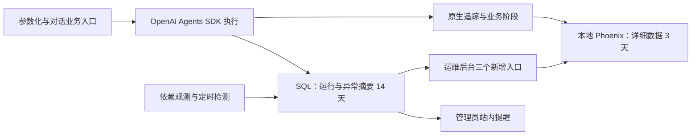

# 运维后台升级方案

状态：用户已确认；新增前端及合成交互已完成，本次补全已通过前端检查及独立复审；真实授权审计和后端联调待完成，真实追踪及五个 ops 后端接口仍待实现。确认及前端先行授权日期：2026-11-11；前端补全记录日期：2026-11-12。G0 真实追踪、G1 后端契约冻结、G3 贯通均未通过，不代表整套运维后台已上线。方案按功能模块组织，不预设实施人数或人员分配。

## 1. 目标与首期边界

将管理员后台升级为运维后台，保留平台概览、账号管理、模型与检索、账号安全四项原职责，新增出题运行、依赖状态、异常中心。首期以参数化出题和对话出题为业务验收入口；Agent 模块使用 OpenAI Agents SDK，并提供后续 Agent 能遵循的运行记录契约。

首期解决以下问题：

- 出题失败、等待过久、执行过久或疑似失联，能够定位具体运行和阶段。
- 模型、Redis、向量库及必要数据库是否异常，区分个人凭据故障与共享服务故障。
- 题量不足、频繁重出、审核跳过、检索或审核降级能够被识别，避免流程结束被当作完整成功。
- 管理员能够查看获准采集的出题对话及相关 API 数据，关联详细调用链排错。
- 同类故障聚合、管理员站内提醒、持续故障去重和恢复状态形成闭环；同时能够判断运维采集、导出、告警、清理和通知链路自身是否可信。

首期不新增管理员代用户重试、强停、修改任务结果、外部通知、模型费用结算、全新持久任务队列或多实例协调；新增运维链路自监控、容量保护和只读访问审计。已有账号管理、系统模型配置与索引重建继续按原规则工作。

## 2. 最终技术与存储决定

| 层次 | 已确认决定 |
| --- | --- |
| Agent 执行与追踪事件 | OpenAI Agents SDK 及其原生 tracing |
| 详细追踪存储和查看 | 本地部署 Phoenix；明确只向本地追踪出口导出 |
| 平台运行及告警摘要 | 应用 SQL 数据库，供运维接口直接读取 |
| 详细追踪正文 | 默认保留 3 天，可配置 |
| 平台摘要 | 默认保留 14 天，可配置 |
| 清理 | 每日执行，检查策略应用与执行结果，不要求精确到时刻删除 |
| 实施顺序 | 后端仍按 G0 → G1 → G2 → G3 推进；本轮仅前端按第 4 节用户授权例外先行 |
| 模块组织 | 按 M1–M9 九个模块划分：追踪、运行、质量、依赖、告警、接口、界面、清理调度、运维系统自监控与审计 |

SDK 在本地运行不等于详细数据自动存储在本地。接入时替换默认追踪处理器，验证没有向默认 OpenAI 追踪后端双写，也不在本地服务故障时自动回退云端。该限制针对追踪导出；模型调用仍使用业务选定的服务。

Phoenix 不替代平台任务状态库，平台摘要不复制整套对话正文。详细数据过期后，运行摘要继续按自身保留期可查，追踪入口显示已过期或不可用等可解释状态。

## 3. 现有实现与前置依赖

调查以本地源码为证据，不代表远端最新代码或部署状态。

- 当前 [AdminPanel](../../frontend/src/components/admin/AdminPanel.tsx)按原导航和样式扩展为七入口与管理员通知；原平台资源和历史批次统计提取至 [LegacyOverview](../../frontend/src/components/admin/LegacyOverview.tsx)，继续读取真实接口。2026-11-11 历史验收见第 10.2 节，不覆盖第 10.3 节本次补全。
- [管理员概览](../../backend/app/api/admin.py)只统计已持久化批次；[GenerationBatch](../../backend/app/models/question.py)在成果落库时生成，不能作为真实请求总数或失败率分母。
- 异步出题依赖进程内后台任务和 Redis 缓存，同步及对话出题没有统一持久运行台账；任务缓存过期不能证明执行完成。
- 当前生成与审核存在多线程边界、异常转普通回复及降级放行，不能只依靠 HTTP 状态或根 span 是否抛异常判断业务结果。
- 当前审核中的 regenerated 是每次尝试去重后、后续评估前的候选数量之和，既不是重出尝试次数，也不是最终交付保留数；需单独采集尝试、失败、补齐和降级。
- 2026-11-11 本地分支调查未发现 SDK Agent 业务接入；根锁文件中的 openai-agents 为间接依赖，不代表接入已完成。

Agent 模块的 SDK 化是本方案前置依赖，不将整个 Agent 重写纳入运维任务。保留参数化／对话业务验收入口，不在旧实现中先造一套过渡追踪。最终实现目标分支在开工时按仓库约定确认，不能默认所有工作合入 main。

## 4. 前置追踪验收门槛 G0

G0 验证追踪接入模块与 SDK Agent 执行路径能正确衔接，并核对样例和关联契约。除下述本轮前端例外外，G0 通过前只进行设计、部署试接入及 Agent 必需的追踪接入，不开始运维运行库、接口和告警后端编码。

**2026-11-11 用户授权的 frontend-only 例外：允许在 G0 通过前，按 v1 联调契约先行实现完整七入口前端与管理员通知，并提供仅 DEV、管理员登录后显式勾选的合成演示。此例外仅覆盖前端，不解除后端门槛；G0 真实追踪、G1 后端契约冻结、G3 真实链路贯通均未通过。前端实现或合成回归不能替代上述验收，也不能据此宣称整套系统已上线。**

v1 在本轮是前端映射与联调基线，不能把 TypeScript 类型或合成客户端视为后端契约已冻结。后端最终实现时仍需核对 schema、OpenAPI、接口正文及前端映射。

| 验收项 | 通过条件 |
| --- | --- |
| 真实执行结构 | Agent 由 SDK 驱动；参数化／对话出题能产生对应追踪，包含成功、失败和降级样例 |
| 关联正确 | 每次出题独立运行；同一会话多次运行及跨账号并发时，子调用不串线 |
| 内容可查 | 本地 Phoenix 能查看合成对话和相关模型／工具／业务 API 请求响应 |
| 脱敏与访问 | 导出前排除凭据、密码、Cookie、认证令牌；受控访问 Phoenix，普通教师／学生不因此获得追踪正文 |
| 单一出口 | 验证追踪只发到本地端点，无默认 OpenAI 追踪双写；模型服务流量单独识别 |
| 导出故障 | 断连、缓冲耗尽及恢复不阻断出题；导出有界并明确延迟、失败或丢失 |
| 必要采集证据 | 用验收专用内存收集器验证业务接点事件与 trace 关联，无需先建运维 SQL 台账 |
| 保留策略 | 核对实际项目 3 天详细保留和每日清理配置；隔离合成项目用短 TTL 或受支持过期样本验证真实删除及未到期对照，不能仅检查配置文件存在 |
| 交接物 | 兼容版本清单、部署与启动说明、合成样例及 trace 标识、脱敏证据、出口证据、资源与写入量记录 |

验收优先使用合成对话、假模型与假服务；如需检查实际 Phoenix 的接收结果，也仅使用合成数据。测试不指向真实用户或生产模型账号。G0 不是全平台业务验收，也不以真实模型消耗作为通过条件。

**2026-11-12 确认的 G0 最小闭环：** 两类实际 SDK 业务路径、本地根及必要子 spans、成功／失败／降级与并发归属、必要事件关联、正文脱敏与受控访问、有界导出失败／恢复／关闭、兼容版本及 Phoenix 保留能力。业务成果仍按真实事务保存；不要求新增运维 SQL。保留验证无需等待真实 3 天，记录加速方式与限制，不声称已观察完整 3 天周期；选定版本无法满足约定策略时阻塞 G0，不能临时增加应用调度器掩盖。

| G0 后的工作 | 所属模块及阶段 |
| --- | --- |
| 运维运行 SQL、持久事件幂等、独立周期心跳与重启恢复 | G1 冻结后由 M2 实现 |
| 最终集合、版本及审核范围的完整持久化质量统计 | M3 |
| 定时依赖探测、异常轮次、站内通知 | M4／M5 |
| 五个运维查询 API | M6 |
| SQL 14 天清理、活动保护、应用调度及作业记录 | M8 |
| 长运行根追踪到期、迟到 spans、平台到期链接关闭 | M8／G3，不由 G0 加速删除样例替代 |

## 5. 采集契约与状态原则

详细字段、枚举、拟新增接口和响应样例见[接口与联调契约](运维后台接口与联调契约.md)。该契约已作为前端 v1 基线，五个 ops 后端接口仍待实现；当前后端接口仍以根 `openapi.json` 和 [API 文档](../api.md)为准。本轮仅同步 API 文档入口说明，不重新生成 OpenAPI 或接口正文。

### 5.1 标识与记录边界

每次执行有独立 run_id，关联 trace_id、入口、账号、可空 session_id 和成功落库后才能确定的 batch_id。会话、执行和成果批次不可互相替代。资料关联仅保存排障需要的标识，正文在 Phoenix 保存一份。

平台摘要在业务受理、实际开始、阶段更新、心跳和结束时记录；SDK 追踪补充详细调用。运行和告警接口从本地 SQL 查询，不抓取 Phoenix 界面，也不依赖未公开 API。Phoenix 是否在线不证明某条追踪已经持久化，导出完成与可查看状态应区分。

接点清单见[联调契约第 3.3 节](运维后台接口与联调契约.md#33-采集接点与事件生产契约2026-11-12-确认)：由受理、实际执行、内容变更、审核、重出、降级及事务提交等权威步骤产生事件。成果仅在业务事务成功提交后进入最终交付集合；对话回复关联另行确认，不能用 flush、HTTP 成功或批次存在替代全部事实。G0 只验证内存事件证据，持久化在后续模块完成。

### 5.2 执行与质量分开

- 执行结束、失败、取消和进行中按真实事件记录；超时与心跳缺失是异常信号，不擅自强改终态。
- 题量满足、审核覆盖、已知降级和重出尝试单独记录；题量满足不等于审核正常，更不代表数学正确性已得到保证。
- 获取不到的数据为未知或不可用，不能填成零或正常；历史未采集请求不补造开始、结束、耗时和失败率。
- 统计响应说明采集起点、窗口、样本数及分母。失败率按已采集且可判定的运行计算，未知状态单独计数。
- 已受理未开始、阶段内等待、正在执行数量分别展示；目前没有持久业务队列，不用 Redis 键数冒充队列长度。

审核证据绑定题目版本及实际审核范围；内容变化后保留旧证据，不静默沿用到新版本。题干难度通过不能冒充答案／解析或全面数学正确性审核通过。缺证据为 unknown／incomplete，明确跳过才记跳审；不为满足统计自动增加模型复审。详见[联调契约第 4.1 节](运维后台接口与联调契约.md#41-题目版本与实际审核范围)。

### 5.3 采集内容与权限

采集出题相关用户对话、模型输入输出、检索和工具交互、白名单业务 API 请求响应，以及状态码、耗时、重试和错误分类。认证、改密接口不纳入正文采集。

凭据、密码、Cookie、认证令牌及私钥不得进入追踪；不能仅依靠正文采集开关，需要在导出边界检查嵌套字段、异常与自定义属性。普通应用日志和平台摘要不写入完整对话、题干或原始异常正文。

原管理员同权和独立运维身份保持不变。获准查看排障追踪是本轮明确的数据可见范围扩展，不授予教师工作台或全部题库资源访问；API 继续使用现有管理员认证依赖。Phoenix 访问应受本地入口或认证保护，不能认为 MathCraft 管理员登录自动完成第三方后台授权。

## 6. 页面与交互

| 新入口 | 首期内容 |
| --- | --- |
| 出题运行 | 时间、账号、入口、执行及质量异常筛选；运行详情展示阶段、耗时、目标／实际题量、审核覆盖、重出尝试、降级原因及追踪入口 |
| 依赖状态 | 模型、Redis、向量库和数据库状态；显示检查来源与时间，区分共享服务异常和单账号凭据问题 |
| 异常中心 | 故障聚合、首次／最近发生时间、影响次数、关联运行、持续／恢复状态和管理员站内提醒 |

前端完整处理加载、空列表、无权限、网络错误、未知数据、部分不可用、正文已过期等状态。正文过期或 Phoenix 不可用不能误报为出题失败。保留现有系统模型配置的未保存提醒、忙时导航保护和安全操作反馈。

### 6.1 本轮前端实现与演示边界

本轮完整前端范围为七入口：保留平台概览、账号管理、模型与检索、账号安全，新增出题运行、依赖状态、异常中心；另提供管理员通知的未读、已读、删除与异常轮次定位。通知已读不等于告警恢复，通知关联类型不代表后端已经开始生成运维告警。

平台概览将运维观测统计与原平台资源／历史批次统计分别加载。`frontend/src/types/ops.ts` 定义 v1 类型和客户端边界，`frontend/src/api/adminOps.ts` 适配五个待实现查询与现有通知接口，`adminOpsDemo.ts` 仅用于 DEV 显式启用的合成客户端。页面、抽屉、通知及共用组件职责见[模块说明 M7](运维后台模块说明.md#m7-运维后台界面)。

管理员完成真实登录后，只有 DEV 显示“使用演示数据”；默认关闭并使用真实 API，主动勾选后才启用演示。合成数据只覆盖运维统计、运行、依赖、异常、通知；旧平台资源统计与账号、模型、安全始终使用真实接口。演示通知操作仅修改内存。生产没有演示入口且不包含 demo 模块；第 10.2 节记录历史产物核验，本次补全后的验证结果见第 10.3 节。

支持 `normal`、`loading`、`empty`、`partial`、`error` 五种 DEV 场景，分别用于典型运行与异常、缓慢加载、空数据、部分可用／未知及服务失败的界面核验。真实 API 错误不能自动回退 mock；保留真实错误、重试和最近成功更新信息，不将错误或未知伪装为正常。演示状态不能证明真实追踪已可查看、依赖探测已执行或通知已真实投递。

### 6.2 2026-11-12 前端补全与安全边界

七入口保持不变。新增 `OpsExtensions.tsx` 集中呈现运维链路健康、只读生效配置、题目版本与审核范围及告警排障指引；`useOpsClock.ts` 使用服务端快照时间加页面经过时间复核观测有效期。经过时间单调累加 `max(wallDelta, performanceDelta, 0)`，覆盖校时回拨及 Windows 休眠；新快照只向前校准，空数据和旧快照不能回拨。概览时钟提升至父层，依赖时钟保留在 `DependenciesPanel` 顶层，筛选导致卡片重挂不能延长证据寿命；自监控同样持续复核观测时间，轮询失败不续期。`observed_at > generated_at` 的未来观测在该快照内持续为 unknown，不随页面时间增长变成 healthy；过期或缺新鲜度证据同样展示未知。

概览内增加“近 24 小时新建”的监控链路异常、容量异常、通知失败三按钮，分别按 `monitoring_pipeline_failure`、`capacity_warning`、`notification_failure` 导航异常中心。窗口按轮次 `first_seen_at`，不代表全部活动故障。已知规则扩展为九项；未来规则仅接受经安全格式校验的标识，展示原始标识及通用只读指引，不猜测恢复逻辑。

前端类型扩展见[联调契约第 1.2 节](运维后台接口与联调契约.md#12-2026-11-12-前端先行扩展待-g1-冻结)：`self_monitoring`、`review_versions`、详情 `regeneration_config`、告警 `guidance/effective_config` 均为可选扩展，不改变既有必填字段。字段未提供表示未接入／未提供，显式 `null` 表示证据未知；配置不据此补默认阈值。审核按每题最终 `content_revision` 匹配证据，分别显示实际完成范围与明确通过范围，逐条区分当前版本、旧版本或关联未知；不从集合版本或运行摘要 `revision` 推导整题通过，不自动补审。

`OpsClient.openTrace(path)` 已改为异步访问结果。真实适配固定返回 `not_integrated` 并关闭正文访问，即使摘要称 trace 可读或提供安全路径也不跳转；独立授权与审计接入前不能放行。DEV 在原五场景之外提供 `trace_denied`、`trace_audit_failed`、`trace_expired`、`trace_simulated_success` 四种访问结果演示；模拟成功也仅显示合成反馈，不打开正文、不产生真实审计。未新增后端或审计 API。

分页追加后暂停自动刷新；刷新第一页失败保留已追加集合及暂停状态，成功后才回到第一页并恢复自动刷新。通知的迟到响应、已读／删除竞争及重复提醒按同一客户端生命周期隔离；筛选清除、关联导航和抽屉焦点遍历／归还纳入本次回归。新增前端及合成交互已完成，实际检查结果见第 10.3 节，不沿用历史通过结论。

## 7. 告警与依赖观测

以下均为用户确认的首版初值，实施时配置化；不作为自动取消或模型 timeout 的替代值。

| 类型 | 初值与语义 |
| --- | --- |
| 共享依赖 | 连续失败 3 次告警，连续成功 2 次标记恢复 |
| 等待 | 已受理未开始超过 30 秒，持续观察 2 分钟后告警 |
| 执行过久 | 单次运行超过 10 分钟，标记疑似超时 |
| 心跳失联 | 超过 90 秒未更新，标记疑似失联 |
| 质量异常 | 每次记录题量不足、审核跳过和降级；最近 5 分钟正常结束且质量可判定的运行至少 10 次、其中异常比例达到 20% 时聚合提醒；同一运行多原因只计一次 |
| 重复提醒 | 同类故障合并，持续期间 10 分钟内不重复通知；恢复后复发可开启新轮次 |
| 频繁重出 | 首先采集真实尝试、失败、比例与耗时，依据 G0 合成样例校准阈值；阈值未配置时明确显示，不能伪造判断 |

依赖状态结合实际业务调用结果与低成本的定时探测，显示数据新鲜度。Redis 检查实际命令，不能以客户端构造成功判健康；向量库区分初始化与查询故障。模型主动探测不在页面轮询中自动调用真实付费模型，个人凭据错误只影响对应账号与运行。

检测和通知的状态保存在 SQL，避免依赖 Redis 自己报告 Redis 故障；站内投递按现有通知能力扩展并去重。当前仅支持单应用 worker 的检测调度，不新增任务队列或声称多实例协调；重启后根据持久化状态接续检测，故障端点必须有超时。

## 8. 存储、清理与运行边界

Phoenix 先以本地单实例接入，持久目录、绑定地址、认证方式和固定兼容版本写入 G0 记录。试接入可用 SQLite；实际多人部署的数据存储按官方部署边界验证，不为追踪迁移平台业务数据库。资源评估记录镜像、运行内存、写入量及采集开销，不能以 SDK 包或镜像大小代替运行容量。

详细追踪配置 3 天保留，平台运行／阶段／告警关联摘要配置 14 天保留，均由每日调度清理。清理有界、可重入且记录执行结果；活动运行和仍需检测的故障不因简单 TTL 被无条件抹掉。过期清理完成不等于数据库文件立即缩小，不把严格到秒删除或磁盘立即回收作为验收要求。

Phoenix 停止、导出失败或摘要写入异常不应导致模型出题直接失败，但需要可定位的观测缺口；不得静默生成正常状态或无限堆积内存。SQL 自身不可用时不得承诺摘要与站内告警仍然可用；Phoenix 可能保留独立的调用证据。已有业务对 Redis 的依赖不因本方案消失。

### 8.1 运维系统自身健康、容量与访问审计

新增 M9 监测运维链路自身：事件采集与 SQL 写入延迟、事件丢弃、Phoenix 导出失败与队列积压、告警评估停滞、清理失败、通知投递失败、运行与 trace 关联缺失，以及 SQL／Phoenix 存储空间。自监控数据陈旧或监测器停止时显示 `unknown`／`monitoring_unavailable`，不能显示“无异常”。

容量保护按 warning／critical 两级配置，至少覆盖运行台账写入延迟、Phoenix 导出积压、事件丢弃数量、通知投递积压和存储空间。缓冲有上限，优先保留运行终态、质量摘要和根 trace 关联；详细子 span 可以按有界策略丢弃，但丢弃、脱敏失败和重试耗尽必须计数。观测链路不阻断出题，也不允许无限重试或无限增长内存。

管理员查看运行详情、告警详情、Phoenix trace 及对话／模型调用正文时记录访问审计，至少包含管理员、时间、目标 run／trace、动作和结果，不记录正文、凭据或原始异常。正文默认隐藏，单条 trace 需要独立授权和审计成功；MathCraft 管理员身份不自动等于 Phoenix 正文权限。审计写入失败时不得无记录放行正文。

告警、清理和正文详情附带安全的影响范围、责任模块、推荐排查入口和是否需要人工处理的只读指引。阈值只由配置文件或环境变量提供，后台展示实际生效值，不新增首期在线修改阈值接口。部署、健康检查、清理验证、备份边界和故障恢复步骤见[运维后台运行手册](运维后台运行手册.md)。

## 9. 模块划分与依赖顺序

详细职责、输入输出、异常边界和验收要点见[模块说明](运维后台模块说明.md)。模块边界按业务能力划分，同一模块可以包含必要的采集、存储、接口和展示接点。

三人协作的接口归属、共享文件编辑与交接顺序另见[三人实施分工方案](运维后台三人实施分工方案.md)；本节继续按模块组织，人员安排不改变模块契约。

| 模块 | 核心职责 | 主要输出 |
| --- | --- | --- |
| M1 追踪接入与 Phoenix | SDK 追踪适配、本地出口、上下文关联、正文脱敏和访问控制 | 可定位的详细追踪及 G0 验收证据 |
| M2 运行记录与执行状态 | 受理、开始、阶段、心跳、终态及业务标识的持久化 | SQL 运行摘要和可靠的执行状态 |
| M3 交付质量观测 | 题量、最终版本审核覆盖、重出尝试和降级采集 | 独立的质量状态、计数和原因 |
| M4 依赖健康监测 | 模型、Redis、向量库、数据库等调用观测与受控探测 | 分范围的健康状态、新鲜度及错误分类 |
| M5 异常聚合与站内告警 | 等待、疑似超时、依赖及质量异常的检测、去重、恢复和复发 | 告警轮次、影响摘要和管理员站内通知 |
| M6 运维查询接口与权限 | 五个只读接口、筛选分页、管理员权限和安全错误 | 后端 schema、OpenAPI、API 文档及响应契约 |
| M7 运维后台界面 | 原职责保留，运行、依赖与异常入口和追踪跳转 | 页面、前端 API／类型映射及完整交互状态 |
| M8 保留清理与调度 | 每日清理、活动保护、唯一调度、重启恢复及故障记录 | 可配置保留策略和可复核的作业状态 |
| M9 运维系统自监控与审计 | 采集链路健康、积压容量、通知失败、正文访问审计和只读排障指引 | 运维健康摘要、自监控告警、访问审计和生效配置 |

后端及真实贯通的依赖顺序仍为 G0 追踪验收 → G1 契约冻结 → G2 模块实现 → G3 联合验收；M7 前端按第 4 节授权例外在 G0 前先行。M1 依赖已有 SDK Agent 实现并通过 G0；G1 固定跨模块字段与状态语义；G2 中 M2／M3 提供运行和质量数据，M4 提供依赖证据，M5 消费这些证据，M6 暴露查询契约，M7 对接真实结果，M8 为检测与清理提供统一调度，M9 提供自监控、容量保护和授权审计。模块可按已冻结契约并行实现，最终在 G3 验证真实链路。2026-11-11 前端阶段原定分支为 codex/ops-frontend；2026-11-12 补全在以 main 为目标的 codex/ops-frontend-completion 分支进行。本次共享工作区文档同步不提交、不合并、不推送。

## 10. 验收与文档状态

- 原有四个后台区域、管理员与教学身份隔离、账号与系统配置操作保持可用。
- 除第 4 节授权的前端先行外，后端开发仍须先通过 G0；两个账号并发、同一会话多次运行和工具并发时关联正确，无追踪云端双写。
- 覆盖成功、失败、部分交付、审核降级、未知、超时、心跳失联及重出数据，不使用成功批次冒充全部请求。
- 导出端断连、缓冲耗尽、恢复、正文过期、无权限和追踪不可用时，业务与展示语义正确。
- 共享依赖失败、恢复、复发及个人凭据故障时，聚合、去重与站内提醒符合阈值。
- 清理策略应用到实际项目并可执行；摘要仍在保留期时，正文过期不破坏运行列表。
- 相关权限、共享链路、迁移及前端检查按仓库约定执行。测试使用假服务，Redis 隔离按当前夹具核实。

### 10.1 当前交付与未完成项

本轮为前端先行实现及既有文档同步；五个 ops 后端接口、运行摘要持久化、SDK → Phoenix 真实追踪、依赖探测、告警生成投递、清理调度、M9 运维链路自监控、容量保护和正文访问审计仍待实现／验收。现有通知读写能力与新增运维通知生成、关联字段分别核验，前端可展示合成通知不证明后端已扩展。

| 门槛 | 当前状态 |
| --- | --- |
| G0 真实追踪验收 | 未通过；不能以页面或合成客户端替代 SDK → 本地 Phoenix 的真实路径证据 |
| G1 后端契约冻结 | 未通过；v1 仅作为已授权先行前端的联调基线 |
| M7 前端先行 | 新增前端及合成交互已完成；包含自监控／版本／配置／指引、原五场景及四种访问结果；本次前端检查及独立复审已通过，真实联调待完成 |
| M9 自监控与审计 | 前端展示与合成反馈已补全；实际采集、容量保护、通知失败处理、独立授权与审计后端待实现／联调；真实正文入口保持关闭 |
| G3 真实链路联合验收 | 未通过；后端及追踪依赖未就绪，不能写为整套已上线 |

新增 API 真正落地时同步后端 schema、OpenAPI、API 正文与前端映射；本轮只更新 `docs/api.md` 的入口状态说明，不重新生成 `openapi.json` 或 API 接口正文。

### 10.2 本轮前端验收记录

执行日期：2026-11-11。以下全部为当日历史记录，保留原覆盖与证据，不覆盖 2026-11-12 前端补全；本次检查见第 10.3 节。离线脚本 `frontend/ops-panel-regression.mjs` 使用真实 React 应用、合成 API 和本机 Chromium，不访问真实模型或生产账号。检查结果仅证明当日前端与合成交互完成，真实后端联调仍待完成。历史审查“未关闭发现为 0”也不代表本次新增改动已审查。

| 检查项 | 执行方式／覆盖 | 实际结果 |
| --- | --- | --- |
| TypeScript | 在 `frontend/` 执行 `npm run typecheck` | 通过；生产构建再次执行类型检查 |
| ESLint | 在 `frontend/` 执行 `npm run lint` | 通过，0 错误；保留 RecordsTab 两条 Hook 及 AuthContext 一条原有警告 |
| 生产构建 | 在 `frontend/` 执行 `npm run build`，核验无演示入口且产物不包含 demo 模块 | 通过；JS 产物无演示入口文案／合成运行标识，未生成 demo chunk；仍有大于 500kB 的分包提示 |
| 离线回归 | 在 `frontend/` 执行 `node ops-panel-regression.mjs`；七入口、通知、五场景、真实错误不回退 mock、旧功能真实请求边界 | 9 组通过；另运行 `node admin-panel-regression.mjs`，原账号／配置／安全及导航保护回归通过 |
| 窄屏浏览器 | 375px；七入口、运维筛选、详情／通知与横向溢出 | 脚本通过；生成概览、列表、通知、详情截图 |
| 平板浏览器 | 768px；七入口、运维筛选、详情／通知与横向溢出 | 脚本通过；生成同类截图 |
| 小桌面浏览器 | 1024px；七入口、运维筛选、详情／通知与横向溢出 | 脚本通过；生成同类截图 |
| 桌面浏览器 | 1440px；七入口、运维筛选、详情／通知与横向溢出 | 脚本通过；生成同类截图 |

脚本还验证分页去重与追加后暂停刷新、抽屉 Escape／焦点约束及归还、减少动态效果、旧告警定位不附默认窗口、显式 24 小时筛选、全部已读覆盖未展示通知、未知值与非法响应校验、安全追踪路径、网络竞态及失败保留旧数据。截图保存在忽略目录 `output/playwright/ops/`，不提交运行产物。人工查看了四种宽度的概览及 375／1440px 运行抽屉、375px 通知和依赖、1440px 异常列表截图，确认可读布局与内容换行。文档核验覆盖 74 处本地链接与根 README 的 49 个目录树路径。Windows 环境构建临时将 TEMP／TMP 指向忽略目录 `frontend/.tmp/ops-esbuild`，规避系统临时目录 esbuild 文件占用，不改变构建配置。

离线对旧接口的合成拦截仅用于回归隔离，不改变应用演示数据范围。前端检查即使全部通过，也只证明本轮前端验证结果，不能将 G0、G1 或 G3 自动改为通过。

最终审查由未参与本轮实现及前期验证的全新子智能体按 `open-code-review-delegate` 技能完成，实际执行 OCR preview／rule，并覆盖全部 21 个任务文件；唯一跳过项为用户原有 `.gitignore`。初审发现的 4 项问题（通知窗口回流重复提醒、未知分母的确定比率、审核覆盖率与计数不一致、运维通知缺轮次关联）均已修复，补充浏览器回归并经独立复审关闭，当前未关闭发现为 0。复审另以实际解析器核验 33 个非法输入被拒绝、18 个合法输入被接受。完整审查报告留在忽略目录 `output/playwright/ops/final-review.md`。

### 10.3 2026-11-12 补全检查

新增前端及合成交互已完成。以下检查在 2026-11-12 对本次修复后的代码执行，2026-11-11 历史结论不自动沿用；真实授权审计和后端联调仍待完成。

| 检查项 | 本次覆盖／执行方式 | 实际结果与证据 |
| --- | --- | --- |
| TypeScript | `frontend/` 执行 `npm run typecheck` | 通过；最后的 `npm run build` 再次执行 `tsc --noEmit` 并通过 |
| ESLint | `npm run lint` | 0 错误、0 新增警告；保留 RecordsTab 两条 Hooks 警告和 AuthContext 一条 Fast Refresh 警告 |
| 生产构建与演示隔离 | `npm run build`；静态产物与真实浏览器登录核验 | 通过；无演示入口、四种模拟标识或 DEV 模块请求。保留现有大分包提示。Windows 系统临时目录的 esbuild 删除权限错误通过进程级 TEMP／TMP 指向忽略目录 `frontend/.tmp/ops-esbuild` 解决 |
| 类型解析及旧响应兼容 | 缺省／null／完整／非法扩展、重复标识、版本／范围、三新规则及安全未知规则 | 174 项扩展契约断言通过；旧 v1 继续可解析，非法结构使用 INVALID_OPS_RESPONSE，未知证据未补零或成功 |
| 前端离线交互回归 | `node ops-panel-regression.mjs` | 23 组通过；全部请求留在合成边界。覆盖七入口、三种关联导航、正文四结果与正式关闭、分页和通知竞争、时间、筛选、键盘及生产隔离 |
| 版本、配置与时间 | 逐题版本、实际完成与通过范围、冲突／旧证据；配置空值；服务器时间加单调经过时间 | 通过；明确验证仅难度不算全部范围、旧版本不能覆盖当前；校时回拨、旧／空快照及筛选不续期，未来观测在原快照持续未知。Windows 休眠累计由独立定点逻辑验证，未声称实际让机器休眠 |
| 交互恢复与无障碍 | 四宽度、正反向 Tab、Escape、滚动锁与焦点归还、减少动态效果 | 375／768／1024／1440px 均通过；通知完整焦点周期与正文内联说明不逃出外层 dialog。截图保存在忽略目录 `output/playwright/ops/`，新增 `health-*.png`、`notifications-*.png`、`production-no-demo.png` |
| 原管理员回归 | `node admin-panel-regression.mjs` | 2 组通过；原账号、配置、安全、旧后端错误、未保存提醒及保存期间导航保护保持可用 |
| 文档与独立审查 | 路径／链接、M1–M9、规范与需求两轴审查 | 两名未参与实现的独立智能体审查及复核完成；3 项代码问题及 2 项文档口径问题已修复，1 项分页误报经审查者撤回。提交前核对 12 份文档的 128 处本地引用均存在，暂存差异检查通过；当前确认未关闭问题为 0 |

规范审查确认并关闭系统校时回拨、未来观测随后自行恢复健康两项问题；需求审查确认并关闭筛选清空数据导致旧快照续期的问题。完整 Tab 周期回归另外发现通知弹窗可能把焦点送到浏览器工具栏，已复用焦点循环并经独立复核。需求审查中的分页追加失败发现经复核撤回：已有追加集合的暂停状态在失败分支保持，成功首屏或主动切换查询才重置。两条审查轴最终均无已确认未关闭问题。

文档复核另外纠正依赖解析器时间先后校验的描述，明确其与自监控解析的边界；运行手册也已将 unknown 从告警级别移到条件状态，严重级别仍只有 warning／critical。

本次按前端先行扩展交付，不新增后端或审计 API、不修改 OpenAPI。G0 真实追踪、G1 后端契约冻结及 G3 贯通均未通过；本节结果仅证明新增前端和合成交互，不证明 SDK Agent、Phoenix、真实运维采集或授权审计已经上线。

## 11. 决策来源与官方依据

2026-11-12 用户确认三人分工、业务采集接点、题目版本及实际审核范围、G0 最小闭环四项细化，随后授权补全既有前端。人员安排单独成文，主方案仍按模块组织；前端先行扩展与合成交互已完成，前端检查已完成，真实授权审计／后端联调待完成，不表示后端接点、字段、接口或 G0 已完成。

用户逐轮确认了原职责保留、首期监测问题、当前业务入口验收、正文可查、站内告警、无新增运行干预、执行与质量分开、SDK Agent 接入门槛、三个后台入口及告警初值；最终确认 SDK 原生追踪到本地 Phoenix，以及正文 3 天、摘要 14 天和每日清理。文档按最新要求仅说明功能模块及其依赖，不按人数划分。此前默认云端、正文 7 天与摘要 30 天等讨论值均已被最终确认替代。

2026-11-11 用户进一步批准完整前端按 v1 契约先行，形成第 4 节仅覆盖前端的 G0 例外；默认真实、DEV 显式演示、旧功能真实、生产排除 demo 以及真实错误不自动 mock 均为本轮授权边界。该决定不撤销 G0 真实追踪、G1 后端契约冻结和 G3 贯通验收。

- [OpenAI Agents SDK tracing](https://openai.github.io/openai-agents-python/tracing/)：追踪、处理器与默认出口；本地方案需替换默认处理器。
- [Phoenix 的 Agents SDK 集成](https://arize.com/docs/phoenix/integrations/llm-providers/openai/openai-agents-sdk-tracing)：原生 SDK 追踪接入依据。
- [Phoenix 保留策略](https://arize.com/docs/phoenix/settings/data-retention)：项目级时间／数量保留与清理调度。
- [Phoenix 部署架构](https://arize.com/docs/phoenix/self-hosting/architecture)：本地及多人部署的数据存储边界。
- [管理员设计](管理员与账号开通设计.md)、[设置拆分设计](设置拆分与保存反馈设计.md)：需保留的既有职责与权限。
