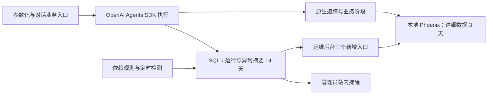

# 运维后台升级方案

状态：用户已确认，待实施。确认日期：2026-11-11；方案按功能模块组织，说明模块职责、依赖与验收边界，不预设实施人数或人员分配，不代表追踪、接口或页面已经上线。

## 1. 目标与首期边界

将管理员后台升级为运维后台，保留平台概览、账号管理、模型与检索、账号安全四项原职责，新增出题运行、依赖状态、异常中心。首期以参数化出题和对话出题为业务验收入口；Agent 模块使用 OpenAI Agents SDK，并提供后续 Agent 能遵循的运行记录契约。

首期解决以下问题：

- 出题失败、等待过久、执行过久或疑似失联，能够定位具体运行和阶段。
- 模型、Redis、向量库及必要数据库是否异常，区分个人凭据故障与共享服务故障。
- 题量不足、频繁重出、审核跳过、检索或审核降级能够被识别，避免流程结束被当作完整成功。
- 管理员能够查看获准采集的出题对话及相关 API 数据，关联详细调用链排错。
- 同类故障聚合、管理员站内提醒、持续故障去重和恢复状态形成闭环。

首期不新增管理员代用户重试、强停、修改任务结果、外部通知、模型费用结算、全新持久任务队列或多实例协调。已有账号管理、系统模型配置与索引重建继续按原规则工作。

## 2. 最终技术与存储决定

| 层次 | 已确认决定 |
| --- | --- |
| Agent 执行与追踪事件 | OpenAI Agents SDK 及其原生 tracing |
| 详细追踪存储和查看 | 本地部署 Phoenix；明确只向本地追踪出口导出 |
| 平台运行及告警摘要 | 应用 SQL 数据库，供运维接口直接读取 |
| 详细追踪正文 | 默认保留 3 天，可配置 |
| 平台摘要 | 默认保留 14 天，可配置 |
| 清理 | 每日执行，检查策略应用与执行结果，不要求精确到时刻删除 |
| 实施顺序 | SDK Agent 追踪接入验收通过后，才开始补运维业务代码 |
| 模块组织 | 按追踪、运行、质量、依赖、告警、接口、界面、清理调度划分 |

SDK 在本地运行不等于详细数据自动存储在本地。接入时替换默认追踪处理器，验证没有向默认 OpenAI 追踪后端双写，也不在本地服务故障时自动回退云端。该限制针对追踪导出；模型调用仍使用业务选定的服务。

Phoenix 不替代平台任务状态库，平台摘要不复制整套对话正文。详细数据过期后，运行摘要继续按自身保留期可查，追踪入口显示已过期或不可用等可解释状态。

## 3. 现有实现与前置依赖

调查以本地源码为证据，不代表远端最新代码或部署状态。

- 当前 [AdminPanel](../../frontend/src/components/admin/AdminPanel.tsx)已有四个原后台区域，按现有导航和样式扩展。
- [管理员概览](../../backend/app/api/admin.py)只统计已持久化批次；[GenerationBatch](../../backend/app/models/question.py)在成果落库时生成，不能作为真实请求总数或失败率分母。
- 异步出题依赖进程内后台任务和 Redis 缓存，同步及对话出题没有统一持久运行台账；任务缓存过期不能证明执行完成。
- 当前生成与审核存在多线程边界、异常转普通回复及降级放行，不能只依靠 HTTP 状态或根 span 是否抛异常判断业务结果。
- 当前审核中的 regenerated 是重出后保留数，不能当作重出尝试次数；需单独采集尝试、失败、补齐和降级。
- 2026-11-11 本地分支调查未发现 SDK Agent 业务接入；根锁文件中的 openai-agents 为间接依赖，不代表接入已完成。

Agent 模块的 SDK 化是本方案前置依赖，不将整个 Agent 重写纳入运维任务。保留参数化／对话业务验收入口，不在旧实现中先造一套过渡追踪。最终实现目标分支在开工时按仓库约定确认，不能默认所有工作合入 main。

## 4. 前置追踪验收门槛 G0

G0 验证追踪接入模块与 SDK Agent 执行路径能正确衔接，并核对样例和关联契约。G0 通过前只进行设计、部署试接入及 Agent 必需的追踪接入，不开始运维运行库、接口、页面和告警功能编码。

| 验收项 | 通过条件 |
| --- | --- |
| 真实执行结构 | Agent 由 SDK 驱动；参数化／对话出题能产生对应追踪，包含成功、失败和降级样例 |
| 关联正确 | 每次出题独立运行；同一会话多次运行及跨账号并发时，子调用不串线 |
| 内容可查 | 本地 Phoenix 能查看合成对话和相关模型／工具／业务 API 请求响应 |
| 脱敏与访问 | 导出前排除凭据、密码、Cookie、认证令牌；受控访问 Phoenix，普通教师／学生不因此获得追踪正文 |
| 单一出口 | 验证追踪只发到本地端点，无默认 OpenAI 追踪双写；模型服务流量单独识别 |
| 导出故障 | 断连、缓冲耗尽及恢复不阻断出题；导出有界并明确延迟、失败或丢失 |
| 保留策略 | 实际项目应用 3 天详细保留和每日清理；清理能执行，不能仅检查配置文件存在 |
| 交接物 | 兼容版本清单、部署与启动说明、合成样例及 trace 标识、脱敏证据、出口证据、资源与写入量记录 |

验收优先使用合成对话、假模型与假服务；如需检查实际 Phoenix 的接收结果，也仅使用合成数据。测试不指向真实用户或生产模型账号。G0 不是全平台业务验收，也不以真实模型消耗作为通过条件。

## 5. 采集契约与状态原则

详细字段、枚举、拟新增接口和响应样例见[接口与联调契约](运维后台接口与联调契约.md)。该契约是待实现设计，当前运行接口仍以根 openapi.json 和 [API 文档](../api.md)为准。

### 5.1 标识与记录边界

每次执行有独立 run_id，关联 trace_id、入口、账号、可空 session_id 和成功落库后才能确定的 batch_id。会话、执行和成果批次不可互相替代。资料关联仅保存排障需要的标识，正文在 Phoenix 保存一份。

平台摘要在业务受理、实际开始、阶段更新、心跳和结束时记录；SDK 追踪补充详细调用。运行和告警接口从本地 SQL 查询，不抓取 Phoenix 界面，也不依赖未公开 API。Phoenix 是否在线不证明某条追踪已经持久化，导出完成与可查看状态应区分。

### 5.2 执行与质量分开

- 执行结束、失败、取消和进行中按真实事件记录；超时与心跳缺失是异常信号，不擅自强改终态。
- 题量满足、审核覆盖、已知降级和重出尝试单独记录；题量满足不等于审核正常，更不代表数学正确性已得到保证。
- 获取不到的数据为未知或不可用，不能填成零或正常；历史未采集请求不补造开始、结束、耗时和失败率。
- 统计响应说明采集起点、窗口、样本数及分母。失败率按已采集且可判定的运行计算，未知状态单独计数。
- 已受理未开始、阶段内等待、正在执行数量分别展示；目前没有持久业务队列，不用 Redis 键数冒充队列长度。

### 5.3 采集内容与权限

采集出题相关用户对话、模型输入输出、检索和工具交互、白名单业务 API 请求响应，以及状态码、耗时、重试和错误分类。认证、改密接口不纳入正文采集。

凭据、密码、Cookie、认证令牌及私钥不得进入追踪；不能仅依靠正文采集开关，需要在导出边界检查嵌套字段、异常与自定义属性。普通应用日志和平台摘要不写入完整对话、题干或原始异常正文。

原管理员同权和独立运维身份保持不变。获准查看排障追踪是本轮明确的数据可见范围扩展，不授予教师工作台或全部题库资源访问；API 继续使用现有管理员认证依赖。Phoenix 访问应受本地入口或认证保护，不能认为 MathCraft 管理员登录自动完成第三方后台授权。

## 6. 页面与交互

| 新入口 | 首期内容 |
| --- | --- |
| 出题运行 | 时间、账号、入口、执行及质量异常筛选；运行详情展示阶段、耗时、目标／实际题量、审核覆盖、重出尝试、降级原因及追踪入口 |
| 依赖状态 | 模型、Redis、向量库和数据库状态；显示检查来源与时间，区分共享服务异常和单账号凭据问题 |
| 异常中心 | 故障聚合、首次／最近发生时间、影响次数、关联运行、持续／恢复状态和管理员站内提醒 |

前端完整处理加载、空列表、无权限、网络错误、未知数据、部分不可用、正文已过期等状态。正文过期或 Phoenix 不可用不能误报为出题失败。保留现有系统模型配置的未保存提醒、忙时导航保护和安全操作反馈。

## 7. 告警与依赖观测

以下均为用户确认的首版初值，实施时配置化；不作为自动取消或模型 timeout 的替代值。

| 类型 | 初值与语义 |
| --- | --- |
| 共享依赖 | 连续失败 3 次告警，连续成功 2 次标记恢复 |
| 等待 | 已受理未开始超过 30 秒，持续观察 2 分钟后告警 |
| 执行过久 | 单次运行超过 10 分钟，标记疑似超时 |
| 心跳失联 | 超过 90 秒未更新，标记疑似失联 |
| 质量异常 | 每次记录题量不足、审核跳过和降级；最近 5 分钟正常结束且质量可判定的运行至少 10 次、其中异常比例达到 20% 时聚合提醒；同一运行多原因只计一次 |
| 重复提醒 | 同类故障合并，持续期间 10 分钟内不重复通知；恢复后复发可开启新轮次 |
| 频繁重出 | 首先采集真实尝试、失败、比例与耗时，依据 G0 合成样例校准阈值；阈值未配置时明确显示，不能伪造判断 |

依赖状态结合实际业务调用结果与低成本的定时探测，显示数据新鲜度。Redis 检查实际命令，不能以客户端构造成功判健康；向量库区分初始化与查询故障。模型主动探测不在页面轮询中自动调用真实付费模型，个人凭据错误只影响对应账号与运行。

检测和通知的状态保存在 SQL，避免依赖 Redis 自己报告 Redis 故障；站内投递按现有通知能力扩展并去重。当前仅支持单应用 worker 的检测调度，不新增任务队列或声称多实例协调；重启后根据持久化状态接续检测，故障端点必须有超时。

## 8. 存储、清理与运行边界

Phoenix 先以本地单实例接入，持久目录、绑定地址、认证方式和固定兼容版本写入 G0 记录。试接入可用 SQLite；实际多人部署的数据存储按官方部署边界验证，不为追踪迁移平台业务数据库。资源评估记录镜像、运行内存、写入量及采集开销，不能以 SDK 包或镜像大小代替运行容量。

详细追踪配置 3 天保留，平台运行／阶段／告警关联摘要配置 14 天保留，均由每日调度清理。清理有界、可重入且记录执行结果；活动运行和仍需检测的故障不因简单 TTL 被无条件抹掉。过期清理完成不等于数据库文件立即缩小，不把严格到秒删除或磁盘立即回收作为验收要求。

Phoenix 停止、导出失败或摘要写入异常不应导致模型出题直接失败，但需要可定位的观测缺口；不得静默生成正常状态或无限堆积内存。SQL 自身不可用时不得承诺摘要与站内告警仍然可用；Phoenix 可能保留独立的调用证据。已有业务对 Redis 的依赖不因本方案消失。

## 9. 模块划分与依赖顺序

详细职责、输入输出、异常边界和验收要点见[模块说明](运维后台模块说明.md)。模块边界按业务能力划分，同一模块可以包含必要的采集、存储、接口和展示接点。

| 模块 | 核心职责 | 主要输出 |
| --- | --- | --- |
| M1 追踪接入与 Phoenix | SDK 追踪适配、本地出口、上下文关联、正文脱敏和访问控制 | 可定位的详细追踪及 G0 验收证据 |
| M2 运行记录与执行状态 | 受理、开始、阶段、心跳、终态及业务标识的持久化 | SQL 运行摘要和可靠的执行状态 |
| M3 交付质量观测 | 题量、最终版本审核覆盖、重出尝试和降级采集 | 独立的质量状态、计数和原因 |
| M4 依赖健康监测 | 模型、Redis、向量库、数据库等调用观测与受控探测 | 分范围的健康状态、新鲜度及错误分类 |
| M5 异常聚合与站内告警 | 等待、疑似超时、依赖及质量异常的检测、去重、恢复和复发 | 告警轮次、影响摘要和管理员站内通知 |
| M6 运维查询接口与权限 | 五个只读接口、筛选分页、管理员权限和安全错误 | 后端 schema、OpenAPI、API 文档及响应契约 |
| M7 运维后台界面 | 原职责保留，运行、依赖与异常入口和追踪跳转 | 页面、前端 API／类型映射及完整交互状态 |
| M8 保留清理与调度 | 每日清理、活动保护、唯一调度、重启恢复及故障记录 | 可配置保留策略和可复核的作业状态 |

依赖顺序为 G0 追踪验收 → G1 契约冻结 → G2 模块实现 → G3 联合验收。M1 依赖已有 SDK Agent 实现并通过 G0；G1 固定跨模块字段与状态语义；G2 中 M2／M3 提供运行和质量数据，M4 提供依赖证据，M5 消费这些证据，M6 暴露查询契约，M7 展示结果，M8 为检测与清理提供统一调度。模块可按已冻结契约并行实现，最终在 G3 验证真实链路。目标分支按仓库约定在实施前确认。

## 10. 验收与文档状态

- 原有四个后台区域、管理员与教学身份隔离、账号与系统配置操作保持可用。
- G0 必须先通过；两个账号并发、同一会话多次运行和工具并发时关联正确，无追踪云端双写。
- 覆盖成功、失败、部分交付、审核降级、未知、超时、心跳失联及重出数据，不使用成功批次冒充全部请求。
- 导出端断连、缓冲耗尽、恢复、正文过期、无权限和追踪不可用时，业务与展示语义正确。
- 共享依赖失败、恢复、复发及个人凭据故障时，聚合、去重与站内提醒符合阈值。
- 清理策略应用到实际项目并可执行；摘要仍在保留期时，正文过期不破坏运行列表。
- 相关权限、共享链路、迁移及前端检查按仓库约定执行。测试使用假服务，Redis 隔离按当前夹具核实。

当前仅交付方案、契约和模块说明。未安装或启动 Phoenix，未修改业务代码、数据库或 HTTP 契约；本轮只执行文档差异和本地链接检查。新增 API 实现时同步生成 OpenAPI 与 API 文档，不能把本轮契约草案视为已存在端点。

## 11. 决策来源与官方依据

用户逐轮确认了原职责保留、首期监测问题、当前业务入口验收、正文可查、站内告警、无新增运行干预、执行与质量分开、SDK Agent 接入门槛、三个后台入口及告警初值；最终确认 SDK 原生追踪到本地 Phoenix，以及正文 3 天、摘要 14 天和每日清理。文档按最新要求仅说明功能模块及其依赖，不按人数划分。此前默认云端、正文 7 天与摘要 30 天等讨论值均已被最终确认替代。

- [OpenAI Agents SDK tracing](https://openai.github.io/openai-agents-python/tracing/)：追踪、处理器与默认出口；本地方案需替换默认处理器。
- [Phoenix 的 Agents SDK 集成](https://arize.com/docs/phoenix/integrations/llm-providers/openai/openai-agents-sdk-tracing)：原生 SDK 追踪接入依据。
- [Phoenix 保留策略](https://arize.com/docs/phoenix/settings/data-retention)：项目级时间／数量保留与清理调度。
- [Phoenix 部署架构](https://arize.com/docs/phoenix/self-hosting/architecture)：本地及多人部署的数据存储边界。
- [管理员设计](管理员与账号开通设计.md)、[设置拆分设计](设置拆分与保存反馈设计.md)：需保留的既有职责与权限。
