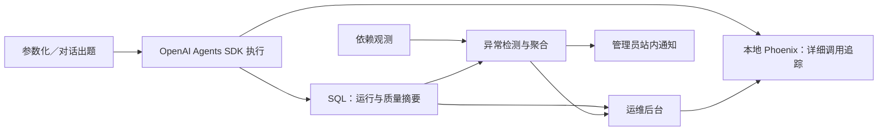

# MathCraft 运维后台系统方案说明

状态：**已确认方案，待实施**。方案日期：2026-11-11。

本文供产品、开发和协作人员了解运维后台的建设目标、功能范围与使用方式，可作为方案评审材料。文中新增能力均为建设方案，不表示已部署或已通过验收。方案按功能模块组织，不预设实施人数或人员分配。

## 1. 系统定位与建设目标

MathCraft 将现有管理员后台升级为统一的运维后台，继续承担账号、平台信息、模型与检索配置、账号安全等管理职责，并补充出题平台的运行监测与排障能力。

出题涉及模型调用、资料检索、生成、审核、重出及成果保存。一次请求正常返回，仍可能出现题量不足、审核跳过或降级交付；只查看最终题目和成功批次，难以发现这些问题。运维后台需要把运行过程、交付情况和故障证据关联起来，帮助管理员回答以下问题：

- 哪次出题失败或长时间没有完成，停在哪个阶段？
- 模型、Redis、向量库或数据库是否异常，影响的是单个账号还是共享服务？
- 是否存在大量等待、执行过久或心跳失联的运行？
- 实际交付是否达到目标题量，审核是否完整，是否频繁重出或发生降级？
- 如何找到对应对话、模型和工具调用、相关 API 请求响应，复查故障原因？

首期以参数化出题和对话出题为验收入口，并通过统一运行记录契约，为后续 Agent 接入提供一致的观测方式。

## 2. 使用对象与功能入口

系统由平台管理员使用，沿用现有管理员身份与权限边界。普通教师、学生的业务入口保持原有角色和资源归属约束，运维权限不直接扩展为全部教学资源的读写权限。

| 入口 | 建设方式 | 提供的能力 |
| --- | --- | --- |
| 平台概览 | 保留原职责，补充独立运行指标 | 查看平台资源汇总及采集后的出题运行概况，区分历史成功批次与真实运行记录 |
| 账号管理 | 保留 | 按既有规则管理平台账号及启用状态 |
| 模型与检索 | 保留 | 继续维护系统模型、检索配置及已有索引管理能力 |
| 账号安全 | 保留 | 继续使用既有账号安全设置与操作反馈 |
| 出题运行 | 新增 | 按时间、账号、入口和状态定位运行，查看阶段、题量、审核、重出、降级及追踪入口 |
| 依赖状态 | 新增 | 查看模型和基础依赖的观测状态、影响范围、检查来源与时间 |
| 异常中心 | 新增 | 汇总故障轮次、关联运行、影响情况、持续或恢复状态，并提供管理员站内提醒 |

所有新增页面均需说明加载、空列表、未知数据、部分不可用、无权限和服务故障，避免用统一的“正常”状态掩盖观测缺口。

## 3. 典型使用流程

### 3.1 日常巡检

管理员进入运维后台，查看当前已受理未开始、正在执行及疑似异常的运行，再检查依赖状态和活动告警。指标附带采集范围、样本数和观测时间；没有采集到的数据明确显示未知，不自动填成零。

已受理未开始数量用于观察等待情况。首期沿用现有执行机制，不将该数量或 Redis 键数称为持久任务队列深度。

### 3.2 单次出题排障

管理员从站内提醒或运行列表进入详情，先确认执行阶段、耗时和最后心跳，再核对实际题量、最终版本审核覆盖、重出尝试及降级原因。需要进一步分析时，通过关联入口进入本地 Phoenix 查看获准采集的详细调用过程。

例如，用户要求生成 5 道题，最终交付 3 道，其中 1 道因审核服务异常而放行。即使执行流程正常结束，详情仍应显示“执行已结束、交付质量需关注”，并标明题量不足和审核降级，保留相关追踪以供排查。

### 3.3 持续故障与恢复

同类故障聚合到同一活动轮次，持续期间累计影响证据并控制通知频率。获得明确恢复证据后更新为已恢复；恢复后再次出现故障，建立新的轮次。读取通知不代表故障恢复，检测停止或证据不足也不能作为恢复依据。

单次明确执行失败属于离散事件：记录故障并保存触发通知后即关闭该告警轮次，不等待持续故障的恢复条件，也不发送恢复通知。告警关闭不表示本次出题成功，运行详情继续保留失败结果。

## 4. 系统组成与模块关系

| 模块 | 主要作用 |
| --- | --- |
| M1 追踪接入与 Phoenix | 将 SDK 原生追踪导出到本地 Phoenix，完成关联、脱敏、正文查看和导出故障处理 |
| M2 运行记录与执行状态 | 保存受理、开始、阶段、心跳、终态及账号、会话、成果关联 |
| M3 交付质量观测 | 独立记录题量、审核覆盖、重出尝试与降级事实，形成质量状态 |
| M4 依赖健康监测 | 根据实际调用与受控探测，区分依赖故障、个人凭据问题及观测陈旧 |
| M5 异常聚合与站内告警 | 根据规则检测异常，维护去重、通知、恢复与复发轮次 |
| M6 运维查询接口与权限 | 提供只读查询、管理员校验、筛选分页及安全错误契约 |
| M7 运维后台界面 | 保留既有管理功能，展示三个新增入口、通知及追踪跳转 |
| M8 保留清理与调度 | 管理检测和每日清理的调度、保留期限、活动保护及作业结果 |

系统的数据流如下：

运行摘要与详细追踪分别存储。后台列表、统计和告警主要读取应用 SQL 数据库，Phoenix 提供详细调用证据；不通过抓取 Phoenix 页面拼装平台运行状态。

## 5. 运行、质量与追踪分别判断

| 判断维度 | 回答的问题 | 处理原则 |
| --- | --- | --- |
| 执行状态 | 是否受理、实际开始、结束、失败或取消？ | 依据执行体的真实事件；等待过久和心跳失联只形成疑似异常，不直接改写终态 |
| 交付质量 | 题量是否满足、最终交付是否完成审核、是否有降级？ | 与执行状态独立；正常结束后仍可标为需关注，未知审核证据不能当作通过 |
| 追踪可查看状态 | 详细调用记录是否已可查、过期、无权限或暂不可用？ | 导出受理和 Phoenix 在线都不证明某条追踪完整可查；追踪不可用不等于出题失败 |

一次出题执行对应独立运行，同一对话可包含多次运行，成果批次只在实际保存后关联。历史未采集的请求不补造运行、耗时和失败率；统计不使用成功批次数冒充全部请求。

“质量达标”仅表示可观测的交付规则满足，不代表数学内容已获得人工正确性确认。重出统计记录真实尝试次数，与最终去重保留的题目数量分别计算。

## 6. 首期异常发现规则

以下为首版默认配置，后续调整需保持记录与展示口径一致：

| 类型 | 触发与处理 |
| --- | --- |
| 明确执行失败 | 一次权威失败事件即触发运行级告警；记录并保存触发通知后关闭，不发送恢复通知，关闭不改变执行失败结果 |
| 依赖故障 | 同一依赖、同一作用范围连续失败 3 次告警，连续成功 2 次恢复；个人凭据错误不累加为共享服务故障 |
| 等待异常 | 已受理但未开始超过 30 秒，且该条件持续观察 2 分钟后告警 |
| 执行过久 | 实际运行超过 10 分钟，标记疑似超时，不自动终止 |
| 心跳失联 | 运行中心跳超过 90 秒未更新，按契约判断疑似失联 |
| 质量异常 | 单次问题始终可见；最近 5 分钟正常结束且质量可判定的运行至少 10 次，其中需关注比例达到 20% 时聚合告警，同一运行多原因只计一次 |
| 通知去重 | 同一持续故障 10 分钟内不重复提醒；恢复后复发开启新轮次 |
| 频繁重出 | 先采集真实尝试、结果和耗时，按接入样本校准阈值；未配置时明确显示，不凭空判定异常 |

异常中心保留规则证据和观测时间，质量告警的样本范围、恢复条件与计数公式以接口契约为准。页面查询本身不触发付费模型探测。

## 7. 数据、权限与故障边界

Agent 使用 OpenAI Agents SDK，详细追踪仅导出至本地 Phoenix；接入时替换默认追踪处理器，验证不存在默认追踪云端双写或故障后的云端回退。该约束针对追踪数据，业务模型调用仍使用选定的模型服务。

详细追踪可包含获准采集的出题对话、模型与工具交互、白名单业务 API 请求响应。认证、改密等敏感接口不采正文；凭据、密码、Cookie、认证令牌和私钥在导出前排除。普通日志、运行摘要及通知不复制完整正文或原始异常。

Phoenix 需配置独立受控访问，平台管理员登录不自动等同于 Phoenix 授权。运维页面的追踪入口不携带认证令牌，也不向普通教师、学生开放正文。

| 数据 | 默认保留 | 到期处理 |
| --- | --- | --- |
| Phoenix 详细追踪与正文 | 3 天 | 到期关闭平台正文入口，每日执行清理 |
| SQL 运行、质量、依赖与告警关联摘要 | 14 天 | 每日清理到期历史；活动运行及仍需检测故障的必要摘要延后清理并记录原因 |

期限和清理调度可配置，不要求精确到秒删除。正文过期后，仍在保留期内的摘要继续可查；保护活动摘要不延长正文保留期限。

追踪导出失败不应阻断出题，缓冲与重试必须有界，数据缺口应可解释。SQL 不可用时如实报告摘要与告警能力受限；Redis 故障可能影响现有登录与业务，不能承诺整站继续正常使用。首期检测和清理按单 worker、单调度实例设计，不承诺多实例协调。

## 8. 建设顺序与验收目标

首先完成 SDK Agent 执行路径及本地追踪接入验收（G0），验证成功、失败、降级、并发关联、脱敏及导出故障处理。Agent 主体实现为前置依赖，不将整个 Agent 重写计入运维范围；G0 通过前不开始其他运维业务代码。

随后冻结模块间契约（G1），实现各模块（G2），最后进行真实链路联合验收（G3）。验收使用合成输入与假模型、假服务，覆盖原管理功能、两类出题入口、质量异常、依赖故障、通知去重恢复、追踪过期及数据清理。安装 SDK 或展示模拟页面不能替代实际贯通。

首期完成后，管理员应能从异常或运行入口定位到具体执行，分清执行结果与交付问题，查看必要排障证据，并看到持续故障、恢复和复发的完整状态。

首期不增加管理员代用户重试、强停、修改运行结果、外部通知、费用分析、全新持久任务队列及多实例调度能力。已有管理操作继续按原规则工作。

## 9. 代码实施必须参考的约定文档

本文用于沟通与评审系统方案。完成代码实现时，必须参考以下三份已约定文档，核对模块边界、前置条件、数据语义和验收标准；不得仅依据本文的概述自行补充或改变契约：

1. [《运维后台升级方案》](运维后台升级方案.md)：作为范围、技术路线、追踪接入门槛、告警初值与整体验收的依据。
2. [《运维后台模块说明》](运维后台模块说明.md)：作为八个模块的职责、输入输出、依赖、异常边界与模块验收的依据。
3. [《运维后台接口与联调契约》](运维后台接口与联调契约.md)：作为标识关联、状态枚举、空值、统计分母、接口字段、权限错误及联调样例的依据；实现时同步后端 schema、OpenAPI、API 文档与前端映射。
