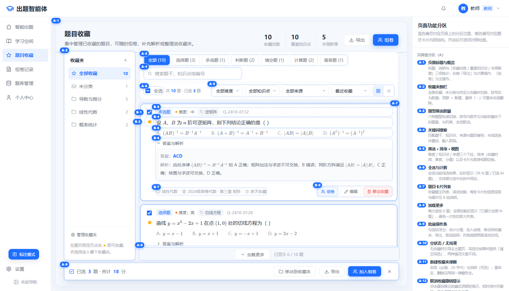
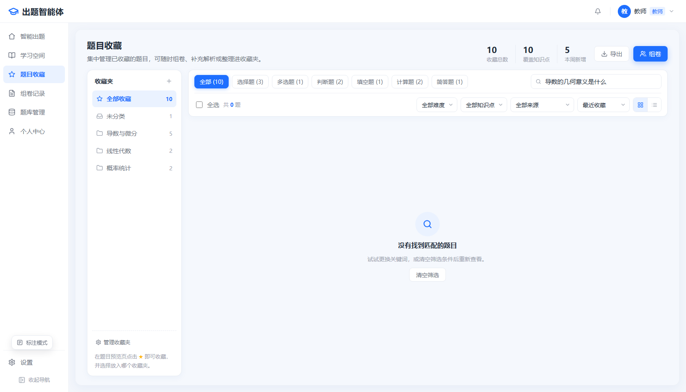

# 题目收藏页面设计

**状态**：设计稿 + 实施依据。本期只做前端页面，数据来自前端 mock，刷新即重置；后端持久化待接入。

**适用**：教师端（单租户）。承接左侧主导航「题目收藏」，替换现有「该模块暂未开放」提示。

**来源**：外部设计稿 `题目收藏-设计方案.md` 与可交互原型 `题目收藏-页面设计.html`（原型与 `vendor/katex` 不入库）。本文整理为仓库文档，作为后续实现与验收的依据。

## 目标

把预览页「随手点星标」变成可检索、可归类、可复用到组卷与题库的题目资产库：

- 集中查看已收藏题目，按收藏夹、题型、难度、知识点、来源和关键词筛选；
- 按最近收藏、最早收藏、难度或分值排序，支持卡片与紧凑两种视图；
- 勾选题目后批量加入组卷、移动收藏夹或导出；
- 支持收藏夹的新建、重命名与删除，删除收藏夹不删除题目；
- 取消收藏后提供 5 秒撤销，避免误操作。

## 使用范围

本期包含：

- 左侧导航「题目收藏」入口与整页布局；
- 收藏夹侧栏、题型胶囊、搜索、筛选、排序、视图切换、全选与计数；
- 题目卡片列表、答案与解析折叠、加载更多、批量操作条；
- 空状态、新建收藏夹弹窗、取消收藏撤销提示；
- 前端 mock 数据与收藏状态；
- 「组卷」入口只加入组卷清单并提示计数，不打开组卷弹窗；卡片只读，「编辑」按钮只给提示。

本期不包含：

- 后端接口与持久化；刷新页面后收藏、收藏夹与排序状态恢复为初始 mock；
- Word / CSV 真实导出（按钮只给演示反馈）；
- 收藏页题目编辑（卡片只读，按钮只给提示，不抽共享编辑态）；
- 组卷弹窗与发布到学习空间的真实闭环（本期只提示并计数）。

## 设计取舍

1. **左侧用「收藏夹」而不是二级 Tab。** 收藏夹是教师自建的专题，数量会增长，且与题型筛选是正交维度；独立侧栏可随时看到各夹题量。
2. **列表用卡片而不是表格。** 题目含公式、选项与解析，行高不可控；卡片与题目预览页保持一致的心智模型。
3. **批量操作浮在底部。** 浏览时不占高度，勾选后出现在视线终点；切换收藏夹或修改筛选会清空已选，避免对不可见题目做批量操作。

## 页面结构

### 线框图

```text
┌───────────────────────────────────────────────────────────────────────────────┐
│ 顶栏：Logo「出题智能体」                              通知 │ 头像 教师 教师 ▾     │
├──────────┬────────────────────────────────────────────────────────────────────┤
│ 图标+文字 │  A-1 题目收藏                                       10   10    5      │
│ 智能出题  │      集中管理已收藏的题目……                     收藏总数 知识点 本周  │
│ 学习空间  │                                       [ ↓ 导出 ] [ 👥 组卷 ]        │
│▶题目收藏  ├───────────────┬────────────────────────────────────────────────────┤
│ 组卷记录  │ A-2 收藏夹  +  │  A-3 全部(10) 选择题(3) 多选题(1)…    A-4 搜索框     │
│ 题库管理  │ ★ 全部收藏 10  ├────────────────────────────────────────────────────┤
│ 个人中心  │    未分类    1 │  A-6 全选 共10题·已选3题   A-5 难度 知识点 来源 排序 ▦│
│           │    导数与微分 5├────────────────────────────────────────────────────┤
│           │    线性代数  2 │ A-7 ┌──────────────────────────────────────────────┐│
│           │    概率统计  2 │     │ □ ★ │ 多选题 · 难度中 · 逆矩阵  Q-2410-0132 ││
│           │                │     │     │ 设 A、B 为 n 阶可逆矩阵……（题干）  ││
│           │  ─────────    │     │     │ A. (AB)⁻¹=B⁻¹A⁻¹   B. …（选项）    ││
│           │ ⚙ 管理收藏夹   │     │     │ ⌄ 答案与解析（折叠区）              ││
│           │ 在预览页点★收藏 │     │     │ 收藏夹 · 来源题库 · 3 天前收藏     ││
│           │                │     │     │                 组卷 编辑 移出收藏 ││
│           │                │     └──────────────────────────────────────────────┘│
│           │                │ A-8 [ ⌄ 加载更多 ]  已显示 6 / 10 题               │
│           │                │ A-9 [✓ 已选 3 题 · 合计 18 分  移动 导出 加入组卷 ✕]│
├──────────┴────────────────┴────────────────────────────────────────────────────┤
│ ⚙ 设置                                                                          │
└───────────────────────────────────────────────────────────────────────────────┘
```

### 页面级分区（A 组）

位置为 1680×962 画布下的近似值，可对照[标注图](./assets/题目收藏/预览-标注.png)。

| 编号 | 位置（≈x,y,w×h） | 内容 | 交互 / 状态 |
| --- | --- | --- | --- |
| **A-1 页面标题与概览** | 212,100 · 1452×66 | 标题「题目收藏」21px 加粗；一行说明；右侧三组统计（收藏总数 / 覆盖知识点 / 本周新增）；最右「导出」次按钮 +「组卷」主按钮 | 统计随收藏增删实时变化；未勾选时「组卷」按当前筛选结果，勾选后只对已选题目；本期仅加入清单提示与计数，不进入组卷流程 |
| **A-2 收藏夹侧栏** | 220,165 · 224×693 | 标题「收藏夹」+ ＋；「全部收藏 / 未分类 / 各专题」及题量；底部「管理收藏夹」与收藏引导 | 单击切换，列表、题型胶囊、计数联动；悬停出现「⋯」→ 重命名 / 删除；删除夹时题目回流「未分类」；当前夹浅蓝底 + 蓝字 + 加粗 |
| **A-3 题型筛选胶囊** | 460,172 · 640×40 | 全部 + 六种题型，括号内为**当前收藏夹**的题量 | 单选；与难度/知识点/来源、关键词叠加；切换即清空已选 |
| **A-4 关键词搜索** | ≈1336,176 · 280×36 | 放大镜 + 占位「搜索题干、知识点或编号」 | 输入防抖；匹配题干（去标签）、知识点、来源、章节、题型、编号；无结果显示 A-10。≥1536 与胶囊同行（280px），更窄时独占整行 |
| **A-5 筛选 · 排序 · 视图** | 1018,234 · 590×36 | 难度 / 知识点 / 来源三个下拉（选项由数据去重生成）、排序（最近收藏 / 最早收藏 / 难度 / 分值）、卡片·紧凑视图切换 | 下拉单选、可叠加；排序默认「最近收藏」；紧凑视图隐藏选项与解析，只保留题干 + 操作 |
| **A-6 全选与计数** | 460,242 · 300×24 | 全选复选框 + 「共 N 题 · 已选 M 题」；存在任一非默认筛选时，计数右侧显示「清空筛选」，位于视图切换左侧 | 全选只作用于**当前筛选结果**；部分选中呈中间态（—）；已选数为 0 时不显示「已选」；「清空筛选」重置题型 / 难度 / 知识点 / 来源 / 搜索与分页为 6，保持排序与当前收藏夹，清空已选并让列表回到顶部 |
| **A-7 题目卡片列表** | 460,305 · 1172×520 | 收藏题主列表，纵向滚动；卡片结构见 B 组 | 滚动加载；空/无结果显示 A-10；卡片 hover 抬阴影；选中卡片蓝色描边 + 外发光 |
| **A-8 加载更多** | 460,830 · 1172×26 | 居中「加载更多」+「已显示 6 / 10 题」 | 每次追加 6 条；全部加载后只留「已展示全部 N 题」；失败时原位重试（mock 不涉及） |
| **A-9 批量操作条** | 216,872 · 1416×54 | 勾选后浮出：已选 N 题 · 合计 X 分；「移动到收藏夹」「移出收藏」「导出」「加入组卷」「✕ 取消选择」 | 与列表共用选择集合；合计分值按 `score` 求和；空选时整条淡出；列表底部预留 86px；「加入组卷」本期只提示并累计计数；「移出收藏」为危险态，与卡片单项移出同色，`aria-label="移出收藏（N 题）"`，点击直接移出（无二次确认），清空已选并弹出 5 秒撤销，撤销按移出快照一次性恢复题目与原勾选 |
| **A-10 空状态 / 无结果** | 列表区域居中 | 圆角浅蓝图标 + 标题 + 说明 + 一个动作；两种文案 | 无收藏：「这个收藏夹还是空的」→「去智能出题」；有筛选但无命中：「没有找到匹配的题目」→「清空筛选」 |
| **A-11 新建收藏夹弹窗** | 视口居中 · 420×300 | 标题 + 说明 + 名称（必填，20 字）+ 说明（可选，40 字）+ 取消 / 创建 | 打开即聚焦名称；空名称不提交；Enter 提交、Esc 与点遮罩关闭；重命名复用同一弹窗（名称预填） |
| **A-12 取消收藏撤销提示** | 顶部居中 · 56px 下沿 | 深色轻提示「已取消收藏「…」」+「撤销」 | 5 秒内可撤销并恢复，同时恢复勾选；连续操作时后一条覆盖前一条 |

### 卡片内部（B 组）

| 编号 | 位置 | 内容 | 交互 |
| --- | --- | --- | --- |
| **B-1 多选勾选框** | 卡片左上（24px 列，顶部） | 16px 方框 | 勾选 → 卡片蓝描边、计入 A-9；点击整卡不勾选 |
| **B-2 收藏星标** | 勾选框下方 | 金色实心星（已收藏的唯一合法状态） | 点击 = 取消收藏，触发 A-12；hover 放大 1.1 |
| **B-3 题型 · 难度 · 知识点** | 卡片首行 | 题型徽标（浅蓝底蓝字）、难度色点（低绿 / 中琥珀 / 高橙 / 地狱红）、知识点胶囊、题目编号 | 知识点胶囊可点 → 以该知识点筛选（可选增强）；编号用于与题库/组卷记录对账 |
| **B-4 题干** | 卡片第二行 | 16px / 1.75 行高，主文本；公式用 KaTeX 行内渲染 | 整段不可编辑；点击卡片空白处展开解析（可选增强） |
| **B-5 选项区** | 题干下方 | 客观题选项横向排布；主观题整块隐藏 | 只读；正确答案不在选项区加粗，避免剧透 |
| **B-6 答案与解析** | 选项下方 | 折叠行「⌄ 答案与解析」；展开为浅灰底圆角块，答案蓝色加粗，解析常规 | 默认折叠；展开状态在本次会话内保留 |
| **B-7 来源与收藏时间** | 卡片底部左 | 收藏夹 · 来源题库与章节 · 收藏时间（昨天 / N 天前 / N 个月前） | 只读 |
| **B-8 卡片操作** | 卡片底部右 | 「打开」次操作、「组卷」主操作、「编辑」次操作、「移出收藏」危险操作 | 打开 = 题目详情弹窗；组卷 = 单题加入组卷清单并提示计数；编辑 = 本期只读，点击提示编辑能力待接入；移出收藏与 B-2 同一动作，同样可撤销 |

## 折叠态

两个折叠开关只作用于收藏页，状态写入 localStorage，刷新、切换页面后保持；默认展开。

### 收藏夹栏（A-2）

- 展开态标题行右侧：新建「＋」与折叠按钮；折叠按钮用 chevron，`aria-expanded="true"`，`title="收起收藏夹栏"`。
- 折叠态宽 48px：顶部展开按钮（`aria-expanded="false"`，`title="展开收藏夹栏"`）；全部 / 未分类 / 自建收藏夹只保留图标，右上角数量角标，`title` 提供「名称（N 题）」；当前收藏夹保留浅蓝选中态；底部保留「＋」新建入口；数量多时图标列纵向滚动。
- 展开宽度保持响应式：1024–1439 为 200px，≥1440 为 232px；折叠后 48px。
- <1024 收藏夹栏本身不渲染（改为顶部横向胶囊），折叠状态不影响该断点。

### 筛选栏（A-3 ~ A-6）

- 展开态：第一行右上角显示「收起筛选」按钮（chevron + 文字），`aria-expanded="true"`，`title="收起筛选"`。
- 折叠态为单行 40px：
  - 搜索框（保留原查询绑定）；
  - 生效筛选摘要：题型 · 难度 · 知识点 · 来源 · 搜索关键词，`truncate` 截断，`title` 提供全文；无筛选显示「未设置筛选」；
  - 展开按钮（`aria-expanded="false"`，`title="展开筛选"`）；
  - 有筛选时显示「清空筛选」，行为与展开态一致。
- 空间不足时摘要优先截断；窄到无法容纳时只保留搜索框、展开与清空。

### 状态与布局

| 项 | 值 |
| --- | --- |
| 收藏夹栏折叠键 | `mcraft.favorites.railCollapsed`（`'1'` 折叠 / `'0'` 展开） |
| 筛选栏折叠键 | `mcraft.favorites.filtersCollapsed` |
| 默认 | 均展开 |
| 布局 | 列表 `flex-1 min-h-0` 自适应；收起筛选后列表直接获得 40px 面板释放的高度，无绝对定位、无遮挡 |

### 管理收藏夹弹窗（A-2）

- 入口：收藏夹栏底部「管理收藏夹」，打开弹窗，不新增路由或页面。
- 列表：全部收藏、未分类固定在最前，只提供「打开」；自建收藏夹每行显示拖拽手柄、图标、名称与题数，操作区顺序为上移 / 下移 → 打开 → 重命名 → 删除。
- 打开：关闭弹窗并切到该收藏夹，沿用现有切换规则（清空已选、加载更多回到 6），列表滚回顶部；焦点回到「管理收藏夹」按钮。「打开」只保留文字、不使用图标，`title="打开收藏夹"`。
- 搜索：弹窗顶部按名称过滤自建夹，输入即筛；「全部收藏」「未分类」不参与搜索；无匹配显示「没有匹配的收藏夹」。搜索期间禁用拖拽与上移 / 下移，禁用控件 `title="清空搜索后可排序"`。
- 排序：自建夹支持原生 HTML5 拖拽，拖到目标行上 / 下时显示 2px 主色插入线，松手即时生效并同步侧栏；每行另提供上移 / 下移按钮作为键盘与触屏兜底（触屏不支持 HTML5 拖拽）。排序写入 `order` 字段（自建夹 1..n，未分类固定 0），仅会话内生效，刷新重置。
- 操作：
  - 重命名复用 A-11 的新建 / 重命名弹窗；
  - 删除走二次确认：标题「删除收藏夹」，正文「确定删除该收藏夹？题目将移至未分类」，按钮为次要「取消」与危险色「删除」；取消、Esc、点遮罩均不改动；确认后成员回到「未分类」，题目本身不删除，并提示「已删除收藏夹「X」，N 道题已移至未分类」；
  - 底部「＋ 新建收藏夹」复用 A-11 弹窗。
- 空态：除「全部收藏」「未分类」外没有自建夹时，显示「还没有自建收藏夹，点击下方「新建收藏夹」按专题归类题目。」
- 删除当前选中的收藏夹时，页面自动切回「未分类」。
- 重命名、删除、新建与排序后保持弹窗列表滚动位置，不跳回顶部。
- 无障碍：打开后焦点落在关闭按钮；Tab 在弹窗内首尾循环；Esc 关闭；关闭后焦点回到「管理收藏夹」按钮。子弹窗打开时本弹窗暂停 Esc 处理，子弹窗关闭后焦点回到本弹窗。

### 题目详情弹窗（B-8）

- 入口：收藏卡片操作区最左的「打开」（次要按钮，与「编辑」同色）。
- 形态：`max-w-3xl`、最大高 85vh，内容区可滚动；头部为题型 + 知识点与右上角 ✕，正文标题「题目详情」下留一行空白，不放大段说明。
- 内容：题型 / 难度 / 知识点 / 编号、完整题干、选项、答案与解析（默认展开，复用 `AnswerPanel` 只读态）、收藏夹 / 来源 / 收藏时间。
- 底部只放「关闭」。
- 交互：Esc、点遮罩、底部关闭均可关闭；打开聚焦关闭按钮，关闭后焦点回到触发卡片的「打开」按钮；列表滚动位置与勾选状态保持不变。

## 交互流程

**A. 从收藏到组卷**

1. 进入「题目收藏」→ 默认「全部收藏」、按最近收藏排序。
2. 用胶囊/搜索/下拉把范围缩到 3~5 题（每次改条件清空已选）。
3. 勾选题目 → 底部条显示「已选 N 题 · 合计 X 分」。
4. 点「加入组卷」→ 沿用现有 `AssembleModal` 的题型分组与分值逻辑。
5. 也可只勾 1 题，用卡片上的「组卷」单题加入。

**B. 整理收藏夹**

1. 点侧栏「＋」→ 名称/说明 → 创建（列表立即出现，选中新夹）。
2. 勾选若干题 → 「移动到收藏夹」→ 选择目标夹 → 完成。
3. 悬停夹「⋯」→ 重命名 / 删除；删除时二次确认，题目回到「未分类」而不是被删除。

**C. 误操作兜底**

1. 点星标、卡片「移出收藏」或批量条「移出收藏」→ 顶部轻提示 + 撤销。
2. 5 秒内点「撤销」→ 题目回到原位（含原排序位置与勾选状态）；批量移出时按快照一次性恢复全部并还原原勾选。

## 状态清单

默认 / 筛选中 / 无结果 / 空收藏夹 / 加载中（本期 mock 延迟极短，可显示「正在加载收藏…」）/ 已选 / 全部加载完 / 弹窗打开 / 弹窗提交中。本期不涉及加载失败与分页游标失败。

## 数据契约（本期 mock）

题目本身复用现有 `Question`（`types/index.ts`），收藏关系与收藏夹为前端新增类型：

```ts
/** 收藏关系（题目本身仍由 Question 承载） */
interface FavoriteItem {
  id: string                 // 收藏记录 ID
  questionId: string
  folderId: string           // 'inbox' 表示未分类
  collectedAt: string        // ISO 时间
  source: { bankName?: string; docName?: string; chapter?: string }
  question: Question
}

interface FavoriteFolder {
  id: string
  name: string
  description?: string
  count: number
  order: number
}
```

本期 mock 数据：

| 项 | 内容 |
| --- | --- |
| 收藏题目 | 10 道，覆盖 6 种题型；与原型一致，含矩阵、极限、导数、概率等公式 |
| 收藏夹 | 全部收藏、未分类、导数与微分、线性代数、概率统计 |
| 题量分布 | 导数与微分 5、线性代数 2、概率统计 2、未分类 1 |
| 来源字段 | 题库名、章节、收藏时间（相对天数） |
| 状态存储 | 模块内存态；刷新页面恢复初始 mock |

后端接口为后续预留，本期不实现：`GET/POST/DELETE/PATCH /api/favorites`、`POST /api/favorites/move`、`GET/POST/PATCH/DELETE /api/favorite-folders`。

## 与现有代码接入点

| 位置 | 现状 | 本期需要的改动 |
| --- | --- | --- |
| `components/layout/SideNav.tsx` | `fav` 项无 `tab`，点击提示「暂未开放」 | 补 `tab: 'favorites'` |
| `store/AppContext.tsx` | `TabKey` 含 generate/preview/bank/space/profile/settings | 增加 `'favorites'`；收藏状态独立 `FavoritesContext`，不塞进出题状态 |
| `App.tsx` | 按 `activeTab` 渲染各页，`bank` 为独立整块 | 增加 `activeTab === 'favorites'` 分支，渲染 `components/tabs/FavoritesTab` |
| `components/tabs/PreviewTab/QuestionCard.tsx` | 已含勾选、星标、题干、选项、答案折叠、分值、编辑/删除 | 星标改用 `FavoritesContext` 统一状态；收藏页新增只读 `FavoriteCard`，复用 `AnswerPanel`，不引入编辑态 |
| `components/tabs/PreviewTab/AnswerPanel.tsx` | 答案/解析折叠 | 直接复用（`editing=false`） |
| `components/tabs/PreviewTab/AssembleModal.tsx` | 组卷发布演示 | 本期不修改；收藏页不打开该弹窗 |
| `components/ui/Toast.tsx` | 顶部深色轻提示，无操作按钮 | 支持可选「撤销」动作与 5 秒时长 |
| `components/ui/Dropdown.tsx` | 自绘下拉 | A-5 的四个下拉直接复用 |
| `api/favorites.ts`、`api/mock/favoritesMock.ts` | 已有 mock/http 双适配 | 新增收藏域 API 封装与 mock 实现；`FavoritesContext` 只依赖 `api/favorites.ts`，后端接入时只替换该文件，不受出题页 `httpAdapter` 切换影响 |
| `styles/global.css` | 颜色/字号 token | 无需新增 token |

## 视觉规范

| 项 | 值 | 用途 |
| --- | --- | --- |
| 页面底色 | `#f3f6fb`（内容区 `#f5f8fd`） | 主卡片内部背景 |
| 主色 / 浅蓝 / 极浅蓝 | `#1e6fff` / `#eaf2ff` / `#f3f8ff` | 主按钮、选中态、徽标、hover |
| 文字 | `#1f2937` / `#6b7280` / `#9ca3af` | 主文 / 次文 / 提示 |
| 分割线 | `#e7ebf2` | 边框、表头、虚线分隔 |
| 星标 / 危险 | `#ffb300` / `#ef4444` | 收藏、移出 |
| 字号 | 21 / 20 / 16 / 15 / 14 / 13 / 12.5 | 页面标题 / 统计数字 / 题干 / 正文 / 控件 / 辅助 / 说明 |
| 圆角 | 16 / 14 / 12 / 8 / 4 | 主卡片、弹窗 / 侧栏 / 卡片、筛选条 / 按钮、输入 / 题型徽标 |
| 阴影 | 主卡片 `0 6px 24px rgba(30,90,180,.06)`；卡片 hover `0 4px 16px rgba(30,90,180,.08)`；主按钮 `0 4px 14px rgba(30,111,255,.32)` | — |
| 字体 | `Microsoft YaHei / PingFang SC / …`；公式 KaTeX（复用 `lib/latex.tsx`） | — |

## 响应式与无障碍

- ≥1440：四个下拉恢复完整标签「全部难度 / 全部知识点 / 全部来源 / 最近收藏」；题型胶囊恢复换行，隐藏滚动条。
- ≥1536：侧栏 232；题型胶囊与 280px 搜索框同行；全选、四个下拉与视图切换同行。
- 1440–1535：侧栏 232；搜索框独占整行；全选、四个下拉与视图切换同行，勾选后不换行。
- 1024–1439：侧栏收窄到 200；搜索框独占整行；视图切换位于全选行右侧，四个下拉单列一行、四等分（1024 下每列约 126px）；下拉显示短标签「难度 / 知识点 / 来源 / 排序·最近」，不截断；题型胶囊保持单行，超出部分直接截断（`overflow-hidden`），不滚动、无滚动条、无遮罩。
- <1024：收藏夹侧栏折叠为列表上方一行横向胶囊；胶囊行尾部提供「＋ 新建收藏夹」，自建收藏夹带「⋯」菜单；收藏夹胶囊与题型胶囊均单行截断（`overflow-hidden + flex-nowrap`），不滚动、无滚动条、无遮罩；卡片操作换行；批量条左右留 16px。不做手机布局。
- 固定行约束：收藏夹胶囊行、筛选面板与「加载更多」行不参与纵向压缩（`shrink-0`），高度不足时只收缩题目列表，胶囊行始终完整显示。
- 最小宽度：根容器 `min-width: 960px`；视口 <960 时整页横向滚动，不再做逐级适配。
- 触屏（`hover: none`）：侧栏收藏夹的「⋯」常显，不依赖悬停。
- 勾选框带 `aria-label`；星标用 `aria-pressed`；批量条用 `aria-live="polite"`；弹窗焦点锁定首个输入框、Esc 关闭、关闭后焦点回到触发按钮；焦点环 2px 主色。

## 异常边界

- **刷新即重置**：本期无后端，收藏、收藏夹、排序与筛选状态不跨刷新保存；刷新后回到初始 mock。
- **删除收藏夹**：只删除分组，题目回到「未分类」，不删除题目本身。
- **取消收藏**：题目从当前列表移除；5 秒撤销窗口内可恢复原位置与勾选；超过窗口或连续取消时，前一次不可撤销。
- **筛选无结果**：保留筛选条件并显示「没有找到匹配的题目」，提供「清空筛选」。
- **空收藏夹**：显示「这个收藏夹还是空的」并提供「去智能出题」入口。
- **批量操作范围**：切换收藏夹或修改任一筛选条件都会清空已选，避免对不可见题目执行批量删除或移动。
- **编辑与组卷**：本期为前端本地行为；卡片只读，编辑按钮只给提示；组卷只加入清单并累计计数，不打开组卷弹窗、不发布给学生。
- **来源失效**：本期 mock 不产生失效来源；后端接入后需支持「来源已失效」置灰、不可组卷。

## 验收标准

- [ ] 从侧栏进入「题目收藏」，默认全部收藏、按最近收藏排序，统计数字与列表一致。
- [ ] 切换收藏夹、题型胶囊、难度/知识点/来源、搜索、排序后，列表与「共 N 题」同步，且选择被清空。
- [ ] 全选只选当前结果；部分选中时复选框呈中间态；「已选 M 题」「合计 X 分」实时正确。
- [ ] 勾选后批量条出现、列表最后一张卡不被遮挡；取消勾选后批量条消失。
- [ ] 点星标或「移出收藏」后题目移出列表并出现撤销提示，5 秒内撤销可恢复到原位置。
- [ ] 答案与解析默认折叠，展开后答案与解析排版与预览页一致（公式正常渲染）。
- [ ] 新建/重命名/删除收藏夹可用；删除收藏夹不会删除题目，题目回到「未分类」。
- [ ] 空收藏夹与筛选无结果两种空状态文案与动作正确。
- [ ] 键盘可完成：Tab 遍历 → 空格勾选 → Enter 打开解析 /「组卷」；弹窗内 Esc 关闭。
- [ ] 「组卷」只提示并累计计数，不打开组卷弹窗；「编辑」只提示，不进入编辑态。
- [ ] 1440 / 1680 / 1280 三个宽度下无横向滚动、无文字截断（题目编号除外）。
- [ ] 刷新页面后恢复初始 mock 数据，不残留上一次会话的收藏变化。

## 参考图

默认态（含已选 3 题、展开答案）：


标注态（A/B 编号与功能分区说明）：



筛选无结果态：


