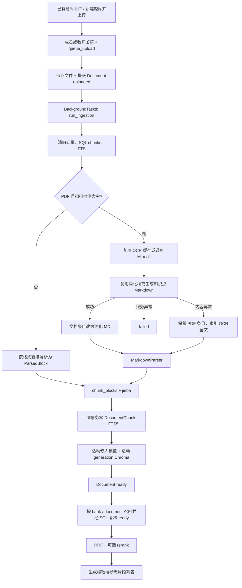

# 出题功能逻辑梳理

> 性质：**当前实现调查**，不是待实现设计，也不代表真实外部服务或端到端质量验收。  
> 调查日期：**2026-11-14**；代码基线：**main / a8c7c65**（完整 HEAD：`a8c7c65a59ff3114879744af9911d7f9d7b2542b`）。  
> 本轮只新建本文，调查知识库入库、检索、参数化与对话出题、审核、结果持久化及前端交付。未修改实现、切换分支或提交，未读取 `.env`、`local_secrets.py` 或运行数据，未调用真实模型、OCR、Redis 或数据库服务。默认参数均指源码默认，不代表部署时没有覆盖。

## 1. 阅读口径与结论

先阅读已有的[知识库模块说明](../design/知识库模块说明.md)、[模型配置来源与普通知识库流程](../design/模型配置来源与普通知识库流程.md)、[扫描 PDF 云端 OCR 策略](../design/扫描PDF云端OCR策略.md)、[智能出题 PRD](../requirements/PRD-智能出题智能体.md)，并参考[教材解析存储对比与按章变式出题评估](教材解析存储对比与按章变式出题评估.md)。已有未跟踪文档仅作为阅读材料保留，未覆盖。以下以当前源码为事实依据，历史设计和测试记录不能代替本次运行验证。

当前“知识库”的资源边界实际是 `Bank → Document → DocumentChunk`，不是独立的知识图谱或教材章节系统。`BankMember` 控制共享资料权限；SQL 切片和 FTS5 保存可检索文本，Chroma 保存同 ID 的向量，Redis 保存进度及 HyDE 等缓存。[models/bank.py:12–83](../../backend/app/models/bank.py#L12)、[db.py:40–48](../../backend/app/db.py#L40)、[documents.py:378–423](../../backend/app/services/documents.py#L378)、[cache.py:10–15](../../backend/app/services/cache.py#L10)。

必须分清两条处理链：**原生文档直接解析**；**扫描 PDF 先 MinerU OCR，再默认生成知识点简化稿**。两者最终进入相同的切块与索引流程，但提供给出题模型的材料可能完全不同。扫描简化提示词明确排除例题、习题、练习、测试和解答，并移除图片引用，不能把扫描教材 ready 等同于原题完整入库。[documents.py:265–372](../../backend/app/services/documents.py#L265)、[knowledge_simplify.py:209–221](../../backend/app/services/knowledge_simplify.py#L209)。

现有文档存在局部滞后，本文按源码更正口径但不改动原文：当前 `hybrid` 使用 `skip_rerank=True`，确实跳过重排；组合创建上传以 `commit=False` 加 `queue_upload` 的提交形成题库、成员、首文档同一 SQL 事务，不能继续描述为先提交空题库。[api/documents.py:213–220](../../backend/app/api/documents.py#L213)、[retrieval.py:141–152](../../backend/app/services/rag/retrieval.py#L141)、[api/banks.py:70–78](../../backend/app/api/banks.py#L70)、[banks.py:161–172](../../backend/app/services/banks.py#L161)、[documents.py:116–130](../../backend/app/services/documents.py#L116)。

## 2. 真实调用链总览

图中入口、后台投递、分流、索引、检索分别对应：[api/documents.py:71–85](../../backend/app/api/documents.py#L71)、[api/banks.py:61–79](../../backend/app/api/banks.py#L61)、[documents.py:237–423](../../backend/app/services/documents.py#L237)、[retrieval.py:97–166](../../backend/app/services/rag/retrieval.py#L97)。图示表达逻辑依赖，不代表 SQL、文件系统和向量存储具有跨存储事务。

## 3. 题库关联、租户归属与权限

| 对象或操作 | 当前行为 | 源码依据 |
| --- | --- | --- |
| 题库资源边界 | `Bank.creator_id` 记录创建者；`BankMember` 以 `(bank_id, user_id)` 唯一关联成员，角色为 creator/editor/readonly，成员须 active | [models/bank.py:12–36](../../backend/app/models/bank.py#L12) |
| 文档与切片 | 文档持有 `bank_id/uploader_id`；切片持有 `bank_id/document_id`，`(document_id, chunk_index)` 唯一。共享资料按题库授权，非仅上传者本人可见 | [models/bank.py:43–83](../../backend/app/models/bank.py#L43)、[api/documents.py:57–68](../../backend/app/api/documents.py#L57) |
| 进入题库 | `resolve_bank_access` 只允许教师、学生；非活动题库或非活动成员返回 404；平台管理员返回 403，没有教学资源权限豁免 | [deps.py:77–100](../../backend/app/deps.py#L77) |
| 读写权限 | creator/editor 可上传、重解析、删除文档；readonly 可看状态、下载、检索；题库设置、成员管理、整库删除要求 creator | [deps.py:48–69](../../backend/app/deps.py#L48)、[deps.py:103–118](../../backend/app/deps.py#L103)、[api/documents.py:71–105](../../backend/app/api/documents.py#L71)、[api/documents.py:147–199](../../backend/app/api/documents.py#L147) |
| 新建与成员 | 只有教师可新建题库及组合创建上传；创建者可添加启用的教师/学生为 editor/readonly；按题库编号加入已经禁用 | [api/banks.py:51–85](../../backend/app/api/banks.py#L51)、[api/banks.py:131–158](../../backend/app/api/banks.py#L131) |
| 文档归属校验 | 状态、下载、重解析等读取路径先鉴权题库，再验证文档属于路径中的题库，否则 404 | [api/documents.py:50–54](../../backend/app/api/documents.py#L50)、[api/documents.py:89–115](../../backend/app/api/documents.py#L89) |
| 检索隔离 | Chroma 按题库建集合、可加 `doc_id` 过滤；FTS 和回 SQL 同时限制题库及可选文档，并要求文档 ready | [vectorstore.py:77–100](../../backend/app/services/rag/vectorstore.py#L77)、[vectorstore.py:138–150](../../backend/app/services/rag/vectorstore.py#L138)、[fts.py:57–73](../../backend/app/services/rag/fts.py#L57)、[retrieval.py:32–73](../../backend/app/services/rag/retrieval.py#L32) |
| 共享资料与个人结果 | 生成批次记录 `user_id/bank_id/document_id`，题目另记 `created_by`；资料共享不意味着生成结果自动共享。结果交付见后文落库与预览说明 | [models/question.py:12–47](../../backend/app/models/question.py#L12)、[generation.py:43–76](../../backend/app/services/generation.py#L43) |

这里的“租户隔离”具体落在账号成员关系与题库资源过滤上；当前这些模型没有独立 `tenant_id`。底层检索函数接受 bank/document ID，本身不接收当前用户，调用者必须先完成鉴权；可见 SQL 字段与 HTTP 依赖分别见上表，不应把 collection 命名本身当作完整授权机制。

## 4. 上传、排队与文档状态

1. `POST /api/banks/{bank_id}/documents` 先完整 `await file.read()`，再调用 `queue_upload`；组合入口 `POST /api/banks/with-document` 同样读取单个文件后创建题库和成员，再交给相同上传服务。普通上传返回 202，组合创建返回 201，均只表示受理。[api/documents.py:71–86](../../backend/app/api/documents.py#L71)、[api/banks.py:61–79](../../backend/app/api/banks.py#L61)。
2. 服务以扩展名允许 PDF/DOCX/XLSX/MD/markdown/TXT；默认上限 200 MiB，拒绝无内容、不支持格式和超限文件。校验发生在完整读入内存之后，不是流式入库或基于内容识别文件类型。[documents.py:35–42](../../backend/app/services/documents.py#L35)、[documents.py:92–103](../../backend/app/services/documents.py#L92)、[config.py:144–148](../../backend/app/config.py#L144)。
3. 文件写入 `upload_path()/{bank_id}/{document_id}{suffix}`，SQL 创建 Document（uploaded、上传者、文件路径），提交后通过 FastAPI `BackgroundTasks` 调用 `run_ingestion`。文件保存早于 SQL 提交，后台执行不属于该 SQL 事务。[documents.py:105–138](../../backend/app/services/documents.py#L105)。
4. 后台新开 `SessionLocal`，检查源文件，再清理旧向量、SQL chunks 与 FTS，然后开始解析；初次上传也会经过清旧步骤。向量清理失败先保留旧 SQL/FTS；清旧成功后不保留一份已发布旧解析版本。[documents.py:209–215](../../backend/app/services/documents.py#L209)、[documents.py:247–263](../../backend/app/services/documents.py#L247)。

| 状态/阶段 | 当前行为 | 源码依据 |
| --- | --- | --- |
| uploaded → parsing | 已存原文件、等待任务；解析开始进度 10 | [documents.py:116–130](../../backend/app/services/documents.py#L116)、[documents.py:260–263](../../backend/app/services/documents.py#L260) |
| ocr（扫描 PDF） | OCR 起始进度 20，分片完成数推进约 20–45；缓存可直接跳过外呼 | [documents.py:270–298](../../backend/app/services/documents.py#L270) |
| chunking | 既包含原生解析完成后的切块，也包含扫描件目录提取、LLM 概括和写入 SQL 切片；不能只理解为本地切字符串 | [documents.py:284–364](../../backend/app/services/documents.py#L284)、[documents.py:365–405](../../backend/app/services/documents.py#L365) |
| embedding → ready | SQL/FTS 提交后向量化，写入 Chroma，最后设置 ready、progress=100、chunk_count=实际切块数 | [documents.py:403–423](../../backend/app/services/documents.py#L403) |
| failed | 失败也设置 progress=100，记录 error_message；因此 progress=100 不等于成功。兜底异常回滚当前 SQL 事务后尝试落失败状态 | [documents.py:159–167](../../backend/app/services/documents.py#L159)、[documents.py:429–447](../../backend/app/services/documents.py#L429) |

SQL 是进度真相：`_set_stage` 先提交 Document，再写 Redis `ingest:task:{document_id}`，默认 TTL 7200 秒；Redis 进度写失败仅记录安全日志，继续处理。轮询详情直接读 SQL，响应包含 status/stage/progress/chunk_count/ocr_status/error_message，不包含内部 storage_path、ocr_result_path 或 text_source。[documents.py:141–156](../../backend/app/services/documents.py#L141)、[config.py:103–105](../../backend/app/config.py#L103)、[api/documents.py:31–47](../../backend/app/api/documents.py#L31)、[api/documents.py:89–96](../../backend/app/api/documents.py#L89)。

## 5. 原生文档：直接解析，不经过知识点简化

`run_ingestion` 对非扫描 PDF 及其他支持格式直接调用 `get_parser(...).parse(...)`，标记 `ocr_status=not_needed/text_source=native`；随后切块和索引。没有自动调用 `knowledge_simplify` 的通用步骤。[documents.py:365–372](../../backend/app/services/documents.py#L365)。

| 格式 | 解析内容与中间元数据 | 能力边界及源码 |
| --- | --- | --- |
| 原生文字 PDF | PyMuPDF 逐页 `get_text("text")`；非空页产出 ParsedBlock，meta 有 `page`（从 1 开始）、source | 不解析独立图像或公式实体，也不按页混合 OCR；[parsing/pdf.py:16–27](../../backend/app/services/parsing/pdf.py#L16) |
| DOCX | 先遍历正文段落，再遍历表格逐行拼接 ` | `；meta 为正文 index 或 table/row | 不是正文与表格原有穿插顺序的统一版面 IR，未提取图形或公式对象；[parsing/docx.py:10–27](../../backend/app/services/parsing/docx.py#L10) |
| XLSX | openpyxl 的 read_only/data_only 模式；首行有任意内容即作为表头，后续行转成“表头: 值”；meta 含 sheet/row/source | 读取缓存值，不计算 Excel 公式；旧 `.xls` 上传不支持；[parsing/excel.py:10–36](../../backend/app/services/parsing/excel.py#L10)、[parsing/base.py:58–76](../../backend/app/services/parsing/base.py#L58)、[documents.py:35–42](../../backend/app/services/documents.py#L35) |
| Markdown | 按 `#` 到 `######` 标题 flush 正文，标题栈拼成 `section`，只为有正文的块输出 ParsedBlock | 标题关系以字符串保留，没有章/节实体和页码映射；[parsing/markdown.py:7–35](../../backend/app/services/parsing/markdown.py#L7) |
| TXT | 按空行分段；超过 1000 字符的段落按行拆，meta 为 source | 单个长行仍可能很长；UTF-8 解码忽略错误；[parsing/txt.py:6–24](../../backend/app/services/parsing/txt.py#L6) |

`ParsedBlock` 只有 `text/meta`。`parsing/base.py` 确实保留 `OCRNotConfigured` 占位引擎，普通 PdfParser 也保留平均每页不足 20 字符时调用该协议的分支；但题库主路径在之前已用 MinerU 扫描检测分流，不能据该占位类断言当前扫描件尚未接 OCR。[parsing/base.py:14–40](../../backend/app/services/parsing/base.py#L14)、[parsing/pdf.py:8–22](../../backend/app/services/parsing/pdf.py#L8)、[documents.py:265–272](../../backend/app/services/documents.py#L265)。

## 6. 扫描 PDF：检测 → OCR → 知识点简化

### 6.1 扫描判断与 OCR

`mineru.detect_scanned_pdf` 提取所有页面文本，零页返回非扫描；总字符少于 50，或平均每页少于 30 字符，即判为扫描。这是整份 PDF 的文本量启发式，不检测图像、乱码或每页质量；混合扫描 PDF 不能据此保证每一页都被 OCR。[mineru.py:111–121](../../backend/app/services/mineru.py#L111)。

| 步骤 | 实际执行及边界 | 源码依据 |
| --- | --- | --- |
| 凭据来源 | 上传/重解析在请求时取得本次操作者的个人 MinerU Token、DeepSeek Key；无个人值取部署默认，并传入后台任务。不会自动借用原上传者的个人凭据 | [api/documents.py:80–85](../../backend/app/api/documents.py#L80)、[api/documents.py:110–115](../../backend/app/api/documents.py#L110)、[model_settings.py:21–33](../../backend/app/services/model_settings.py#L21) |
| 顶层 OCR 缓存 | 先要求存在有效来源的 Token 值，再检查 `ocr_path()/{doc_id}/full.md` 是否存在；存在即读回，`ocr_task_id` 写固定值 `local` | [documents.py:272–284](../../backend/app/services/documents.py#L272) |
| 云端调用 | MinerU API v4、vlm；申请上传 URL 时启用公式/表格、中文和 `is_ocr=True`，PUT 上传，轮询批次，下载 ZIP 解压，读取 full.md | [mineru.py:20–25](../../backend/app/services/mineru.py#L20)、[mineru.py:172–184](../../backend/app/services/mineru.py#L172)、[mineru.py:233–291](../../backend/app/services/mineru.py#L233) |
| 大 PDF | 单文件仍检查 200 MiB；超过 200 页改走分片，不是整本直接拒绝。首片 15 页，其余按 `max(30, ceil(剩余页数/15))` 页分，目标总片数不超过 16 | [mineru.py:22–28](../../backend/app/services/mineru.py#L22)、[mineru.py:240–244](../../backend/app/services/mineru.py#L240)、[mineru.py:294–309](../../backend/app/services/mineru.py#L294) |
| 分片缓存和合并 | 分片 PDF 写到 `parts/part_XX.pdf`；已有 `part_XX/full.md` 直接复用，缺片一起提交云端任务，按片序合并成顶层 full.md | [mineru.py:312–326](../../backend/app/services/mineru.py#L312)、[mineru.py:382–443](../../backend/app/services/mineru.py#L382) |
| 超时和重试 | 单批 OCR 轮询上限 600 秒、间隔 5 秒；分片总轮询上限按缺片数计算，最高 3600 秒；下载与上传存在三次有限重试 | [mineru.py:24–25](../../backend/app/services/mineru.py#L24)、[mineru.py:261–275](../../backend/app/services/mineru.py#L261)、[mineru.py:329–379](../../backend/app/services/mineru.py#L329)、[mineru.py:416–438](../../backend/app/services/mineru.py#L416) |

分片计划的尺寸由总页数计算，没有把每片页数再次约束为不超过 200；特别大的 PDF 不能仅凭存在分片流程就推定一定满足供应商单片限制。此为计划公式与 MAX_PAGES 的静态比较结论，未用真实文件验证。[mineru.py:22–28](../../backend/app/services/mineru.py#L22)、[mineru.py:294–309](../../backend/app/services/mineru.py#L294)。

### 6.2 简化步骤与信息损失

1. 清洗 OCR Markdown：表格文本扁平化，去 Markdown 图片引用及 `<html>…</html>` 段。[knowledge_simplify.py:40–60](../../backend/app/services/knowledge_simplify.py#L40)。
2. 从清洗后开头最多 24000 字符提取三级目录；通过章/节标题在全文的最后匹配位置定位正文，标题匹配忽略空白。单节截取上限 20000 字符，单章约束 90000 字符；节标题失败则按知识点关键词开窗，实际只取合并窗口列表第一项；未定位到的章节/小节不具备完整正文保证。[knowledge_simplify.py:23–27](../../backend/app/services/knowledge_simplify.py#L23)、[knowledge_simplify.py:193–206](../../backend/app/services/knowledge_simplify.py#L193)、[knowledge_simplify.py:290–371](../../backend/app/services/knowledge_simplify.py#L290)。
3. 每批最多 4 节或约 64000 输入字符，最多 4 路并发概括，显式传入本次操作者 Key。提示词要求概括定义、定理、方法与每知识点 2–4 个核心公式，不照抄段落、不保留公式编号、不引用图片，排除例题、习题、解答；这是生成指令，不是内容完整性或数学正确性的程序校验。[knowledge_simplify.py:209–223](../../backend/app/services/knowledge_simplify.py#L209)、[knowledge_simplify.py:377–423](../../backend/app/services/knowledge_simplify.py#L377)、[knowledge_simplify.py:470–510](../../backend/app/services/knowledge_simplify.py#L470)。
4. 对漏写小节补写一次，仍缺失则组装占位说明；最终生成带目录的知识点 Markdown。因此即使文档随后 ready，也可能含“本节内容未能生成”的占位文本。[knowledge_simplify.py:438–459](../../backend/app/services/knowledge_simplify.py#L438)、[knowledge_simplify.py:512–549](../../backend/app/services/knowledge_simplify.py#L512)。

| 简化结果 | 当前文档条目/索引对象 | 源码依据 |
| --- | --- | --- |
| 成功，或命中简化缓存 | 写 `{doc_id}_simplified.md`，把同一 Document 的名称改为 `*_知识点简化版.md`、format 改 MD、大小和 storage_path 指向简化稿；原 PDF 留磁盘，索引简化 Markdown | [documents.py:306–329](../../backend/app/services/documents.py#L306)、[documents.py:346–364](../../backend/app/services/documents.py#L346) |
| LLM 服务异常 `SimplifyServiceError` | 明确失败并提示检查凭据、额度、连接，不自动改索引 OCR 原文 | [knowledge_simplify.py:77–126](../../backend/app/services/knowledge_simplify.py#L77)、[documents.py:332–337](../../backend/app/services/documents.py#L332) |
| 目录/内容等其他异常 | 将 OCR 全文写入同名 simplified 路径供解析，但保留 PDF 的文档名称、format、storage_path；检索用 OCR 全文，下载仍为 PDF | [documents.py:338–364](../../backend/app/services/documents.py#L338) |

当前下载路由始终读取 Document 的**当前** storage_path；简化成功后下载的是简化 MD，不是原 PDF。只有重解析辅助函数按文档命名后缀与固定路径寻找原 PDF 并恢复其属性；原 PDF 缺失时不会强制失败，会按当前 MD 重解析。[api/documents.py:147–169](../../backend/app/api/documents.py#L147)、[documents.py:65–77](../../backend/app/services/documents.py#L65)、[documents.py:218–234](../../backend/app/services/documents.py#L218)。

### 6.3 缓存与异常边界

OCR 缓存以 doc_id/分片路径和文件存在为复用条件；简化缓存只检查文件存在、以 `# 《` 开头且前 300 字含“知识点简化版”。没有对源文件摘要、解析器版本、LLM 模型或提示词建立缓存指纹，重解析不等于强制重做 OCR/简化；缓存存在也不证明内容完整。[documents.py:277–284](../../backend/app/services/documents.py#L277)、[documents.py:312–318](../../backend/app/services/documents.py#L312)、[mineru.py:392–401](../../backend/app/services/mineru.py#L392)。

OCR 异常使用 operation/provider_code/http_status/part_index 等受限字段描述提交、上传、轮询、解析、下载阶段；入库层区分鉴权、限流、超时、连接等类别并落 failed，不直接回显任意供应商错误文本或签名地址。连接探测只验证连接/鉴权，不能证明实际解析成功。[mineru.py:32–108](../../backend/app/services/mineru.py#L32)、[mineru.py:124–162](../../backend/app/services/mineru.py#L124)、[documents.py:170–206](../../backend/app/services/documents.py#L170)、[documents.py:299–304](../../backend/app/services/documents.py#L299)。

## 7. 切块、元数据与存储

### 7.1 两种切块策略

| 策略 | 选择条件与算法 | 边界及源码 |
| --- | --- | --- |
| 练习卷题号切块 | 全部 ParsedBlock 中至少 5 行命中行首数字题号规则，进入 exam 模式；中文大题标题作为 section；“参考答案”之后标 answer，其余主要标 question；超长内容按滑窗拆 | 启发式识别，不是可靠的逐题结构化解析；长题可拆成多块、题目与答案没有一对一外键。原 ParsedBlock 的页码/标题元信息不继承；[chunking.py:17–33](../../backend/app/services/rag/chunking.py#L17)、[chunking.py:36–98](../../backend/app/services/rag/chunking.py#L36) |
| 通用顺序聚合 | 非 exam 模式按设置的字符长度顺序聚合；section 或页码加到正文前缀；满块时用上一文本块末尾作 overlap | 默认 chunk_size=500、overlap=100；不是 token 上限，单个超长 block 不强制拆小，多个章节可进入同一 chunk；[chunking.py:101–134](../../backend/app/services/rag/chunking.py#L101)、[config.py:163–164](../../backend/app/config.py#L163) |

通用模式在判断是否 flush 旧 buffer 之前先更新 `cur_meta.section`，所以旧正文块的 section 可能被当前新标题覆盖；即使没有超限，多个章节也可聚到一起。这里是逐行控制流推导，未运行样例；它说明不能把 section 当作精确章节归属。[chunking.py:107–125](../../backend/app/services/rag/chunking.py#L107)。

### 7.2 持久化与字段

| 存储 | 保存内容及关联 | 源码依据 |
| --- | --- | --- |
| 上传目录 | 默认 `backend/data/uploads/{bank_id}/`；原文件按 doc_id 命名；扫描简化稿同目录 `{doc_id}_simplified.md`。可配置目录，Document 路径位于 BASE_DIR 内时存相对路径，否则存绝对路径 | [config.py:11](../../backend/app/config.py#L11)、[config.py:144–181](../../backend/app/config.py#L144)、[documents.py:105–125](../../backend/app/services/documents.py#L105)、[documents.py:309](../../backend/app/services/documents.py#L309) |
| OCR 目录 | 默认 `backend/data/ocr/{doc_id}/`；含顶层 full.md、分片 PDF 和分片 OCR 产物，另保存最近批次编号辅助诊断 | [mineru.py:221–230](../../backend/app/services/mineru.py#L221)、[mineru.py:312–358](../../backend/app/services/mineru.py#L312)、[mineru.py:382–443](../../backend/app/services/mineru.py#L382) |
| SQL Document | 文件当前路径、格式、大小、扫描判断、页数、阶段/进度/错误、OCR 字段、bank_id、uploader_id | [models/bank.py:43–64](../../backend/app/models/bank.py#L43) |
| SQL DocumentChunk | ID、bank_id、document_id、顺序、chunk_type、section、text、jieba tokens、char_count。没有独立章 ID、页码范围、图片或公式实体 | [models/bank.py:67–83](../../backend/app/models/bank.py#L67) |
| SQLite FTS5 | chunk_id/bank_id/document_id 是 UNINDEXED 关联列，tokens 走 unicode61；服务先用 jieba.cut_for_search 预分词 | [db.py:40–48](../../backend/app/db.py#L40)、[tokenizer.py:14–22](../../backend/app/services/rag/tokenizer.py#L14) |
| Chroma | PersistentClient，默认 `backend/data/chroma`；collection 为 `kb_{规范化bank_id}`，非空 generation 再追加后缀；cosine 距离 | [vectorstore.py:62–100](../../backend/app/services/rag/vectorstore.py#L62)、[config.py:144](../../backend/app/config.py#L144) |
| Chroma 内容 | ID 与 SQL chunk ID 一致，存向量、全文及 chunk_id/bank_id/doc_id/doc_name/chunk_index/chunk_type/section；不存完整 ParsedBlock.meta | [documents.py:386–417](../../backend/app/services/documents.py#L386)、[vectorstore.py:104–135](../../backend/app/services/rag/vectorstore.py#L104) |
| Redis | 入库/生成进度、用户生成锁、HyDE 缓存；不能代替长期教材正文或索引 | [cache.py:10–15](../../backend/app/services/cache.py#L10)、[documents.py:149–154](../../backend/app/services/documents.py#L149)、[hyde.py:41–59](../../backend/app/services/rag/hyde.py#L41) |

SQL 默认 URL 是相对工作目录的 `sqlite:///./data/mathcraft.db`，由 SQLAlchemy 直接使用；从 backend 启动时落在 backend/data，不能无条件把任意进程的数据库都写成固定路径。本文没有读取部署实际值。[config.py:99–105](../../backend/app/config.py#L99)、[db.py:18–22](../../backend/app/db.py#L18)。

入库先给每个 chunk 分配业务 ID，SQL chunk 与 FTS 在同一 Session 事务写入并提交；之后才生成向量、写 Chroma、发布 ready。嵌入每批 32 条，校验响应数量、下标顺序、数值有限及同次调用维度一致；模型使用平台活动快照。[documents.py:378–423](../../backend/app/services/documents.py#L378)、[embeddings.py:60–117](../../backend/app/services/rag/embeddings.py#L60)。

因此失败文档仍可能留有 SQL/FTS 或部分向量，`chunk_count=0` 也不能证明没有切片。检索靠 ready 作为发布门槛，重解析先清旧数据再重建；不是多版本解析结果的原子替换。[documents.py:209–215](../../backend/app/services/documents.py#L209)、[documents.py:229–234](../../backend/app/services/documents.py#L229)、[documents.py:403–444](../../backend/app/services/documents.py#L403)、[retrieval.py:32–94](../../backend/app/services/rag/retrieval.py#L32)。

## 8. 从索引到检索结果

### 8.1 HTTP 检索入口

`POST /api/banks/{bank_id}/search` 对活动成员开放，请求包含 query（1–512 字符）、top_k（1–50，默认 6）、可选 document_id、mode（dense/sparse/hybrid/hybrid_rerank，默认最后一个）。入口固定运行时快照；document_id 不单独查询其存在性，最终由检索过滤限定本题库 ready 内容，可能只返回空结果。[schemas/bank.py:30–38](../../backend/app/schemas/bank.py#L30)、[api/documents.py:192–234](../../backend/app/api/documents.py#L192)。

| 路径 | 调用与结果 | 源码依据 |
| --- | --- | --- |
| dense | `embed_one(query) → dense_search → vectorstore.search`；在题库 collection 内按可选 doc_id 查；回 SQL 复核 ready、题库和文档范围，过滤失效候选后如不足 top_k，翻倍取候选补召回 | [api/documents.py:225–230](../../backend/app/api/documents.py#L225)、[retrieval.py:32–94](../../backend/app/services/rag/retrieval.py#L32)、[vectorstore.py:138–169](../../backend/app/services/rag/vectorstore.py#L138) |
| sparse | jieba 分词后用带引号词项 OR 构建 FTS MATCH；连接 SQL chunk/document 核对关联与 ready；按 BM25 排序，返回分数取反；HTTP 结果只给 chunk_id/bm25 | [fts.py:35–75](../../backend/app/services/rag/fts.py#L35)、[api/documents.py:232–234](../../backend/app/api/documents.py#L232) |
| hybrid | `hybrid_retrieve(...skip_rerank=True)`，召回并 RRF 融合，reranked 为空；HTTP top_k 不传入两路召回或融合上限 | [api/documents.py:213–220](../../backend/app/api/documents.py#L213)、[retrieval.py:111–159](../../backend/app/services/rag/retrieval.py#L111) |
| hybrid_rerank | 混合融合后调用 rerank，HTTP top_k 传为 rerank_top_k，仍受融合候选总量限制；响应含 hyde/dense/sparse/fused/reranked | [api/documents.py:213–223](../../backend/app/api/documents.py#L213)、[retrieval.py:139–159](../../backend/app/services/rag/retrieval.py#L139) |

### 8.2 混合检索细节

默认 dense_top_k=20、sparse_top_k=20、fused_top_k=12、rerank_top_k=6、rrf_k=60。先用 HyDE 文本（如有，否则原 query）生成稠密向量；FTS 始终使用原 query；两路候选再次回 SQL 过滤，然后以 chunk_id 去重，每条命中累计 `1/(rrf_k + rank)`。重排使用原 query 与 SQL 正文，得到最终片段。[config.py:156–164](../../backend/app/config.py#L156)、[retrieval.py:17–29](../../backend/app/services/rag/retrieval.py#L17)、[retrieval.py:111–159](../../backend/app/services/rag/retrieval.py#L111)。

注意 `_rrf_fuse` 自身先按全局 `settings.fused_top_k` 截断，调用者传更大的 fused_top_k 不能突破该上限。这是内部参数实现边界，不是“请求多少必返回多少”的检索保证。[retrieval.py:17–29](../../backend/app/services/rag/retrieval.py#L17)、[retrieval.py:111–139](../../backend/app/services/rag/retrieval.py#L111)。

| 故障 | 当前边界 | 源码依据 |
| --- | --- | --- |
| 嵌入失败 | 混合链捕获 EmbeddingError，允许只走稀疏；直接 dense 则由 HTTP 转 503 EMBEDDING_UNAVAILABLE | [retrieval.py:119–123](../../backend/app/services/rag/retrieval.py#L119)、[api/documents.py:201–206](../../backend/app/api/documents.py#L201) |
| 稀疏异常 | 混合链捕获异常视为空，可只走稠密；两个候选列表都空就返回空，不另外报告检索降级标记 | [retrieval.py:125–159](../../backend/app/services/rag/retrieval.py#L125) |
| 重排失败 | RerankError 时返回融合前序列前 rerank_k 条；非法结果下标、重复下标、非有限分数也归入 RerankError | [retrieval.py:141–152](../../backend/app/services/rag/retrieval.py#L141)、[rerank.py:29–44](../../backend/app/services/rag/rerank.py#L29) |
| Chroma 故障 | VectorStoreError 不在混合链的 EmbeddingError 捕获范围内，会向上失败；HTTP 检索转 503 VECTOR_STORE_UNAVAILABLE。只有不存在的集合按空处理 | [vectorstore.py:91–101](../../backend/app/services/rag/vectorstore.py#L91)、[retrieval.py:119–130](../../backend/app/services/rag/retrieval.py#L119)、[api/documents.py:201–206](../../backend/app/api/documents.py#L201) |

## 9. 知识库怎样供生成端使用（仅交接边界）

本节解释知识库材料的提供方式；参数出题、对话编排、审核与结果交付见第 13 节及后续章节。

| 交接点 | 已核实行为 | 源码依据 |
| --- | --- | --- |
| 输入是单文档 | GenerateStartBody 提供一个 bank_id/document_id（兼容 kb_id/doc_id）；生成入口核对成员、文档归属和 ready。这里不是多文档集合输入 | [schemas/api.py:14–26](../../backend/app/schemas/api.py#L14)、[api/generate.py:20–40](../../backend/app/api/generate.py#L20) |
| HyDE | 有非空 scope 和 Key 才生成假设教材段落；缓存摘要来自 bank/document/scope/difficulty，TTL 3600 秒；LLM 生成失败返回 None。缓存 Redis 读写异常不在 generate_hyde 的捕获范围内 | [hyde.py:16–59](../../backend/app/services/rag/hyde.py#L16) |
| 每题型检索 | query 为文档名去扩展名 + 可选 scope + 中文题型；`retrieve_for_generation(bank_id, query, document_id, hyde_text)` 调混合检索，返回 reranked；无片段则停止该生成路径 | [question_gen.py:432–444](../../backend/app/services/rag/question_gen.py#L432)、[retrieval.py:163–166](../../backend/app/services/rag/retrieval.py#L163) |
| 材料传给模型 | `_build_context` 将命中正文加“片段序号、section 或 chunk_type”标签，拼进出题用户提示词；同一题型的各小批复用本次检索的 hits，不是把整本文档全部塞给模型 | [question_gen.py:240–246](../../backend/app/services/rag/question_gen.py#L240)、[question_gen.py:295–303](../../backend/app/services/rag/question_gen.py#L295)、[question_gen.py:442–474](../../backend/app/services/rag/question_gen.py#L442) |
| 范围约束 | scope 进入 query 和提示词；Chroma/FTS 只有文档级过滤，没有 chapter_id、页码范围或 section 的硬过滤。仅写“第三章”不能保证只引用第三章 | [question_gen.py:275](../../backend/app/services/rag/question_gen.py#L275)、[question_gen.py:432–440](../../backend/app/services/rag/question_gen.py#L432)、[vectorstore.py:148](../../backend/app/services/rag/vectorstore.py#L148)、[fts.py:57–70](../../backend/app/services/rag/fts.py#L57) |
| 原题计数 | original 模式按 Chroma 中 chunk_type=question 与大题 section 关键词计数；没有 question chunks 时返回 None 并跳过检查。长题切成多块也可能增加计数，不等于完整原题库存量 | [vectorstore.py:192–209](../../backend/app/services/rag/vectorstore.py#L192)、[question_gen.py:207–233](../../backend/app/services/rag/question_gen.py#L207)、[question_gen.py:426–430](../../backend/app/services/rag/question_gen.py#L426)、[chunking.py:52–59](../../backend/app/services/rag/chunking.py#L52) |
| 来源追踪缺口 | Question 模型预留 retrieval_chunk_ids，但 persist_batch 没有写入；当前仅保存 bank/document、参数和 HyDE 等，缺少“每题 → 本次实际切片 → 原页码/原题”的完整持久证据链 | [models/question.py:12–47](../../backend/app/models/question.py#L12)、[generation.py:32–79](../../backend/app/services/generation.py#L32) |

题库检索 HTTP 入口自身不会自动生成 HyDE；HyDE 由生成编排入口取得后传入底层检索。默认生成检索最终约取 6 个片段，没有按题量扩大候选的实际参数传递；不能仅凭 query 构造处的注释理解为覆盖整章或整书。[api/documents.py:213–220](../../backend/app/api/documents.py#L213)、[generation.py:141–166](../../backend/app/services/generation.py#L141)、[question_gen.py:432–442](../../backend/app/services/rag/question_gen.py#L432)、[retrieval.py:111–114](../../backend/app/services/rag/retrieval.py#L111)、[retrieval.py:163–166](../../backend/app/services/rag/retrieval.py#L163)。

## 10. 活动模型、索引重建与版本边界

入库和检索通过 `with_snapshot/use_snapshot` 固定一次调用的 RuntimeConfig 与 generation；默认模型为 BAAI/bge-m3 和 BAAI/bge-reranker-v2-m3，平台活动配置可覆盖模型/地址/凭据。个人 DeepSeek/MinerU 与平台嵌入/重排是不同配置来源。这里只追踪代码优先级，没有读取真实配置值。[rag_runtime.py:15–82](../../backend/app/services/rag_runtime.py#L15)、[documents.py:237–241](../../backend/app/services/documents.py#L237)、[embeddings.py:64–72](../../backend/app/services/rag/embeddings.py#L64)、[rerank.py:20–25](../../backend/app/services/rag/rerank.py#L20)、[model_settings.py:21–33](../../backend/app/services/model_settings.py#L21)。

| 阶段 | 当前行为 | 源码依据 |
| --- | --- | --- |
| 保存嵌入变更 | 模型或 URL 改变时写 pending；只更新活动嵌入凭据或重排配置可供后续请求使用；revision 检测配置冲突 | [rag_settings.py:63–67](../../backend/app/services/rag_settings.py#L63)、[rag_settings.py:135–165](../../backend/app/services/rag_settings.py#L135) |
| 排队重建 | 必须有 pending；活动题库存在非 ready/failed 文档时拒绝 RAG_INGESTION_BUSY；queued/running 期间资料变更门禁拒绝 RAG_REBUILD_BUSY | [rag_settings.py:46–60](../../backend/app/services/rag_settings.py#L46)、[rag_settings.py:199–218](../../backend/app/services/rag_settings.py#L199) |
| 重建正文来源 | 读取活动题库 ready 文档的 SQL chunks，核对数量，每批 32 条重新嵌入，保留 ID、chunk_index、类型、section；不重新 OCR、简化或改写 SQL/FTS | [rag_settings.py:241–278](../../backend/app/services/rag_settings.py#L241) |
| 切换/失败 | 全部成功后一次 SQL 提交活动配置和 generation；旧集合保留供在途请求；失败不切换，保留旧服务与 pending，记录脱敏错误 | [rag_settings.py:279–301](../../backend/app/services/rag_settings.py#L279) |

这里的 generation 是**向量索引代际**，不是文档解析版本或可追溯教材版本。旧集合及失败新集合没有在上述流程中自动回收；只能依据活动指针解释当前索引，不能把磁盘残留当作已发布资料。[rag_runtime.py:31–36](../../backend/app/services/rag_runtime.py#L31)、[rag_settings.py:247–301](../../backend/app/services/rag_settings.py#L247)。

## 11. 重解析、删除与恢复限制

| 场景 | 当前行为及重要限制 | 源码依据 |
| --- | --- | --- |
| 重解析 | 仅 ready/failed 可受理，重置 uploaded/进度/错误和计数字段，保留 OCR/简化缓存；异步任务执行时先删旧索引。旧资料在重解析期间不再符合 ready 检索门槛，没有“新版本失败仍继续用旧解析版本”的发布机制 | [api/documents.py:99–116](../../backend/app/api/documents.py#L99)、[documents.py:209–234](../../backend/app/services/documents.py#L209)、[documents.py:260](../../backend/app/services/documents.py#L260)、[retrieval.py:53–58](../../backend/app/services/rag/retrieval.py#L53) |
| 服务重启 | FastAPI 进程内任务不自动恢复；启动把 uploaded/parsing/ocr/chunking/embedding 文档标 failed，提示重新解析；重建 queued/running 也改 failed，不自动切换或续跑 | [main.py:48–75](../../backend/app/main.py#L48)、[rag_settings.py:304–313](../../backend/app/services/rag_settings.py#L304) |
| 删除文档 | 门禁写锁内重新验证操作者账号版本和成员权限；清理 SQL/FTS/chunks、该文档的所有用户题目及相关收藏、批次；删活动向量成功后提交 SQL，最后 unlink 当前 storage_path | [banks.py:27–46](../../backend/app/services/banks.py#L27)、[banks.py:59–96](../../backend/app/services/banks.py#L59)、[banks.py:213–251](../../backend/app/services/banks.py#L213) |
| 整库删除 | 要求当前创建者；清理库内题目/收藏、FTS、文档、成员，题库 status=deleted，删除活动 collection，最后删除各文档当前 storage_path；函数未显式删除 GenerationBatch 行，不能与单文档删除等同描述 | [banks.py:175–210](../../backend/app/services/banks.py#L175)、[models/question.py:12–24](../../backend/app/models/question.py#L12) |
| 跨存储失败 | 向量失败回滚 SQL 并保留文件；向量成功而 SQL 提交失败仍可留下 SQL/向量不一致；文件清理失败被捕获。只针对 SQLite BUSY/LOCKED 做最多三次事务尝试，其他错误不据此重试 | [banks.py:59–96](../../backend/app/services/banks.py#L59)、[banks.py:175–180](../../backend/app/services/banks.py#L175)、[banks.py:213–218](../../backend/app/services/banks.py#L213) |
| 派生物残留 | 删除只 unlink 当前 storage_path，没有在这些服务中遍历回收 OCR 目录、简化后的原 PDF、旧 generation 集合或对应 Redis 进度/HyDE 缓存；数据库记录删除不代表所有派生文件已擦除 | [banks.py:191–210](../../backend/app/services/banks.py#L191)、[banks.py:231–251](../../backend/app/services/banks.py#L231)、[documents.py:65–77](../../backend/app/services/documents.py#L65)、[mineru.py:382–443](../../backend/app/services/mineru.py#L382) |

“删除共享资料”的影响跨越上传者本人：文档关联题目、收藏和批次按 document_id 删除，并未附加当前用户过滤。这与共享资料删除的实现一致，但后续产品说明应明确，不能描述为仅移除某人的个人文件。[banks.py:234–241](../../backend/app/services/banks.py#L234)。

## 12. 核心限制与后续讨论入口

以下均为调查发现或基于已列代码的推导，不是本轮实施任务：

- **扫描稿和原生稿的信息保留不同。** 扫描简化默认排除原题/解答、图像引用，原生解析不走简化；不能把二者统称为“教材原文全部向量化”。第 5、6 节给出解析和提示词的源码证据。
- **没有严格章节/页码范围契约。** PDF 页码主要进入正文前缀，ParsedBlock 的其他 meta 大量未落库；section 可跨块或被覆盖。当前不能保证“第 40–60 页/第三章”硬约束。第 7 节及第 9 节给出字段与检索条件。
- **ready 是入库发布状态，不是语料完整性或出题质量保证。** 简化可含占位小节，单题/答案未结构化关联；索引查询可降级且没有完整降级标记。第 6、7、8 节给出对应分支。
- **检索依据有限且不可完整追溯。** 默认最终片段数约 6，同题型小批共用片段；没有来源页码/原题实体和已持久化的每题命中切片链。第 9 节给出调用、上下文和存储依据。
- **重解析是覆盖式处理，缓存不是任务检查点。** 没有解析版本发布、内容/模型指纹或自动重启续跑；索引重建 generation 不能替代教材版本。第 6.3、10、11 节给出实现边界。
- **SQL、Chroma、文件系统不原子。** ready 过滤避免部分数据对外发布，但不能自动修复所有跨存储失败与清理残留。第 4、7、11 节给出提交顺序与异常处理。

若后续按章变式出题需要调整，优先讨论原文与摘要的独立保留、稳定章节/页码元数据、来源引用和缓存失效；这些是依据本调查提出的讨论方向，本文未实现或承诺交付。生成编排与审核策略的现状见后文。

## 13. 参数面板与出题接口

前端参数面板调用 AppContext.runGenerate()，提交当前题库、一个文档、选中的题型与每种数量、难度、可选范围，以及预览中已有题干。当前前端固定提交 source_mode=variant_data。每种题型数量上限为 20；参数化接口允许 scope 为空，与对话出题的必填要求不同。

- 前端调用：[AppContext.tsx](../../frontend/src/store/AppContext.tsx#L665)。
- 请求契约：[api.py](../../backend/app/schemas/api.py#L14)。

主要接口：

| 接口 | 行为 |
| --- | --- |
| POST /api/generate/start | 校验资源与模型凭据，在 SQL 用户门禁内受理持久任务，再交 FastAPI BackgroundTasks 执行；可选 request_id 支持同账号同参数幂等重放 |
| GET /api/generate/requests/{request_id} | 仅在当前账号内找回原任务，恢复丢失的启动响应 |
| POST /api/generate/cancel/{task_id} | 幂等取消指定任务；运行中返回 202/canceling，后台工作退出后成为 canceled |
| GET /api/generate/progress/{task_id} | 校验任务用户归属，返回阶段、进度、完成标志、错误、批次、题目及审核统计 |
| POST /api/generate | 同步生成路径，也走生成、审核、落库；原题不足返回 422 NEED_CONFIRM |
| GET /api/generate/batches/latest | 取当前用户最近一个已完成批次，可按题库与文档过滤，用于恢复预览 |

异步任务顺序为 SQL 认领 → build_params → get_hyde → generate_questions → review_questions → SQL 原子提交批次、题目和终态 → 执行退出。进度新增 status、execution_finished；done 仅在业务终态与执行退出均成立时为真。前端约每 500 毫秒轮询一次，网络故障继续查询原任务，不重复发起生成。

后台任务属于当前服务进程，不是持久化消息队列。互斥由 SQL 持久任务及执行退出事实保证；Redis 使用 120 秒辅助租约，只有相同 task/run token 能续租或释放。取消中的任务仍占用门禁，直到已启动模型调用及线程工作退出。一键清空会等待取消收尾，并删除当前预览和本任务已提交但尚未展示的题目；具体异常与恢复边界见[快速出题取消与清空](../implementation/快速出题取消与清空.md)。同步入口和对话入口不复用参数化任务门禁。

来源：[generate.py](../../backend/app/api/generate.py#L43)、[generation.py](../../backend/app/services/generation.py#L134)、[acquire_lock](../../backend/app/services/generation.py#L238)。

## 14. 对话 Agent：模式、状态与需求收集

当前 Agent 由后端固定业务编排，模型在明确的阶段参与意图判断、字段抽取、考点规划、命题、评审与解题。聊天路由通过 SKILLS 注册表分发，没有动态技能安装或任意工具自主执行接口。

| 模式 | 标识 | 执行路径及结果 |
| --- | --- | --- |
| 快速出题 | generate | 槽位收集完整后调用共享生成核心，再经统一审核、落库 |
| 创新命题 | creative | 固定第一种题型 1 道、首次生成强制 new，添加创新约束及图片结构描述；后续复用审核 |
| 知识答疑 | qa | 检索当前文档，结合最近对话回答并提示文档、章节；不生成题目批次 |
| 数据管理 | data | 模型转结构化 DSL，受限查询本人题目、收藏、试卷、空间等；删除收藏或试卷、修改试卷名需要确认 |

来源：[skills.py](../../backend/app/services/rag/skills.py#L37)、[qa.py](../../backend/app/services/rag/qa.py#L24)、[data_agent.py](../../backend/app/services/rag/data_agent.py#L221)。

### 会话与显式模式选择

创建会话时，后端确认用户是题库成员、所选文档属于该题库且已 ready。ChatSession 固定记录 user_id、bank_id、document_id。每次发送消息继续检查当前用户、会话归属及题库访问权限。

模式以用户分段控制器的显式选择为准。意图检测先用关键词，必要时询问模型；高置信度不匹配时返回 mode_mismatch 和建议模式，保存待续文字与图片。用户紧接切换后可以接续此前请求；新的普通消息会替换旧待续内容。切换模式会清理旧槽位。

会话槽位保存在 Redis，SQL 的 slot_state_json 作为快照；Redis 槽位丢失时可回退 SQL。消息历史写入 ChatMessage。模式和待续请求主要存在 Redis，不能将槽位快照恢复等同为所有会话状态完整恢复。

来源：[chat.py](../../backend/app/api/chat.py#L60)、[发送消息与模式控制](../../backend/app/api/chat.py#L110)、[聊天模型](../../backend/app/models/chat.py#L12)。

### 快速出题的槽位检查

抽取器从当前消息及近期历史提取结构化字段；带图片时发送多模态 content。最近历史传入路由最多 6 条，抽取器实际使用最后 4 条。当前快速出题必须明确：

1. 题型：single、multiple、judge、blank、compute、essay。
2. 每种题型的数量：1–20 的整数，不接受布尔、小数、无穷等非法值。
3. 难度：低、中、高、地狱。
4. 范围：知识点或章节，空白不算完整。

状态合并保留之前有效的数量；没有明确给出的数量保持缺失。只给总数时，只有一种题型才能将总数分配给它；多题型不猜分配。缺项时由固定模板逐项追问，questions=[]、done=false，不启动检索与命题。

source_mode 不在当前必填槽位内，默认 variant_data。归一化代码仍兼容 original、variant_context、new 等历史值，但当前槽位抽取提示词没有列出 source_mode，不能承诺每次自然语言来源要求都会可靠提取。mixed_difficulty 存在生成提示支持，但当前完整性检查仍要求合法 difficulty；不能把“混合难度”当成可替代难度必填的完整能力。

来源：[slots.py](../../backend/app/services/rag/slots.py#L28)、[合并规则](../../backend/app/services/rag/slots.py#L105)、[完整性检查](../../backend/app/services/rag/slots.py#L166)、[槽位提示词](../../backend/app/services/rag/prompts.py#L146)。

### 创新命题与图片

创新命题保留第一种题型并将 count 固定为 1，要求范围、题型、难度，首次生成使用 source_mode=new，增加 CREATIVE_SYSTEM_EXTRA。图片先用于抽取 image_note（题型结构与设问描述），该描述加入命题指令。

后端接受最多 4 张 PNG/JPEG/WebP 的 base64 data URL，每张解码后不超过 5 MiB。图片是否能被正确理解还取决于部署模型的多模态能力；代码有图片传递路径，不等于每个模型配置都支持图片。qa 和 data 技能当前不消费图片。

来源：[handle_creative](../../backend/app/services/rag/chat_flow.py#L149)、[ChatMessageBody](../../backend/app/schemas/api.py#L66)。

### 对话的进度与取消

消息接口在执行完后返回整段结果；前端每 1500 毫秒调用 progress 接口获取阶段。pauseChat 同时中止前端请求并向后端写取消标志。后端在生成进度回调、生成结束、审核回调及落库前等检查点处理取消；已经发出的模型调用不一定立即停止。

这是协作式取消，已经发出的模型调用不保证即时终止。当前对话提交在 SQL 会话运行门禁内重新核对取消状态；参数化异步入口另有按任务取消接口及执行退出门禁，见第 13 节。聊天响应 done 主要表示本轮业务是否完成；不能直接等同为“生成了题”或“必定有持久化批次”。

来源：[前端 sendChat](../../frontend/src/store/AppContext.tsx#L744)、[pauseChat](../../frontend/src/store/AppContext.tsx#L915)、[后端取消](../../backend/app/api/chat.py#L362)。

## 15. 共享命题核心

入口为 generate_questions()。不同题型并行执行，每种题型内部再按单题拆批；GEN_BATCH_SIZE=1，单题并发 worker 上限为 6，题型并发上限也为 6。每个单题默认输出预算为 3400 token（3000+400），这是代码预算，不是每题固定实际用量。

每个题型执行：

1. original 模式先尝试统计该题型的 question chunks；有可统计结构且数量不足时抛 NeedConfirmError。
2. 用“文档名去扩展名 + scope + 题型中文名”构造查询，在选定题库、文档内混合检索；无参考片段则失败。
3. 题数至少为 2 时，先要求模型规划互不重叠的细分考点，再把考点分给各单题任务。规划失败不阻断出题。
4. 将参考片段、范围、题型、难度、来源、默认分值、避重题干和额外指令放入命题提示。
5. 模型按“蓝图 → 命题 → 自检”输出结构化题目。
6. 解析并校验模型结果，过滤题型不符的对象，设置 ID、默认分值、目标难度与文档名；做题干去空白后的精确去重。
7. 首轮不足可再补两轮；最终仍达不到题量则抛错，任一题型异常会使本次共享生成调用失败。

多个并发层的上限是分层上限，不是整个系统最多 6 次模型请求。不同题型有独立的初始去重集合；后续审核承担更大范围的语义比对。

来源：[并发与常量](../../backend/app/services/rag/question_gen.py#L28)、[_gen_for_type](../../backend/app/services/rag/question_gen.py#L404)、[generate_questions](../../backend/app/services/rag/question_gen.py#L508)。

槽位、HyDE、考点规划、命题、评审、修补和解题均使用同一个 settings.deepseek_model 配置，源码默认 deepseek-flash；双评表示两次独立调用，不表示使用两个不同模型。有效凭据优先取当前用户个人值，未配置时才用服务端默认。嵌入和重排则使用平台活动 RagSetting，是另一组模型配置。一次 hybrid_retrieve 固定模型与索引快照，但整个生成任务没有统一固定所有题型及后续重出的快照。

来源：[模型凭据选择](../../backend/app/services/model_settings.py#L21)、[LLM 调用](../../backend/app/services/rag/llm.py#L59)、[默认模型](../../backend/app/config.py#L110)、[运行时快照](../../backend/app/services/rag_runtime.py#L53)。

### 命题要求与输出修复

六种题型的默认分值分别是：单选 5、多选 8、判断 3、填空 4、计算 12、简答 10。用户选择的低、中、高、地狱难度不仅进入字段，也通过提示词约束步骤数、知识点组合、计算量与陷阱。

Question 结果包含题干、选项、答案、解析、知识点，并扩展 blueprint、scoringPoints、selfCheck。蓝图记录考点、前置知识、解题路径、步骤、陷阱与验证方式；自检是模型输出，不能当作确定性的数学证明。

模型服务调用使用 chat_stream，滚动解析 questions 数组；每个完整对象以 Pydantic Question 校验。尾部 JSON 损坏可由 json_repair 尝试恢复；Schema 失败会把错误反馈模型并重试一次。数学定界符统一为 $...$ 和 $$...$$，兼容清理部分模型格式偏差。

这属于服务端内部流式处理。当前出题 HTTP 接口没有向前端新增 SSE、WebSocket 或逐 token 题目输出契约。提示词要求的字段与语义也不能全部等同为 Schema 强制验证：Question 对部分字段有默认值，蓝图内部是普通字典，选项数量和数学正确性等主要依赖提示与后续评审。

来源：[prompts.py](../../backend/app/services/rag/prompts.py#L3)、[滚动解析](../../backend/app/services/rag/question_gen.py#L109)、[单题生成及重试](../../backend/app/services/rag/question_gen.py#L260)、[Question schema](../../backend/app/schemas/question.py#L70)。

### 来源模式的实际含义

| 值 | 当前提示语义 | 当前实现边界 |
| --- | --- | --- |
| original | 尽量还原材料原题 | 统计依赖题号切片及大题标题；无题号结构返回 None 并跳过数量检查；最终仍调用模型生成 |
| variant_data | 保留结构替换数值与函数 | 需要参考片段中确实存在原题结构；知识点简化文档不提供这样的保证 |
| variant_context | 保留考点更换背景 | 提示词约束，不是确定性的背景替换器 |
| new | 仅参考材料考点命制新题 | 创新命题首次生成强制使用，但后续参数重建存在丢失，见下文 |

原题计数是 question chunk 数量与 section 中文题型关键词匹配，没有按本次 scope 精确统计，也没有逐题答案关联与原文一致性校验。长题若拆成多个 chunk，也不能将 chunk 数机械理解为严格题目数。

来源：[count_available_originals](../../backend/app/services/rag/question_gen.py#L224)、[SOURCE_LABELS](../../backend/app/services/rag/question_gen.py#L48)、[原题不足处理](../../backend/app/services/rag/chat_flow.py#L104)。

## 16. 审核：查重、评分、修补、补量、独立解题

参数化与聊天出题最终都调用 review_questions()。聊天技能先返回候选题，真正审核与落库位于 api/chat.py，而非 handle_chat 内部。审核统计包括 duplicates、repaired、regenerated、solved。

### 语义查重

语料来自当前用户的收藏、本人试卷快照，以及当前题库中本人生成的历史题。默认每类查询上限 300，文本归一化后去重，最终语料最多保留两倍配置上限。共享知识库不意味着用其他成员的私有题目作为个人历史语料。

新题与历史语料、同组已保留题做向量相似度比较，默认阈值为 0.92，并结合归一化题干精确比较。向量服务异常时有跳过部分或全部语义查重的降级路径，不能承诺所有情况下严格去重。

来源：[load_corpus](../../backend/app/services/question_review.py#L150)、[_drop_duplicates](../../backend/app/services/question_review.py#L195)、[默认配置](../../backend/app/config.py#L151)。

### 双评与仲裁

默认两次独立模型评审并发进行；不是自动使用两种不同模型。评审输入主要是题干、范围、目标难度档，不传入命题方原答案和完整选项。评分分六维：

| 维度 | 权重 |
| --- | --- |
| 知识点匹配 knowledge | 20% |
| 步骤综合 steps | 20% |
| 概念抽象 abstraction | 20% |
| 计算复杂度 computation | 15% |
| 陷阱与非常规 trap | 15% |
| 可解唯一 unique | 10% |

每维为 1–5 分，本地重新计算加权总分。名义档位为 [1,2) 低、[2,3) 中、[3,4) 高、[4,5] 地狱；目标区间判定允许上下各 0.5 的容差，因此目标档与实际 tier 可能不同。两次总分相差超过 0.7 时调用第三次评审仲裁。

unique≤2、超纲缺陷 O、部分答案缺陷 A 等触发否决。高/地狱未提供两种方法时，代码记录日志并继续按分数判断，不是硬性拒绝。评审完全不可用时产生 unknown=true、total=0 并放行。

这些分数用于软件中的难度估计，当前加权方式同时混合知识匹配和可解性，不能视为经学生答题统计标定的难度。

来源：[评分维度与区间](../../backend/app/services/question_review.py#L34)、[parse_review](../../backend/app/services/question_review.py#L312)、[evaluate](../../backend/app/services/question_review.py#L388)。

### 修补与重出

先对不通过的题做一次最小修补，保留题型及考点，再进行单评复审。仍不足时调用同一生成核心补题，附加避重题干、目标档参数及评审建议，换解法模板。重出轮数由配置控制，默认 1，代码限制在 1–2 轮。

当前实现最后存在数量优先兜底：仍缺题且 rejected 非空时，按与目标难度中心的距离排序，把 rejected 中的题补回 accepted。该步骤没有重新排除 veto=true 的题。因此最终结果可能保留 passed=false 或 veto=true 的评分记录；不能将“经过审核”等同于“所有题已严格通过”。

如果不足由重复题等原因造成且没有可补回候选，最终也可能少于请求数量。对话层按真实题量组织完成或不足回复；参数化任务返回实际题目和审核统计。

来源：[review_questions](../../backend/app/services/question_review.py#L576)、[最终补量](../../backend/app/services/question_review.py#L697)。

### 独立解题

最终题目再提交给解题模型；同一次 JSON 响应必须同时提供非空 answer 与 analysis，才成对替换命题时的结果。求解失败或字段不完整时保留原答案与解析。confidence=low 只在 selfCheck 记提醒，仍可能替换答案解析，不构成拒绝条件。该独立解题发生在评分之后，没有再跑一次完整审核。

来源：[_solve_one](../../backend/app/services/question_review.py#L528)、[_solve_all](../../backend/app/services/question_review.py#L554)。

## 17. 落库、预览与后续使用

persist_batch() 创建已完成的 GenerationBatch，记录用户、题库、文档、模式、参数 JSON、HyDE、实际题量；再保存 Question，包含题干、选项、答案、解析、知识点、来源、创建者、蓝图与审核结果等。

SQL 模型虽然预留 retrieval_chunk_ids，当前 persist_batch 没有赋值。scoringPoints、selfCheck 也没有独立持久化字段；题目读取接口没有完整回传 blueprint。不能承诺刷新后可恢复所有生成审计信息或逐题精确追溯参考片段。

即时生成结果使用 model_dump() 的 knowledgePoint、docName、difficultyReview 等 camelCase；列表和批次恢复使用 question_to_api() 的 snake_case。前端 mapQuestion 兼容 difficultyScore 的两种形式，但对 knowledgePoint/docName/difficultyReview 未完整做双格式兼容，可能导致即时结果缺少对应展示数据，刷新恢复后表现不同。

题目列表、编辑与删除按 created_by 限定个人所有权。预览支持编辑、分值调整、收藏、组卷和 Word 导出。组卷从本人题目建立 PaperQuestion 快照；后续编辑源题不会经由引用自动改写已保存试卷快照。教师可发布至学习空间，学生生成的个人练习卷不发布。

来源：[persist_batch](../../backend/app/services/generation.py#L32)、[question_to_api](../../backend/app/services/generation.py#L82)、[Question SQL 模型](../../backend/app/models/question.py#L27)、[前端映射](../../frontend/src/api/backend.ts#L421)、[题目接口](../../backend/app/api/questions.py#L20)、[试卷快照](../../backend/app/services/papers.py#L52)、[create_paper](../../backend/app/services/papers.py#L223)。

## 18. 已核实的参数传递与实现边界

本节是当前代码行为调查，未在本次修复。

| 边界 | 证据与影响 |
| --- | --- |
| 当前出题绑定单文档 | 两种生成入口与 ChatSession 都传入一个 document_id；同库上传多个文档不等于共同出题 |
| 章节范围主要是语义约束 | scope 进入查询及提示，检索硬过滤是题库、文档和 ready 状态；没有按章节 ID、页码区间精确过滤契约 |
| 对话 scope 没写回 GenerateParams | slots.build_params 将 scope 单独返回，构造 params 时未填 scope；首次命题使用单独 scope，后续审核与重出读取 params.scope，导致范围缺失，批次参数记录也缺失 |
| 创新模式 new 没完整传递 | handle_creative 只更新局部 params，未写回 slot_state；chat.py 后续从状态重新构造参数，默认回到 variant_data，影响重出和来源落库 |
| 对话 HyDE 使用本轮抽取前的状态 | chat.py 先按旧 slot_state.scope 生成 HyDE，再执行技能抽取本轮消息；首轮一次说全通常无 HyDE，改变范围时也可能使用旧范围的 HyDE |
| 审核不是严格质量门禁 | unknown 放行、重出后 rejected 补量、独立求解失败保留旧结果等路径均存在 |
| 生成过程与前端接口格式存在不对齐 | camelCase 的即时输出经过主要接 snake_case 的 mapQuestion，部分元数据丢失 |
| 溯源不完整 | 当前未保存 retrieval_chunk_ids，原题数量不是按本次章节范围精确计算 |
| 多资料、题目版本等总体 PRD 目标 | 需以单独实现验收为准；不能从总体设计直接推定当前代码已支持 |

关键来源：[slots.build_params](../../backend/app/services/rag/slots.py#L216)、[handle_creative](../../backend/app/services/rag/chat_flow.py#L149)、[chat.py 的 HyDE 与技能执行顺序](../../backend/app/api/chat.py#L230)、[chat.py 审核参数重建](../../backend/app/api/chat.py#L268)、[审核补题](../../backend/app/services/question_review.py#L468)。

## 19. 一次完整请求示例

需求：“基于当前教材的导数与微分，生成 3 道选择题和 2 道计算题，难度高。”

1. 确认当前用户对题库有成员访问权限，所选文档 ready。
2. generate 模式抽取 两组题型与数量、scope=导数与微分、difficulty=高；缺字段则继续追问。
3. 单选与计算两条任务分别构造查询，在当前文档内执行混合检索，分别取得有限参考片段。
4. 单选规划 3 个角度、计算规划 2 个角度，再并发生成单题。
5. 服务端滚动收集并修复结构化输出，校验 Schema、过滤错误题型及精确重复。
6. 当前用户历史语料查重，双评估计难度；必要时修补、复评和重出。
7. 按当前实现的补量策略确定最终题目，再独立生成答案及解析。
8. 保存批次及题目；返回聊天回复与结果，前端合并到预览。
9. 用户进一步编辑、收藏、导出，或选择题目建立试卷快照。

示例说明的是调用链，不承诺在参考片段不足、外部服务失败、取消或审核降级时仍得到严格符合目标的 5 道题。

## 20. 本次调查验证方式

采用当前源码、请求/响应 schema、前端调用点、SQL 模型和已有测试源码交叉核对；另外通过 AST 静态检查确认 slots.build_params 的 GenerateParams 关键字确实缺少 scope，以及 persist_batch 的 Question 创建未填 retrieval_chunk_ids。文档本地引用已做路径存在性及行号范围检查；该检查不代表逐条业务行为经过运行验证。

本次只新增调查文档，没有修改业务实现、接口、数据库或 AGENTS.md，没有运行会触发 Redis、模型、OCR 的业务流程，也没有运行或新增测试。已有设计文档中的历史测试记录不当作本次运行结果。工作区其他任务已有的修改予以保留。
